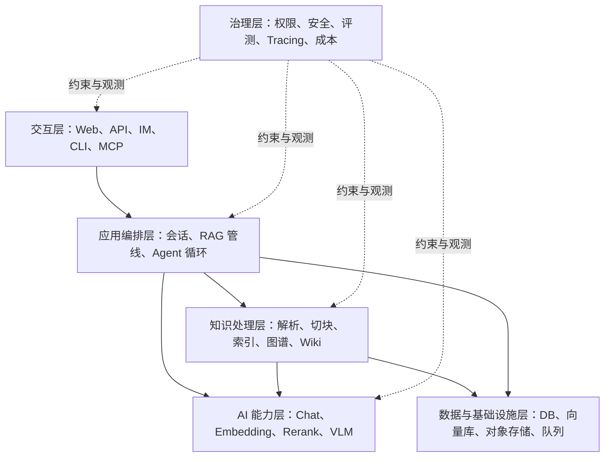

# 第 1 章　AI 应用不是一个更聪明的 CRUD

[返回全书目录](../README.md) · [上一篇：阅读导引](../00-reading-guide.md) · [下一篇：把 LLM 看成计算组件](02-llm-as-a-component.md)

## 本章要解决的问题

传统 Web 开发者第一次接触 AI 项目时，常有两个相反的误解：

- “AI 应用不就是调一个模型 API 吗？”
- “AI 太神秘了，我得先学完机器学习和神经网络才能开始。”

两者都不准确。大多数 AI 应用工程并不负责训练基础模型，但也远远不只是一次 HTTP 调用。它的核心工作是：把不确定的模型能力嵌入一个有数据、有权限、有状态、有质量要求的确定性软件系统。

## 从确定性程序到概率性组件

传统业务代码通常追求这样的契约：

```text
相同输入 + 相同数据库状态 → 相同输出
```

而 LLM 更接近：

```text
输入消息 + 模型 + 参数 + 隐含服务状态 → 一个大概率合适的输出
```

即使关闭大部分随机性，模型也不是数据库查询或纯函数。模型版本、上下文裁剪、供应商实现和提示词的细小变化，都可能改变结果。

因此，AI 应用工程增加了几类传统 CRUD 中不突出的职责：

1. **上下文工程**：决定把哪些信息放进模型有限的上下文。
2. **检索工程**：从大量私有数据中找到真正相关的少量证据。
3. **模型编排**：选择模型、参数、工具和调用顺序。
4. **效果评测**：用样本和指标判断“回答得好不好”。
5. **不确定性治理**：处理幻觉、无答案、格式漂移和工具误用。
6. **成本与延迟治理**：Token、外部 API 和多阶段流水线都有成本。

## AI 应用的六层视图

可以先把 WeKnora 看成六层，而不是几十个目录：



这个视图最重要的意义是：**模型只是系统的一层，不是整个系统。**

WeKnora 的官方架构图也表达了相似边界，可查看 [`docs/images/architecture.png`](../../docs/images/architecture.png)。

## 用熟悉的 Web 分层理解 WeKnora

你可以把一次普通知识问答类比成一条增强版 Web 请求：

| 传统 Web 请求 | WeKnora 知识问答 |
|---|---|
| Vue 发送 REST 请求 | Vue 发起 SSE/流式 POST |
| Controller 校验 DTO | Handler 解析问题、会话、知识库范围 |
| Service 编排业务 | Session Service 动态组装 RAG 管线 |
| Repository 查询数据库 | 检索服务同时查关键词索引与向量索引 |
| 业务规则组合结果 | Rerank、合并、Top-K、Prompt 构造 |
| 返回 JSON | LLM 逐块生成，服务端以 SSE 持续返回 |

熟悉的架构仍然存在。真正新增的是中间那组“检索—上下文—模型”阶段，以及对这些阶段进行评测和观测的需要。

## 两条生命周期

理解 RAG 型 AI 应用时，必须把两个生命周期分开。

### 知识准备生命周期

```text
原始文档 → 解析 → 清洗 → 切块 → Embedding → 索引
```

它通常是异步、重计算、可重试的后台任务。一份文档可能处理几秒到几十分钟。

### 在线问答生命周期

```text
用户问题 → 查询理解 → 检索 → Rerank → 构造上下文 → LLM → 流式回答
```

它对首字延迟非常敏感。用户希望尽快看到检索进度或第一个答案片段。

二者通过“Chunk 和索引”连接。知识准备的质量决定在线检索的上限，在线链路的策略决定这些知识能否被正确使用。

### 手工推演：同一个错误会在哪条生命周期暴露

一份制度 PDF 中把“报销上限 800 元”解析成了“8,000 元”，随后被切块、向量化并标记为 Ready。在线问答的检索、Rerank、Prompt 和 Chat 即使都运行正确，也可能给出带引用的错误答案；这是知识准备阶段的内容错误，不能靠换更强 Chat 模型解决。

反过来，若 PDF 已正确入库，在线请求却因为权限范围没有带上该知识库而检索为空，这就是在线编排或授权错误。先沿“原文 → Chunk → 索引”核对事实，再沿“授权 → 候选 → 上下文 → 回答”核对一次请求，能避免把所有问题都模糊归为“AI 不准”。

## 为什么 WeKnora 看起来比一个 RAG 教程复杂很多

教程经常把 RAG 写成五步：加载文件、切块、向量化、相似度搜索、调用 LLM。这是正确的最小模型，但成熟系统还要回答：

- 文档重新上传时，旧 Chunk 和索引怎样幂等删除？
- 同一知识库能否只开关键词索引，不开向量索引？
- 多知识库使用不同 Embedding 模型时能否一起搜索？
- 用户中断请求后，后台流和消息状态如何收尾？
- 模型限流、超时或返回半截 JSON 怎么办？
- 引用怎样准确对应到原文、文件和图片？
- 共享知识库不能泄漏给无权限租户，检索层如何继续保持隔离？
- 怎样知道慢在查询理解、检索、Rerank 还是模型生成？

WeKnora 的复杂度，大部分来自这些“把 Demo 做成产品”的问题。学习时需要识别复杂度来源，而不是把每一层复杂度都归因于 AI。

## 本书采用的边界

本书关注 **AI 应用工程**，包括 RAG、Agent、工具调用、评测和生产治理。它不会系统讲解：

- Transformer 的数学推导；
- 预训练和分布式训练；
- CUDA 内核；
- 从零实现深度学习框架；
- 大规模模型微调的全部技术栈。

这些属于模型与机器学习工程的重要主题，但不是理解 WeKnora 主体架构的前置条件。

## 源码观察点

第一次只需打开以下位置：

1. [`internal/router/routes_chat.go`](../../internal/router/routes_chat.go)：观察普通知识问答、Agent 问答和纯检索是三个独立 API 入口。
2. [`internal/handler/session/qa.go`](../../internal/handler/session/qa.go#L777)：观察 Handler 只负责解析、校验和选择执行模式。
3. [`internal/application/service/session_knowledge_qa.go`](../../internal/application/service/session_knowledge_qa.go#L23)：观察应用 Service 如何建立 RAG 状态并组装阶段。
4. [`internal/models/chat/chat.go`](../../internal/models/chat/chat.go#L87)：观察 LLM 在系统中首先是一个接口。
5. [`internal/models/embedding/embedder.go`](../../internal/models/embedding/embedder.go#L16)：观察 Embedding 与聊天模型是两类独立能力。

### 阅读时回答这三个问题

- HTTP Handler 有没有直接实现检索或调用模型？
- 普通聊天和 RAG 聊天在哪个位置分流？
- 模型供应商细节有没有泄漏进上层业务编排？

如果能回答，就已经抓住了第一层架构，不必继续钻进所有实现。

## 值得学习的设计思想

### 将模型能力接口化

上层依赖 `Chat`、`Embedder`、`Reranker` 等抽象，而不是到处拼供应商 HTTP 请求。这是依赖倒置和适配器模式在 AI 系统里的直接应用。

### 把复杂问答显式建模为管线

RAG 不是一个巨大 Service 方法中的隐式步骤，而是由查询理解、搜索、Rerank、合并、构造消息和流式生成等阶段组成。这为插拔、观测和测试提供了边界。

### 把治理放进主架构

Tracing、权限、队列和模型并发不是上线前才补的外围功能。成熟 AI 系统中，它们会直接影响正确性、成本和数据安全。

## 常见误区

1. **只研究 Prompt。** Prompt 很重要，但错误的检索证据无法靠漂亮措辞稳定修复。
2. **只看最终答案。** 需要同时观察召回片段、分数、Rerank、上下文和模型输出。
3. **把所有问题交给更大的模型。** 很多失败来自知识准备、权限或流程设计，不是模型参数量不足。
4. **一开始就学习 Agent。** Agent 会把基础问题包装在循环和工具调用里，使定位更困难。
5. **复制成熟系统的全部复杂度。** 学习优秀项目是理解其决策，不是无条件复刻每个模块。

## 本章小结

- AI 应用工程的核心，是把概率性模型放入确定性软件系统。
- WeKnora 可以用交互、编排、AI 能力、知识处理、基础设施和治理六层理解。
- RAG 有知识准备与在线问答两个生命周期。
- 模型只是一个组件；数据、上下文、评测和治理共同决定系统质量。
- 你的 Java/Vue/Web 经验大部分仍然有效，需要补的是 AI 特有的中间层和质量观。

### 可选实践

不运行项目，只根据本章内容在纸上画一张六层架构图，并把你熟悉的一个 Java 项目放进同一视图中。找出哪些层已经存在，哪些层是 AI 应用新增的。

下一章：[把大语言模型看成一种不确定的计算组件](02-llm-as-a-component.md)
