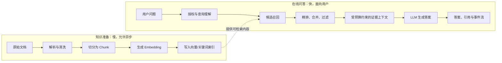

# 第 5 章　一张图理解 RAG

[返回全书目录](../README.md) · [上一篇：模型能力、成本、速度与选择](../01-foundations/04-model-selection.md) · [下一篇：文档如何变成向量索引](02-ingestion-pipeline.md)

## 本章要解决的问题

假设你的公司有一万份制度、项目文档和故障记录。员工问：

> 上海员工去北京出差，酒店每晚最多报销多少？

直接把问题交给大语言模型，模型也许能写出流畅的答案，却不知道你公司的制度，更无法保证数字正确。把全部文档粘进 Prompt 也不可行：内容太多、成本太高，而且会泄露无权限资料。

RAG（Retrieval-Augmented Generation，检索增强生成）解决的不是“让模型变聪明”，而是一个更具体的工程问题：

> 在用户提问的这一刻，怎样从允许访问的海量资料中，找出少量最值得让模型阅读的证据？

本章结束时，你应该能不看源码解释：为什么 RAG 有两条生命周期；“搜索结果”和“模型上下文”为何不是同一个东西；答案错误时应从哪一段开始排查；以及 WeKnora 如何把这条推理链表示为可观察的管线。

## 先建立正确的心智模型：LLM 是开卷考试的答题者

把没有 RAG 的 LLM 想成一位读过大量公开资料、但没有看过你公司内部文件的答题者。它会根据训练中学到的语言规律继续写下去，而不是到你的网盘中查制度。

RAG 则像一场受限的开卷考试：

```text
题目：上海员工去北京出差，酒店每晚最多报销多少？

资料室：一万份文档
     ↓ 只能带少量材料进考场
检索员：找出可能相关的段落
     ↓ 受 Token 预算与权限约束
证据包：标题、原文片段、来源、时间/权限等元数据
     ↓
LLM：阅读证据包，用自然语言作答，并标出依据
```

这里有两个角色，必须分开评价：

- **检索系统**负责“把对的材料找进来”；
- **生成模型**负责“读懂材料、组织答案，并在不知道时克制”。

如果制度中明明写着“北京 600 元/晚”，但证据包里没有那一段，再强的模型也不应被期待稳定答对；如果证据包里已经有正确句子，模型却回答成 800 元，这才主要是生成、Prompt 或模型遵循能力的问题。

这种分层是学习 RAG 最重要的一步。它把“AI 答错了”拆成可以定位和修复的工程问题。

## RAG 为什么存在：四个普通搜索系统也会遇到的约束

### 知识不在模型参数里

模型训练结束后，不会自动获得今天上传的制度、私有 Git 仓库或客户合同。微调也不是所有场景的替代品：它成本高、更新慢，且不天然给出来源。

### 上下文窗口不是无限的免费资料

即使模型能处理很长文本，也存在输入 Token 上限、延迟和费用。更重要的是，塞入大量不相关文字会稀释关键信息：模型需要在噪声中判断何处可信，反而更容易遗漏答案。

### 权限不是检索后的装饰

“先把所有内容搜出来，再在回答时隐藏”已经太晚了。只要秘密段落进入模型上下文、日志或外部 Provider，就可能构成泄露。正确顺序是先根据当前用户的 Scope 缩小可搜索集合，再做召回。

### 人需要依据，而不只需要一句流畅的话

制度问答、客服、研发排障都需要回到原文验证。RAG 让答案能附上“哪份文档、哪一段”的证据；但请记住：**显示了引用不等于该引用真的支持结论**，这仍需 Prompt、评测和必要的人工审核。

## 两条生命周期：先准备知识，再在问题到来时使用它

RAG 常被误解为一次在线 API 调用，实际有两条独立链路。



**知识准备**的产物不是“把 PDF 存起来”，而是可被检索的、带稳定身份和来源的知识单元。它可以花几分钟，也可以失败后重试。**在线问答**不能每次重新解析所有文档；它依赖前一条链已完成的索引，以较低延迟选出证据。

这就是为什么 UI 上“上传成功”和“可回答”应是不同状态。文件已上传但仍在解析/索引时，系统应该显示 Processing 或 Failed，而不是让用户得到一次看似随机的空回答。

## 用一个可手算的例子走完在线链路

暂时忽略真实向量和模型，设想知识库已被切成下面五个片段。`C` 是 Chunk 的编号，不是模型能直接理解的编号；它用于系统追踪来源。

| Chunk | 标题 | 内容摘要 |
| --- | --- | --- |
| C1 | 差旅制度：住宿 | 北京：600 元/晚；上海：700 元/晚；超标需审批。 |
| C2 | 差旅制度：交通 | 上海至北京优先经济舱或高铁二等座。 |
| C3 | 差旅制度：餐补 | 北京出差餐补 150 元/天。 |
| C4 | 客户接待标准 | 北京客户晚宴上限 600 元/人。 |
| C5 | 2023 年旧制度 | 北京住宿 500 元/晚，已于 2024 年废止。 |

用户提问：**“上海员工去北京出差，酒店每晚最多报销多少？”**

### 第一步：理解查询，但不要擅自改变用户意图

系统可能生成一个用于检索的查询，例如“北京 出差 住宿 酒店 报销 上限”。这样做是为了连接口语与文档术语；它不是让模型自由改写结论。

查询理解还可能识别：

- 实体：出发地上海、目的地北京；
- 意图：询问住宿费用上限；
- 约束：当前有效制度，而不是历史制度；
- Scope：这个用户允许搜索的知识库。

若系统把“上海员工”误解成“在上海住宿”，后面的检索再精确也会围绕错误问题运行。因此查询改写应可观测、可关闭，并能回退到原问题。

### 第二步：粗召回，目标是“别漏掉”

检索器可能分别给出两份候选列表：

```text
关键词检索：C1（住宿、北京、报销） > C5（北京、住宿） > C4（北京、600）
向量检索：  C1（差旅住宿语义） > C3（出差补贴） > C2（差旅交通）
```

这一步只要求较高的**召回率**（recall）：正确答案所在的 C1 是否出现在候选集中。它不要求第一名一定正确，所以通常保留较大的 Top-N，例如 20 或 50 个候选。

关键词和向量为何都要有？关键词擅长“北京”“600”“条款 3.2”这类精确线索；向量检索更擅长把“酒店最高能报多少”对应到“住宿标准”。两者不是互相淘汰，而是覆盖不同漏检风险。第 10 章会详细解释它们如何融合。

### 第三步：精排，目标是“真正回答这个问题”

现在候选数已经小得多，可以让 Rerank 模型逐个比较“问题”和“片段”。它应把 C1 排在最前，降低 C3/C2 的位置，并识别 C5 的“已废止”风险。

请区分两个常被混用的词：

- **相关**：片段与问题主题有关系；
- **可回答**：片段包含支撑这个具体结论所需的信息，且在当前条件下有效。

C3 与“北京出差”相关，却不能回答住宿上限。Rerank 的价值就在于减少这类“看起来差不多”的噪声。它无法修复 C1 在粗召回阶段根本没出现的情况。

### 第四步：构造证据包，而不是原样拼接候选

假设最终上下文预算只允许 900 Token。系统不能无条件把 Top-N 全放进去，还要处理：

1. 删除重复或重叠片段；
2. 合并相邻的同一章节，避免句子失去条件；
3. 过滤低分、废止或无权限内容；
4. 保留标题、文档 ID、段落位置等引用元数据；
5. 为聊天历史、系统指令和模型输出预留预算。

因此，最终给模型的材料可能是：

```text
[来源：差旅制度 v2024，住宿标准]
北京市住宿费标准为每人每晚不超过 600 元。
超出标准的住宿费，须在出行前取得部门负责人审批。
```

注意，C2、C3 即便被检索到，也不一定进入最终 Prompt。**候选集合、Rerank 结果、最终上下文是三份不同的数据。** 以后调试时，必须分别查看它们。

### 第五步：生成受证据约束的答案

一个理想的 Prompt 规则会明确要求：仅根据证据回答；证据不足时说明不知道；不要把常识补成公司制度；为每个事实附来源。

于是回答可以是：

> 北京出差的住宿费标准为每人每晚不超过 600 元。若超标，需要在出行前取得部门负责人审批。［差旅制度 v2024：住宿标准］

“上海员工”在这里不改变北京目的地的标准；若制度另有职级、城市等级或特殊项目条件，证据包也必须包含这些条件，否则更安全的回答是“现有片段不足以判断适用档位”。

## RAG 不是数据库查询，也不是模型记忆

下面三件事常被混在一起：

| 机制 | 输入 | 输出 | 适合的问题 |
| --- | --- | --- | --- |
| SQL/精确查询 | 精确字段与条件 | 确定记录 | “订单 123 的状态是什么？” |
| RAG 检索 | 自然语言问题 | 可能相关的证据候选 | “这份制度如何规定差旅住宿？” |
| LLM 生成 | 指令与上下文 | 自然语言、推理、结构化输出 | “把制度解释给员工，并列出注意事项” |

RAG 的检索阶段具有概率性：同一问题换一种写法、切块策略或 Embedding 模型，候选可能不同。生成阶段也具有概率性：温度、Prompt、模型版本都会影响表达。因此高风险业务不应把 RAG 回答直接当作审批、付款或医疗/法律决定；应把它当作带证据的辅助信息。

## 一个答案错了，应该如何诊断

将失败按阶段分类，比直接“换模型”更有效。

| 表现 | 先检查什么 | 可能修复 |
| --- | --- | --- |
| 找不到明明存在的制度 | 文档是否 Ready；原文解析；Chunk 边界；粗召回 Top-N | 修复解析/切分，增加混合召回或扩大候选 |
| 找到很多类似内容但答案引用错 | Rerank 排名；过滤规则；旧版/新版元数据 | 精排、版本过滤、提高最终阈值 |
| 答案遗漏限定条件 | 最终上下文是否截断；相邻段是否合并 | 调整上下文预算与合并策略 |
| 证据正确但回答仍胡编 | Prompt 是否要求基于证据；模型是否遵循 | 加强无答案规则、降低创造性、做生成评测 |
| 用户看到不应看的内容 | 检索前 Scope、共享关系、来源 URL 权限 | 在搜索入口做对象级授权，不在回答后遮挡 |
| 偶尔为空或很慢 | 索引/模型健康、队列状态、超时、Trace | 区分无匹配、依赖失败与预算耗尽 |

这个表也是 RAG 评测的起点。第 12 章会把“是否检索到金标准证据”“答案是否被证据支持”“用户体验与延迟”变成可以持续测量的指标。

## RAG 不会自动消除幻觉

RAG 只提高模型获得正确材料的机会，不能保证以下事情自动成立：

- 原始文档本身正确、完整且仍有效；
- 解析器没有把表格、否定词或脚注弄错；
- 检索没有漏掉相反条款；
- 模型没有忽略“已废止”“仅限某职级”等限定条件；
- 引用确实逐项支持答案中的断言。

一个成熟系统因此需要无答案策略、版本/生效期元数据、引用展示、检索和生成的分阶段评测，以及高风险操作中的人工复核。RAG 的正确承诺不是“永远真实”，而是“答案更有机会基于可检查的证据，并能暴露失败位置”。

## WeKnora 如何把这条推理链变成代码

现在回到项目。[`KnowledgeQA`](../../internal/application/service/session_knowledge_qa.go) 先解析请求中的知识范围、模型、检索 Tenant 和 `SearchTargets`，再构造 `types.ChatManage`。这个对象同时携带三类信息：

- **请求配置**：查询、Top-K、阈值、模型、知识范围、是否启用改写/网页搜索；
- **处理中间状态**：改写后的查询、`SearchResult`、`RerankResult`、`MergeResult`；
- **运行上下文**：事件总线、会话/消息 ID、用户语言和权限相关上下文。

当请求没有知识范围且未启用网页搜索时，代码只组装纯聊天管线；否则组装 RAG 管线：

```text
LOAD_HISTORY（可选）
MEMORY_RECALL
QUERY_UNDERSTAND
CHUNK_SEARCH_PARALLEL
CHUNK_RERANK
WEB_FETCH（可选）
CHUNK_MERGE
FILTER_TOP_K
DATA_ANALYSIS（可选）
INTO_CHAT_MESSAGE
CHAT_COMPLETION_STREAM
```

这和前面的手算例子一一对应，但真实工程多了历史、记忆、网页、图片、数据分析和流式事件等分支。关键仍未改变：搜索插件先填充候选，Rerank/合并/过滤逐步收缩和整理，`INTO_CHAT_MESSAGE` 才把最终证据转成模型消息，最后由流式 Chat 插件输出答案和引用。

## 源码观察点与推荐阅读顺序

1. [`internal/types/qa_request.go`](../../internal/types/qa_request.go)：先看一个问答请求可携带哪些知识范围、附件和模型选择。
2. [`internal/application/service/session_knowledge_qa.go`](../../internal/application/service/session_knowledge_qa.go)：阅读 `KnowledgeQA` 中如何构造 `ChatManage` 和 pipeline，不必立即追每个插件。
3. [`internal/types/chat_manage.go`](../../internal/types/chat_manage.go)：确认候选、Rerank 和合并结果为何分开保存。
4. [`internal/application/service/chat_pipeline/search.go`](../../internal/application/service/chat_pipeline/search.go)：看 `HybridSearch` 如何取得初始候选。
5. [`internal/application/service/chat_pipeline/rerank.go`](../../internal/application/service/chat_pipeline/rerank.go) 与 [`internal/application/service/chat_pipeline/merge.go`](../../internal/application/service/chat_pipeline/merge.go)：看排序与上下文整理的边界。
6. [`internal/application/service/chat_pipeline/into_chat_message.go`](../../internal/application/service/chat_pipeline/into_chat_message.go)：最后看证据如何进入模型消息。

阅读时持续回答三个问题：当前数据是“全部可搜索资料”“候选”“最终上下文”还是“已经生成的答案”？当前步骤改变的是召回率、排序质量、上下文预算还是语言表达？这样就不会在众多结构体和插件之间迷路。

## 本章小结

- RAG 是在生成时按权限和预算动态选择外部证据的上下文系统，而不是给 LLM 加一个搜索按钮。
- 它由知识准备和在线问答两条生命周期组成；上传完成不等于已可回答。
- 粗召回追求不漏证据，Rerank 追求把真正可回答的片段排前，最终上下文还要受 Token、去重、版本和权限约束。
- 候选、精排结果、最终 Prompt 和答案必须分开观察，才能定位失败。
- RAG 能让答案可追溯，但不能保证原文正确、检索完整或模型不幻觉。
- WeKnora 用 `ChatManage` 和显式 pipeline 保存这一过程，使每个阶段可替换、可观测、可继续深入学习。

### 可选实践

选择一份你熟悉的制度或技术文档，手工制作 8 个 Chunk，其中至少放入一个旧版本、一个同主题但无关片段、一个缺少前提条件的片段。为三个问题分别写出：你希望粗召回的 Top-5、Rerank 后的 Top-2、最终交给模型的证据包，以及模型应当在何时回答“不知道”。不要调用模型；只要能解释每次取舍，你就已经在练习 RAG 最核心的能力。

下一章：[入库链路：文档如何变成向量索引](02-ingestion-pipeline.md)
