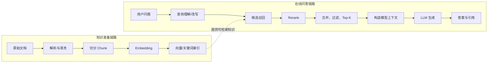

# 第 5 章　一张图理解 RAG

[返回全书目录](../README.md) · [上一篇：模型能力、成本、速度与选择](../01-foundations/04-model-selection.md) · [下一篇：文档如何变成向量索引](02-ingestion-pipeline.md)

## 本章要解决的问题

RAG 是 Retrieval-Augmented Generation，通常译作“检索增强生成”。这个名称容易让人以为它只是在调用 LLM 之前增加一次搜索。

更准确的理解是：**RAG 是一套在生成时为模型动态选择外部证据的上下文系统。**

## 为什么需要 RAG

基础模型存在三个与企业知识场景直接冲突的限制：

1. 它的训练知识有时间边界；
2. 它通常不知道企业私有文档；
3. 即使“似乎知道”，也很难给出可验证的内部来源。

最直接的办法是把相关文档放进模型上下文。但真实知识库可能有数万份文件，不可能全部塞进去，也不应该让无权限内容进入上下文。

RAG 在运行时解决这个选择问题：先从知识库中找到与当前问题最相关的少量证据，再让模型基于证据组织回答。

## RAG 的完整结构

RAG 由离线/后台的知识准备和在线的查询生成两条链组成：



任何一段都可能成为最终质量瓶颈。

## 一个具体例子

假设知识库里有一份《员工差旅制度》，用户问：

> 上海员工去北京出差，酒店每晚最多报销多少？

系统可能经历：

1. 解析 PDF，识别标题、段落和表格文本；
2. 将“住宿标准”所在章节切成若干 Chunk；
3. 为每个 Chunk 生成向量并写入索引；
4. 用户提问时，为问题生成查询向量；
5. 同时用向量语义和关键词召回候选；
6. Rerank 判断哪个候选真正涉及“上海员工、北京、住宿标准”；
7. 把最相关的原文、标题和来源交给 LLM；
8. LLM 组织自然语言回答，并附上文档引用。

如果回答错误，原因可能分别是：

- PDF 表格解析错了；
- 切块把城市和金额分开了；
- Embedding 没有召回相关片段；
- 关键词召回被同名章节干扰；
- Rerank 排序错误；
- Top-K 截掉了关键证据；
- Prompt 没要求严格依据证据；
- 模型读到证据却推断错误。

因此“换更强模型”只是众多可能修复中的一种。

## Chunk 是 RAG 的基本知识单位

文档通常太长，无法直接作为一个检索单位。系统会把它拆成较小片段，即 Chunk。

Chunk 同时影响：

- **召回粒度**：片段越小，命中更精确；
- **语义完整性**：片段太小，容易失去上下文；
- **索引成本**：片段越多，Embedding 和存储成本越高；
- **模型上下文**：片段越大，占用 Token 越多；
- **引用体验**：片段需要能映射回原文位置。

WeKnora 不只支持固定递归切块，还支持标题感知、启发式结构、自动选择和父子 Chunk。项目文档 [`CHUNKING.md`](../../docs/CHUNKING.md) 对策略有集中说明。

父子 Chunk 的思路是：用较小的子片段做精确匹配，命中后把更大的父片段交给 LLM，以兼顾召回精度和上下文完整性。

## Embedding 不是知识压缩后的答案

Embedding 向量表示文本在某个模型空间中的位置。相近语义的文本通常距离更近，因此可以通过近邻搜索寻找候选。

向量本身不是摘要，也不能还原成原文。系统必须同时保存：

- 原始 Chunk 内容及元数据；
- Chunk 对应的向量索引；
- 二者之间的 ID 关系。

问题和文档必须使用相同或兼容的 Embedding 空间，否则向量距离没有意义。这也是为什么 WeKnora 在跨知识库搜索时检查 Embedding 模型一致性。

## 为什么还需要关键词检索

向量检索擅长语义相似，例如“费用上限”可能命中“最高报销标准”。关键词检索擅长精确实体，例如产品型号、错误码、人名、条款编号。

成熟 RAG 往往结合二者：

```text
语义向量召回 + 关键词召回 → 分数归一化/融合 → 候选集合
```

WeKnora 的 `HybridSearch` 会建立向量和关键词检索参数，分别取得结果，再融合或去重。入口见 [`knowledgebase_search.go`](../../internal/application/service/knowledgebase_search.go#L87)。

## 为什么召回后还要 Rerank

第一阶段搜索需要面对整个索引，因此强调速度和召回率：宁可多找一些可能相关的候选，不要漏掉答案。

Rerank 只面对较小候选集，可以使用更昂贵、更精细的模型重新判断“这个片段对当前问题到底有多相关”。

这形成经典两阶段架构：

```text
快速粗召回 Top-N → 精排 → 最终 Top-K
```

通常 `N` 大于 `K`。如果候选阶段已经漏掉正确片段，Rerank 无法凭空找回来；如果候选很多但排序一般，Rerank 才有改善空间。

## 检索结果不应直接等于模型上下文

召回和 Rerank 后仍需要：

- 去重；
- 合并相邻或重叠片段；
- 将子 Chunk 替换/扩展为父 Chunk；
- 按阈值过滤低质量结果；
- 控制最终 Top-K 和 Token 预算；
- 加入来源、标题、标签等元数据；
- 区分知识库结果与网页结果。

WeKnora 把这些工作拆进 `CHUNK_MERGE`、`FILTER_TOP_K` 和 `INTO_CHAT_MESSAGE` 等阶段，而不是让搜索结果直接进入模型。

## RAG 不会自动消除幻觉

RAG 能为模型提供新鲜、私有且可引用的证据，但仍可能失败：

- 没检索到正确证据；
- 检索到相互冲突的证据；
- 模型忽略证据；
- 模型在证据之外继续推断；
- 引用存在，但引用并不支持结论。

所以一个可靠系统还需要：

- 明确的无答案策略；
- 引用与断言的一致性检查；
- 检索和生成分阶段评测；
- 对高风险场景限制自动决策。

## WeKnora 如何显式表示 RAG 管线

普通知识问答会根据是否存在知识范围或网页搜索，动态选择纯聊天或 RAG。

RAG 主干在 [`session_knowledge_qa.go`](../../internal/application/service/session_knowledge_qa.go#L185) 中组装：

```text
LOAD_HISTORY（可选）
QUERY_UNDERSTAND
CHUNK_SEARCH_PARALLEL
CHUNK_RERANK
WEB_FETCH（可选）
CHUNK_MERGE
FILTER_TOP_K
DATA_ANALYSIS（可选）
INTO_CHAT_MESSAGE
CHAT_COMPLETION_STREAM
```

这是阅读整个项目最重要的一段地图。后续章节会逐一展开这些阶段。

## 源码观察点

1. [`session_knowledge_qa.go`](../../internal/application/service/session_knowledge_qa.go#L105)：`ChatManage` 同时保存管线请求、状态和上下文。
2. [`session_knowledge_qa.go`](../../internal/application/service/session_knowledge_qa.go#L156)：纯聊天与 RAG 的分流条件。
3. [`chat_pipeline/search.go`](../../internal/application/service/chat_pipeline/search.go)：知识搜索阶段。
4. [`chat_pipeline/rerank.go`](../../internal/application/service/chat_pipeline/rerank.go)：Rerank 阶段。
5. [`chat_pipeline/merge.go`](../../internal/application/service/chat_pipeline/merge.go)：结果合并阶段。
6. [`chat_pipeline/into_chat_message.go`](../../internal/application/service/chat_pipeline/into_chat_message.go)：证据如何进入模型消息。

### 阅读时回答这三个问题

- 搜索得到的候选结果与最终交给 LLM 的上下文是否相同？
- 哪些阶段可能调用模型，哪些阶段主要是确定性代码？
- 没有知识库范围时，为什么可以跳过整个检索管线？

## 本章小结

- RAG 是运行时选择外部证据的上下文系统。
- 它包含知识准备和在线问答两条链路。
- Chunking 决定知识检索的基本粒度和质量上限。
- Embedding、关键词搜索和 Rerank 各自解决不同问题。
- 搜索结果还需合并、过滤和构造成模型上下文。
- RAG 降低幻觉风险，但不能自动保证事实正确。

### 可选实践

选择一份你熟悉的公司制度或技术文档，手工把它切成 5～10 个 Chunk。然后为三个问题分别选择你认为应召回的 Chunk。这个练习不需要模型，却能直接体会知识边界的重要性。

下一章：[入库链路：文档如何变成向量索引](02-ingestion-pipeline.md)
