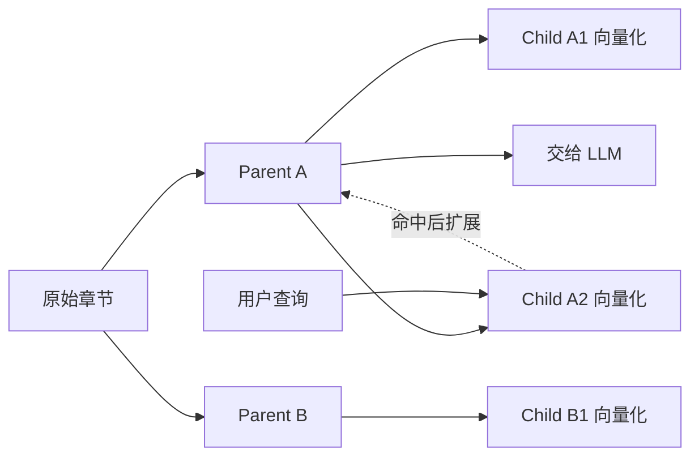

# 第 8 章　Chunking：知识边界决定检索上限

[返回全书目录](../README.md) · [上一篇：从查询到带引用的流式答案](03-query-pipeline.md) · [下一篇：Embedding 与向量空间](05-embedding-vector-space.md)

## 本章要解决的问题

同一份文档、同一个 Embedding 模型和同一个问题，仅仅改变切块方式，就可能得到完全不同的检索结果。

Chunking 不是把长字符串机械截短，而是在决定：什么内容应该作为一个可独立检索、可理解、可引用的知识单元。

## 为什么知识边界如此重要

假设原文是：

```text
北京地区住宿标准
高级职级每晚不超过 800 元，其他职级每晚不超过 500 元。
```

如果切成：

```text
Chunk A: 北京地区住宿标准 高级职级每晚不超过
Chunk B: 800 元，其他职级每晚不超过 500 元。
```

问题“高级职级在北京最多报销多少”可能只命中 A，但答案金额在 B。模型再强，也无法使用没有进入上下文的数字。

Chunking 同时控制五件事：

1. **召回单位**：搜索引擎匹配什么。
2. **语义完整性**：片段能否独立表达一个事实。
3. **索引成本**：Chunk 数量和 Embedding Token。
4. **上下文成本**：最终交给 Chat 模型的文本量。
5. **引用定位**：回答能否映射到原文位置。

## 大 Chunk 与小 Chunk 的矛盾

### Chunk 太小

- 语义和指代被切断；
- 标题、条件和答案分离；
- 大量近似重复片段增加索引；
- 检索精确但模型看不懂完整含义。

### Chunk 太大

- 一个向量混合多个主题；
- 相关局部被大量无关文字稀释；
- 召回后占用更多上下文；
- Rerank 和 Chat 调用更贵；
- 引用范围过宽。

所以不存在脱离文档类型、查询分布和模型限制的“最佳 Chunk Size”。合理值必须在召回、语义、成本和上下文之间平衡。

## 字符预算与 Token 预算

切块配置常以字符数表达，因为字符边界易于定位和重建；Embedding 模型的硬限制却通常以 Token 表达。

这产生两层约束：

```text
目标字符大小：控制检索粒度
Token 上限：保证模型请求不超限
```

WeKnora 的 `SplitterConfig` 同时包含 `ChunkSize` 与 `TokenLimit`。当设置 Token 限制时，切块器按语言估算可容纳字符数并留 10% 安全余量，再收紧 Chunk Size。实现见 [`strategy.go`](../../internal/infrastructure/chunker/strategy.go#L311) 和 [`tokens.go`](../../internal/infrastructure/chunker/tokens.go)。

这种估算不是精确 Tokenizer，而是避免小窗口 Embedding 模型因中文、英文密度差异而频繁超限。

## Overlap 解决边界问题，也制造重复

相邻 Chunk 保留一段重叠文本，可以增加跨边界事实被完整召回的概率。

但 Overlap 越大：

- Embedding 和存储重复越多；
- 多个候选可能只是同一内容的副本；
- 合并与去重负担增加；
- Top-K 可能被重复片段占满。

WeKnora 当前默认 Chunk Size 为 512 字符、Overlap 为 80 字符，并会将异常大的 Overlap 限制在 Chunk Size 的一半以内。默认值见 [`splitter.go`](../../internal/infrastructure/chunker/splitter.go#L77)。

这些数字是项目当前基线，不是通用定律。FAQ、叙事文章、代码文档和 PDF 报告需要不同策略。

## 递归切分：优先在自然边界断开

最小可用切块器通常不是每 512 字符硬切，而是按优先级尝试：

```text
段落 → 换行 → 句号/问号 → 更细字符边界
```

如果一个段落仍过大，再用下一层分隔符递归切分。

WeKnora 的 legacy/recursive 路径通过 `splitBySeparators` 实现优先级递归，并保护 Markdown 链接、图片、表格、代码块和公式等结构，见 [`splitter.go`](../../internal/infrastructure/chunker/splitter.go)。

递归切分适合缺少显式结构的普通文本，但它不知道“哪个章节标题属于哪段正文”。

## 标题感知切分

Markdown、技术文档和 Wiki 的标题层级已经表达语义边界。标题感知切分会：

1. 识别 `#`、`##`、`###` 层级；
2. 尽量按章节形成 Chunk；
3. 对超长章节继续细分；
4. 为 Chunk 生成标题 breadcrumb。

例如正文只写“上限为 500 元”，Embedding 输入可以变成：

```text
# 差旅制度 > ## 住宿标准 > ### 北京

上限为 500 元。
```

WeKnora 将 breadcrumb 放在 `ContextHeader`，与原始 `Content` 分开。这样 Embedding 获得章节语境，又不破坏原文位置不变量。数据结构见 [`chunker.Chunk`](../../internal/infrastructure/chunker/splitter.go#L17)，标题实现见 [`heading_splitter.go`](../../internal/infrastructure/chunker/heading_splitter.go)。

## 启发式切分

PDF 解析结果可能没有 Markdown 标题，但仍包含：

- 页分隔符；
- “第 1 章”或 “Chapter 1”；
- 编号章节；
- 全大写短行；
- 视觉分隔线；
- 重复页脚。

启发式切分尝试利用这些信号恢复文档结构，入口见 [`heuristic_splitter.go`](../../internal/infrastructure/chunker/heuristic_splitter.go) 和 [`patterns.go`](../../internal/infrastructure/chunker/patterns.go)。

启发式规则能改善结构化 PDF，也可能误把普通短句当标题，所以需要校验与回退。

## Auto 不是一个神秘模型，而是策略链

WeKnora 的 `auto` 首先对文档做画像，统计：

- Markdown 标题数量与密度；
- 编号章节、语言章节标记；
- 换页、视觉分隔和重复页脚；
- 表格、代码比例；
- 行长度统计和粗粒度语言。

画像定义在 [`profiler.go`](../../internal/infrastructure/chunker/profiler.go#L12)。`SelectStrategy` 根据画像生成有顺序的候选链，例如 heading → heuristic → legacy。

每个策略输出后还要经过 `ValidateChunks`：

- 大文档是否只产生一个 Chunk；
- 是否产生太多不足 50 字符的小片段；
- 所有 Chunk 是否远小于目标；
- 是否出现超过两倍目标大小的异常片段。

校验失败就进入下一层，最终以 legacy 兜底。主入口见 [`strategy.go`](../../internal/infrastructure/chunker/strategy.go#L27)，校验见 [`validator.go`](../../internal/infrastructure/chunker/validator.go)。

这是一种值得学习的模式：

```text
特征画像 → 选择候选策略 → 验证产物 → 失败回退
```

它比“自动策略一定正确”更符合生产系统思维。

## 父子 Chunk：匹配粒度与阅读粒度分离

父子模式使用两种大小：

- **Child**：较小，生成向量并参与检索；
- **Parent**：较大，保存在数据库，命中 Child 后作为更完整上下文返回。



优势是小片段更容易精确匹配，模型又能看到较完整段落。代价是：

- 数据关系更复杂；
- 多个 Child 可能指向同一 Parent，需要去重；
- Parent 太大会重新带来上下文稀释；
- 引用要区分匹配片段和展示片段。

WeKnora 的策略入口是 [`SplitParentChild`](../../internal/infrastructure/chunker/strategy.go#L120)，入库时父 Chunk 不写向量索引，详见 [`knowledge_process.go`](../../internal/application/service/knowledge_process.go#L400)。

## Chunk 必须保留位置

切块不能只返回字符串数组。WeKnora 的 Chunk 记录 `Start`、`End` 和 `Seq`，并维持：

```text
End - Start = Content 的 rune 数
```

位置用于：

- 原文高亮；
- 引用定位；
- 邻接 Chunk 合并；
- 文档重建；
- 编辑和版本管理。

`ContextHeader` 不能直接拼进 `Content`，否则位置将不再对应原文。这是看似细小、实际连接检索与产品体验的重要数据约束。

## 怎样为不同语料选择起点

| 语料 | 初始策略 | 重点观察 |
|---|---|---|
| FAQ/原子问答 | 小 Chunk、低/零 Overlap | 一条事实是否独立，避免父子模式 |
| Markdown/Wiki | Auto/Heading | breadcrumb 是否正确，章节是否过长 |
| PDF 报告 | Auto/Heuristic | 页眉页脚、表格、章节和 OCR 噪声 |
| 长篇叙事 | 较大递归 Chunk | 跨段推理、Overlap 与上下文完整性 |
| 代码文档 | 结构边界优先 | 代码块保护、类/函数边界、符号名召回 |
| 表格/CSV | 记录级切分 | 列名上下文与行完整性 |

项目说明还提供了一组当前预设，可参考 [`docs/CHUNKING.md`](../../docs/CHUNKING.md)，但应以自己的问题集验证。

## 正确的调参顺序

1. 先检查解析文本是否正确；
2. 再检查结构策略是否符合文档；
3. 观察正确答案是否被完整保存在某个 Chunk；
4. 调 Chunk Size；
5. 调 Overlap；
6. 再考虑父子模式；
7. 用固定问题集比较召回，而不是凭肉眼选择最漂亮片段。

解析错误不能靠切块修复；召回缺失也不应先靠 Prompt 修复。

## 源码观察点

1. [`splitter.go`](../../internal/infrastructure/chunker/splitter.go#L17)：Chunk 不变量、配置、递归切分和保护结构。
2. [`strategy.go`](../../internal/infrastructure/chunker/strategy.go#L27)：策略链、诊断和父子模式。
3. [`profiler.go`](../../internal/infrastructure/chunker/profiler.go#L12)：文档画像。
4. [`validator.go`](../../internal/infrastructure/chunker/validator.go)：策略产物验证。
5. [`heading_splitter.go`](../../internal/infrastructure/chunker/heading_splitter.go)：标题与 breadcrumb。
6. [`knowledge_process.go`](../../internal/application/service/knowledge_process.go#L400)：Chunk 如何变成数据库记录和索引项。

## 本章小结

- Chunking 定义可检索知识边界，直接决定 RAG 质量上限。
- 大小、Overlap、结构完整性、索引成本和上下文成本彼此制约。
- 字符大小控制粒度，Token 上限保护模型请求。
- WeKnora 的 Auto 是画像、策略链、验证和回退，不是单一算法。
- `ContextHeader` 为 Embedding 加结构语境，同时保持原文位置不变。
- 父子 Chunk 将匹配粒度与模型阅读粒度分离。
- 调参必须使用固定问题集，不能只看切块外观。

### 可选实践

在 Chunk 预览接口中对同一份 Markdown 比较 `heading`、`legacy` 和 `auto`。记录策略选择、每个 Chunk 的标题上下文以及被校验器拒绝的原因。

下一章：[Embedding 与向量空间](05-embedding-vector-space.md)
