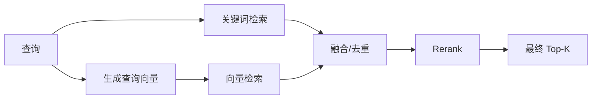

# 第 10 章　关键词、向量与混合检索

[返回全书目录](../README.md) · [上一篇：Embedding 与向量空间](05-embedding-vector-space.md) · [下一篇：Rerank、合并和上下文构造](07-rerank-context-construction.md)

## 本章要解决的问题

向量检索擅长语义，关键词检索擅长精确词项。真实企业知识同时包含自然语言、错误码、产品型号、人名、条款编号和缩写，因此成熟 RAG 往往同时使用两条召回路径。

关键不只是“都查一遍”，还包括候选数量、分数尺度、去重、融合与后续 Rerank。

## 关键词检索解决什么问题

用户搜索：

```text
ERR_AUTH_1042
```

语义模型可能认为多个认证错误都很相近；关键词索引能精确命中包含该错误码的片段。

关键词检索特别适合：

- 错误码、订单号、版本号；
- 产品型号和 API 名称；
- 人名、地名和组织名；
- 法规条款编号；
- 引号中的精确短语；
- 罕见行业术语。

常见 BM25 会综合词频、逆文档频率和文档长度。可以粗略理解为：一个词在当前文档出现得多、在整个语料出现得少，就更有区分度。

## 向量检索解决什么问题

用户问“怎样限制员工在外地住宿的花费”，原文写“差旅酒店最高报销标准”。二者缺少足够相同词项，向量检索仍可能通过语义相似召回。

向量检索擅长：

- 同义改写；
- 口语与正式表达；
- 跨语言或多语言语义；
- 描述性问题；
- 概念相关而非字面相同的内容。

它的弱点是精确实体可能被语义近邻淹没，并且效果依赖 Embedding 与切块质量。

## 混合检索是并行的候选生成

基本结构是：



两条召回路径通常各自保留较多候选，融合后再由 Rerank 精排。候选阶段的目标偏向 Recall，最终阶段的目标偏向 Precision。

## 为什么不能直接相加原始分数

不同检索器分数可能完全不同：

- Cosine 可能映射到 0～1；
- 某些引擎返回距离，越小越好；
- BM25 是无固定上限的正数；
- 不同向量数据库对相同距离的转换不同。

直接计算：

```text
0.8 × 向量分 + 0.2 × BM25 分
```

可能只是让数值尺度较大的 BM25 主导结果，而不是表达真正权重。

有两种常见办法：

1. 将每类分数归一化到可比较尺度；
2. 不依赖原始分数，只融合各自排名。

WeKnora 在多存储场景先做引擎感知的分数归一化，但向量与关键词混合时使用基于排名的 RRF。

## RRF：用排名融合异构检索器

Reciprocal Rank Fusion 为每个候选计算：

```text
RRF(d) = w_vector / (k + rank_vector(d))
       + w_keyword / (k + rank_keyword(d))
```

如果一个 Chunk 同时在向量和关键词列表排名靠前，它会得到两部分分数；只在一条列表出现，也能保留一部分贡献。

RRF 的优点：

- 不要求原始分数同尺度；
- 对单个检索器异常高分不太敏感；
- 实现简单、稳定；
- 容易通过权重表达语料偏好。

参数 `k` 越大，头部排名差异被压平得越多。权重决定向量与关键词的相对贡献。

### 用三个候选手算一次 RRF

假设用户问“ERR_AUTH_1042 如何处理”，两条检索器给出的排名如下：

| Chunk | 向量排名 | 关键词排名 | 直觉解释 |
| --- | ---: | ---: | --- |
| A | 1 | 8 | 语义很像认证故障，但错误码未必完全一致 |
| B | 4 | 1 | 包含精确错误码，也解释了修复步骤 |
| C | 2 | 不在列表中 | 一般认证配置说明 |

忽略权重并取 `k=60` 时，B 的分数约为 `1/64 + 1/61`，A 约为 `1/61 + 1/68`，C 只有 `1/62`。B 虽然在向量列表不是第一，却因两条路径都认可而会排在前面。

这个例子揭示 RRF 的真正含义：它奖励**多种独立信号的一致性**，而不是声称某个原始分数绝对更大。`k=60` 也意味着排名 1 与排名 2 的差距被温和处理；若 `k` 非常小，第一名会被过度放大。实际权重和 `k` 应由问题集校准，而不是当作数学常数。

### 融合后为何仍会有“看起来错误”的结果

RRF 不阅读 Chunk 内容。若错误码恰好出现在一篇“历史故障复盘”中，它可能同时拿到很好的关键词和语义排名，却仍不适合回答“现在如何修复”。融合的职责是把值得进一步阅读的候选集中起来；判断时效、否定、条件和问题—文本的精确关系，仍是 Rerank、元数据过滤和上下文构造的任务。

WeKnora 默认配置中 `k=60`、向量权重 0.7、关键词权重 0.3，定义见 [`retrieval_config.go`](../../internal/types/retrieval_config.go)。具体融合见 [`knowledgebase_search_fusion.go`](../../internal/application/service/knowledgebase_search_fusion.go)。这些是项目默认值，必须用业务语料验证。

## 只有一种结果时不应强行 RRF

如果只有向量结果或只有关键词结果，WeKnora 保留原有分数，按 Chunk ID 去重并取最高分；只有两类结果都存在时才执行 RRF。

这是合理的工程细节：单检索器没有异构尺度需要融合，强行转成排名分会丢失原始相关度和阈值语义。

相关逻辑在 `fuseOrDeduplicate` 中。

## 粗召回为什么常常多取一些

如果最终希望返回 10 个片段，搜索阶段可能先取 50 甚至更多候选，因为后面还会：

- 合并重复；
- 应用权限/标签过滤；
- Rerank 淘汰低相关片段；
- 解析父 Chunk；
- 过滤阈值。

候选太少会导致正确片段在进入 Rerank 之前就消失；候选太多则增加数据库、网络和 Rerank 成本。

WeKnora 的 `HybridSearch` 当前会执行 over-retrieval：按目标 MatchCount 放大、设置最低 50，并对整个查询限制最高 500，见 [`knowledgebase_search.go`](../../internal/application/service/knowledgebase_search.go#L149)。

这是面向后续融合和精排的候选策略，不等于最终给 LLM 的数量。

## 多知识库与多存储 fan-out

一次查询可能跨多个知识库，而每个知识库还可能绑定不同向量存储。WeKnora 会：

1. 校验每个知识库访问权限；
2. 校验 Embedding 空间一致；
3. 预计算一次查询向量；
4. 按“存储 ID + 所属租户”分组；
5. 并发向各检索引擎 fan-out；
6. 对多引擎结果做必要的分数归一化；
7. 再分类为向量和关键词结果进行融合。

主干见 [`knowledgebase_search.go`](../../internal/application/service/knowledgebase_search.go#L87) 和 [`knowledgebase_search_fanout.go`](../../internal/application/service/knowledgebase_search_fanout.go)。

这个设计说明检索范围、模型空间和存储路由都应在融合前处理，不能把所有结果先混在一起再补救。

## Rerank 与融合不是一回事

### 融合

把多个召回器的候选列表合成一份相对合理的列表。主要使用排名、原始分数和去重规则。

### Rerank

让专门模型重新阅读“查询 + 候选文本”，计算更细粒度相关性。

融合不理解候选全文的深层含义；Rerank 更准确但更慢、更贵。因此典型顺序是：

```text
向量/关键词召回 → RRF 融合 → Rerank → 合并与 Top-K
```

WeKnora 在 `CHUNK_SEARCH` 后执行 `CHUNK_RERANK`，插件入口见 [`chat_pipeline/rerank.go`](../../internal/application/service/chat_pipeline/rerank.go)。

## Precision 与 Recall 的拉扯

- **Recall**：该找出的正确片段有多少被找到。
- **Precision**：返回候选中有多少真正相关。

候选召回阶段通常倾向提高 Recall：较低阈值、较大 Top-N、多种检索器。Rerank 和最终过滤倾向提高 Precision：只把最相关证据交给模型。

只看最终答案无法判断是哪一段出了问题。应分别评估：

1. 正确 Chunk 是否在粗召回 Top-N；
2. 是否在融合列表中；
3. 是否被 Rerank 保留到 Top-K；
4. 是否进入最终模型上下文。

## 阈值的陷阱

向量阈值、关键词阈值和 Rerank 阈值属于不同分数空间，不能相互比较。

一个常见错误是看到 0.3 就认为“相关度只有 30%”。模型分数通常不是概率，其解释必须结合具体模型与分布。

校准阈值时应同时使用：

- 有明确答案的问题；
- 同主题但无答案的问题；
- 精确实体问题；
- 语义改写问题；
- 容易混淆的负例。

目标不是让所有查询都有结果，而是无答案时也能安全返回空候选或触发回退。

## 查询改写对两类检索的影响

查询改写可以补全多轮省略，提升向量检索；但如果把错误码、型号或人名改写掉，会伤害关键词检索。

更稳妥的策略可能包括：

- 保留原查询，同时增加改写查询；
- 对精确实体设置保护；
- 使用 Query Expansion 生成多个检索表达；
- 分别观察原查询与改写查询的召回贡献。

这也是为什么查询理解的中间结果必须可观测。

## 正确的检索调试顺序

1. 确认实际检索范围和权限；
2. 检查原查询与改写查询；
3. 单独查看关键词结果；
4. 单独查看向量结果；
5. 查看 RRF 后的排名变化；
6. 查看 Rerank 前后；
7. 检查合并和最终 Top-K；
8. 最后才分析 Chat 模型。

WeKnora 的纯知识搜索接口能在不调用最终 LLM 的情况下返回检索结果，是这套诊断的合适入口。

## 源码观察点

1. [`knowledgebase_search.go`](../../internal/application/service/knowledgebase_search.go#L87)：HybridSearch 主流程。
2. [`knowledgebase_search_fusion.go`](../../internal/application/service/knowledgebase_search_fusion.go)：分类、去重和 RRF。
3. [`knowledgebase_search_fanout.go`](../../internal/application/service/knowledgebase_search_fanout.go)：多存储并发检索。
4. [`retriever/normalizer.go`](../../internal/application/service/retriever/normalizer.go)：不同引擎分数归一化。
5. [`retrieval_config.go`](../../internal/types/retrieval_config.go)：Top-K、阈值和 RRF 参数。
6. [`chat_pipeline/search.go`](../../internal/application/service/chat_pipeline/search.go)：管线怎样调用知识库搜索。
7. [`chat_pipeline/rerank.go`](../../internal/application/service/chat_pipeline/rerank.go)：融合后的精排。

## 常见误区

1. **向量检索可以替代关键词检索。** 精确实体通常仍需要词项匹配。
2. **原始分数可以直接加权。** 不同检索器可能不在同一尺度。
3. **粗召回 Top-K 就是最终上下文 Top-K。** 中间还有融合、精排、合并和过滤。
4. **Rerank 能找回漏掉的答案。** 它只能重排已有候选。
5. **分数等于正确概率。** 多数检索分数不能这样解释。

## 本章小结

- 关键词检索擅长精确实体，向量检索擅长语义改写，二者互补。
- 混合检索需要解决异构分数、去重、候选数量和后续精排。
- WeKnora 使用 RRF 按排名融合向量与关键词结果，避免直接相加不同尺度分数。
- 粗召回倾向 Recall，Rerank 与最终过滤倾向 Precision。
- 多存储查询需先处理权限、Embedding 一致性和存储路由。
- 检索效果必须逐阶段评测，不能只观察最终回答。

### 可选实践

准备三类问题：精确错误码、自然语言改写、两者混合。分别只开关键词、只开向量、开启混合检索，记录正确 Chunk 的排名变化。

下一章：[Rerank、合并和上下文构造](07-rerank-context-construction.md)
