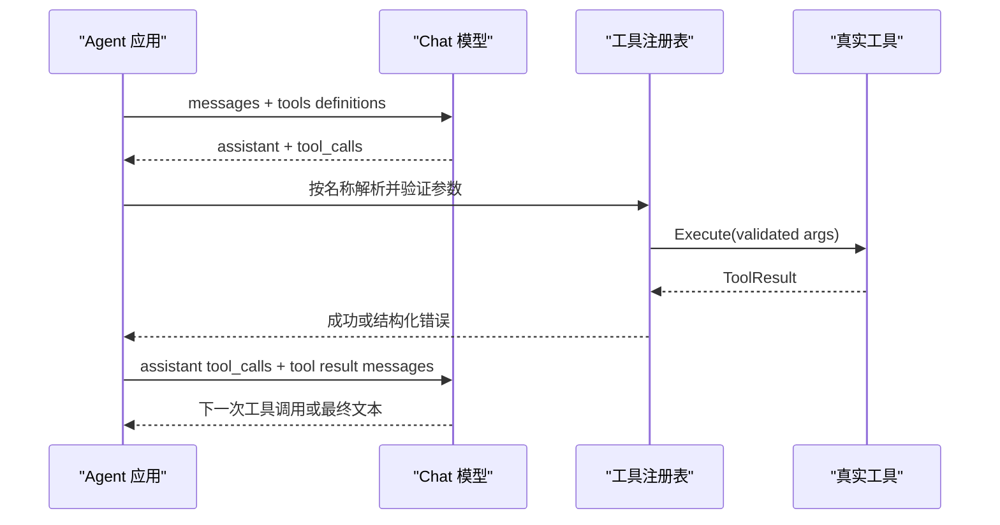

# 第 13 章　Function Calling 与 Tool Schema

[返回全书目录](../README.md) · [上一篇：RAG 的失败模式与评测](../02-rag/08-rag-evaluation.md) · [下一篇：ReAct 循环的状态机](02-react-state-machine.md)

## 本章要解决的问题

普通 Chat 模型只能根据已有上下文生成内容。它不能自行读取企业数据库、访问实时网页、查询知识库，更不能直接修改 Wiki 或执行脚本。

Function Calling，也常称 Tool Calling，为模型和应用之间增加了一种结构化协作方式：

```text
模型：我建议调用 knowledge_search，参数是 {"query":"差旅标准"}
应用：验证并执行这个调用
工具：返回检索结果
应用：把结果作为 tool 消息交回模型
模型：基于结果继续调用工具，或生成最终答案
```

关键措辞是“建议调用”。模型不拥有函数指针、数据库连接或操作系统权限。真正的选择确认、参数验证、权限检查和执行都在应用端。

本章将回答：

- Tool Schema 描述了什么，又没有保证什么；
- 一次 Tool Call 怎样穿过模型协议进入真实代码；
- 为什么模型输出必须按不可信外部输入处理；
- 工具描述、参数 Schema 和结果格式怎样影响 Agent 质量；
- WeKnora 如何注册、裁剪、调用和观测工具。

## Function Calling 不是远程过程调用

从形式上看，模型返回函数名和 JSON 参数，很像 RPC：

```json
{
  "name": "get_document_info",
  "arguments": {
    "knowledge_ids": ["d1", "d2"]
  }
}
```

但它和 Java 中一次受编译器与类型系统约束的方法调用有本质区别：

| 普通方法或 RPC | Function Calling |
|---|---|
| 调用方按照确定代码选择方法 | 模型通过概率生成选择工具 |
| 参数通常由编译器、SDK 或契约生成 | 参数是模型生成的文本或 JSON |
| 接口存在就可能被程序调用 | 只有本轮显式暴露的工具才应可选 |
| 调用失败通常按固定分支处理 | 错误结果还会返回模型，由它决定下一步 |
| 调用链由程序员预先编排 | 调用顺序可能在运行时动态形成 |

因此 Function Calling 更像“模型生成一份结构化执行意图”，而不是模型直接调用了后端函数。

## 一次工具调用的完整协议



协议里有两类不同对象：

1. **Tool Definition**：应用发给模型的能力说明，包括名称、描述和参数 Schema；
2. **Tool Call**：模型返回的调用意图，包括调用 ID、工具名和参数。

工具执行结果还必须通过同一个 Tool Call ID 返回。这个配对让模型知道某份观察结果对应哪次调用，尤其重要于一轮调用多个工具时。

### 用一次“查订单后取消”理解应用的执行权

用户说：“取消我昨天那笔仍未支付的订单。”模型可能先提出：

```json
{"name":"list_customer_orders","arguments":{"date":"昨天","status":"pending"}}
```

应用执行后只返回当前用户可见的候选订单及其稳定 ID。模型再提出：

```json
{"name":"cancel_pending_order","arguments":{"order_id":"o_123","reason":"user_requested"}}
```

此刻仍有四道应用侧 Gate：订单是否属于当前 Principal、状态是否仍为 `pending`、是否允许取消、是否需要用户二次确认。模型即使把 `order_id` 改成别人的订单，或生成 `status="paid"`，也只能得到结构化拒绝；它从未获得数据库直连权限。

这就是“模型提出意图、应用拥有执行权”的具体含义。Schema 只能说明参数形状，不能证明订单存在、归属正确或动作仍然安全。

## Tool Schema 是给模型看的接口契约

一个常见 Function Definition 包含：

```json
{
  "type": "function",
  "function": {
    "name": "search_orders",
    "description": "Search orders visible to the current user.",
    "parameters": {
      "type": "object",
      "properties": {
        "status": {
          "type": "string",
          "enum": ["pending", "paid", "canceled"]
        },
        "limit": {
          "type": "integer",
          "minimum": 1,
          "maximum": 20
        }
      },
      "required": ["status"]
    }
  }
}
```

三部分各有职责：

- `name` 是协议中的稳定标识符，应简短、唯一、含义明确；
- `description` 帮模型判断何时使用、何时不要使用；
- `parameters` 用 JSON Schema 描述字段、类型、必填项、枚举和范围。

Schema 同时服务两个对象：模型用它生成参数，应用用它做运行时验证。但即使供应商宣称支持严格结构化输出，服务端仍不应取消校验，因为模型、适配层、旧版本和外部 MCP 服务都可能产生异常输入。

## 好工具要围绕意图，而不是围绕数据库表

假设订单系统有十张表。直接暴露：

```text
query_order_table
query_order_item_table
query_payment_table
```

会迫使模型理解内部表结构、连接关系和敏感字段。更稳妥的工具可能是：

```text
get_order_summary(order_id)
list_customer_refunds(customer_id, date_range)
cancel_pending_order(order_id, reason)
```

好的工具通常具备：

- 对应清晰的业务动作；
- 输入字段少而明确；
- 内部完成必要的查询、聚合和权限过滤；
- 输出围绕下一步决策，而不是倾倒所有字段；
- 读操作与写操作语义明显；
- 错误可被模型理解并采取替代方案。

工具粒度过小，Agent 需要许多轮才能完成简单任务；粒度过大，则难以控制权限、失败恢复和组合能力。

## Description 也是路由规则

模型不会阅读 JavaDoc 或业务代码，它只能根据名称、描述、Schema 和当前上下文判断工具用途。

高质量描述应说明：

1. 工具能做什么；
2. 何时应该使用；
3. 何时不应该使用，应改用什么；
4. 重要输入的含义和 ID 格式；
5. 返回结果的关键结构；
6. 限制、成本或副作用。

WeKnora 的 [`get_document_info.go`](../../internal/agent/tools/get_document_info.go) 就不只写“获取文档信息”，还说明它适合元数据和处理状态，不适合读取正文；正文应使用知识搜索。它也区分普通文档 `dN` 和 FAQ Chunk `cN` 句柄。

这类描述实质上参与了模型的运行时路由。描述模糊会导致模型选错工具，即使执行器完全正确，Agent 仍然表现很差。

## Schema 需要表达真正约束

建议尽可能使用：

- `required` 表达真正必填字段；
- `enum` 限制有限状态；
- `minimum` / `maximum` 限制数量和范围；
- `minLength` / `maxLength` 限制字符串；
- 清晰的字段描述区分 ID、名称和自然语言查询；
- 小而稳定的对象层级。

不要把一切都定义成 `string`，再希望模型从描述里猜格式。也不要把内部实体完整序列化后暴露给模型，这会增加 Token、耦合和敏感数据风险。

Schema 也不能表达所有业务约束。例如“`knowledge_ids` 与 `faq_ids` 至少有一个非空”需要 `anyOf` 或执行器中的额外检查。WeKnora 当前的轻量参数校验器覆盖必填、类型、枚举、数值范围和字符串长度；工具本身仍负责更复杂的跨字段规则。

## WeKnora 的 Tool 接口

WeKnora 在 [`internal/types/agent.go`](../../internal/types/agent.go) 定义统一接口：

```go
type Tool interface {
    Name() string
    Description() string
    Parameters() json.RawMessage
    Execute(ctx context.Context, args json.RawMessage) (*ToolResult, error)
}
```

这与 Java 中的策略接口很相似：每个工具提供元数据和执行实现，Agent 核心依赖抽象，不直接依赖知识搜索、数据库或 Wiki 的具体类。

`ToolResult` 同时包含：

- `Success`：工具业务上是否成功；
- `Output`：交给模型阅读的文本；
- `Data`：供应用记录和展示的结构化数据；
- `Error`：可反馈给模型的失败信息；
- `Images`：工具返回的图片数据。

`error` 返回值与 `ToolResult.Success=false` 也有区别：前者通常代表执行层异常，后者可以表达预期的业务失败。无论哪种，Agent 都应得到一个可观察结果，而不是让循环无声中断。

## 注册表把定义与执行绑定起来

[`registry.go`](../../internal/agent/tools/registry.go) 中的 `ToolRegistry` 负责：

- 按名称注册和查找工具；
- 生成发给模型的 Function Definitions；
- 在执行前转换与校验参数；
- 调用真实工具；
- 限制工具输出长度；
- 会话结束时清理实现了 `Cleanable` 的工具。

工具定义按名称排序后再发送给模型。这样不仅让行为更可复现，也让依赖字节级前缀的 Prompt Cache 更容易命中。

重复名称采用 first-wins：后注册工具不能覆盖已有工具。这个细节防止外部或动态工具利用名称冲突劫持内置能力。

## 只暴露本轮真正可用的工具

工具越多不一定越智能。过多相似工具会：

- 增加输入 Token；
- 降低模型选择准确率；
- 暴露不必要能力；
- 让权限审计更复杂；
- 降低 Prompt Cache 稳定性。

WeKnora 在 [`agent_service.go`](../../internal/application/service/agent_service.go) 构建注册表时执行多层裁剪：

1. 从 Agent 配置的 `AllowedTools` 白名单开始；
2. 共享只读 Agent 去掉 Wiki 写工具；
3. 没有知识范围时移除知识库工具；
4. 没有 Wiki 能力时移除 Wiki 工具；
5. 没有 RAG 能力时移除对应检索工具；
6. 按 Web Search、MCP、Skills 和沙箱实际能力增加工具；
7. 去重后才注册并暴露给模型。

这体现了一个安全原则：**模型可见能力应是“配置允许 ∩ 用户范围允许 ∩ 运行环境实际支持”的交集。**

## 模型参数必须当作不可信输入

WeKnora 的工具执行路径依次处理：

```text
规范化 Tool Call ID
  → 解析 JSON
  → 尝试修复常见格式错误
  → 解码请求内资源句柄
  → 拒绝无法解析的句柄
  → 按 Schema 做类型转换
  → 校验 required / type / enum / range
  → 设置执行上下文与超时
  → 注册表查找并执行
  → 截断过大输出
  → 记录事件和 Trace
```

相关代码集中在 [`act.go`](../../internal/agent/act.go)、[`json_repair.go`](../../internal/agent/tools/json_repair.go)、[`param_cast.go`](../../internal/agent/tools/param_cast.go) 和 [`param_validate.go`](../../internal/agent/tools/param_validate.go)。

JSON 修复能处理缺失括号、尾随逗号和部分非法转义，是提高兼容性的容错层；它不是授权层。被修复成功的参数仍必须走后续校验和权限检查。

## Schema 校验也不是权限校验

下面参数可能完全符合 Schema：

```json
{"knowledge_ids":["secret-document-id"]}
```

但当前用户未必有权读取这份文档。Schema 只能证明形状正确，不能证明对象属于当前租户、当前会话或当前用户。

真正执行器仍应：

- 从可信服务端上下文获取用户和租户，不信任模型传入身份；
- 校验资源是否落在本轮 `SearchTargets` 或授权范围；
- 对共享 Agent 强制只读；
- 对外部 MCP 写操作应用审批；
- 在数据库、文件和网络层继续执行最小权限。

WeKnora 的文档信息工具会通过 `authorizeKnowledgeInSearchTargets` 等逻辑验证目标是否可访问。资源短句柄也会先经请求内注册表解析，无法解析的 `dN`、`cN` 等句柄在真实执行前被拒绝。

## 副作用工具需要更强边界

搜索知识与删除 Wiki 页面不是同一风险等级。至少应把工具分为：

- 纯读：查询、搜索、获取元数据；
- 受限计算：数据分析、代码运行；
- 可逆写：创建草稿、更新状态；
- 高风险写：删除、发送、付款、发布；
- 外部访问：调用第三方 MCP、访问互联网。

高风险操作常需要 Human-in-the-loop。WeKnora 的 [`approval/gate.go`](../../internal/agent/approval/gate.go) 可以发出审批事件并等待批准、拒绝、超时或请求取消；审批检查失败默认采用 fail-close，避免临时故障悄悄绕过确认。

即使用户批准，也应把最终参数重新校验。审批页面显示的参数必须与实际执行的参数一致，用户修改参数时也要形成新的、可审计的执行输入。

## 工具结果是下一轮上下文，不是日志转储

工具返回十万行数据会同时制造三类问题：

- 挤占上下文窗口；
- 增加后续每轮 Token 和延迟；
- 让恶意或无关内容影响模型。

工具输出应该为下一步决策服务。常见做法包括：

- 返回摘要与少量高价值记录；
- 提供分页句柄，让模型按需继续；
- 把大文件保存在沙箱，只返回路径和摘要；
- 结构化标记错误、总数和是否被截断；
- 对外部内容明确标记为不可信数据。

WeKnora 的注册表设置最大字符预算，超出时按 Unicode 字符截断；部分工具可以根据参数声明自己的受控输出预算。使用字符限制是最后防线，更好的工具会在生成结果时主动分页或聚合。

## 并行 Tool Call 什么时候安全

模型可能在一轮返回多个 Tool Call。若它们彼此独立，例如同时查询两个知识源，可以并行降低延迟。若第二个操作依赖第一个结果，或两个写操作会竞争同一资源，就必须顺序执行。

WeKnora 的 `ParallelToolCalls` 开启后使用并发执行多个调用，但结果仍按模型原始顺序追加。单个工具失败不会取消其他兄弟调用，采用 best-effort 语义。

通用系统还应判断：

- 工具是否声明只读；
- 是否操作同一资源；
- 是否有顺序依赖；
- 是否具备幂等性；
- 并发失败后怎样补偿。

不能仅因为模型一次返回了多个调用，就假设它们天然可并行。

## 错误应成为可操作的 Observation

Agent 中的工具失败不一定终止任务。一个好的错误结果应让模型知道：

- 哪个字段错误；
- 哪项权限或前置条件不满足；
- 是否可以重试；
- 应该换参数、换工具还是停止；
- 哪些敏感实现细节不应暴露。

WeKnora 会把参数校验错误和工具业务错误返回模型，并附加“分析错误并尝试其他方法”的提示。这允许下一轮自行纠正。

但重试必须有边界。持续把相同错误交回模型，会形成昂贵死循环；下一章会讨论最大轮数、重复检测和终止状态。

## 可观测性需要以 Tool Call 为单位

至少记录：

- Agent、会话、轮次和 Tool Call ID；
- 工具名称；
- 参数摘要或脱敏值；
- 权限与审批结果；
- 开始时间、耗时和超时；
- 成功、业务失败或执行异常；
- 输出大小、截断状态；
- 后续模型是否重试或换工具。

WeKnora 为每次调用发送进度、结果和执行事件，并创建 `agent.tool.<name>` Trace Span。数据库 SQL 等敏感参数会在观测数据中脱敏。这让一次 Agent 请求可以按“整次运行 → 某一轮 → 某个工具”展开诊断。

## 与 Spring/Java 的对应

| WeKnora / Agent | Java/Web 对应理解 |
|---|---|
| `types.Tool` | 统一策略接口或 Command Handler |
| Tool Registry | Spring Bean Registry + 按名路由 |
| Function Definition | 面向模型的 OpenAPI/DTO 契约 |
| Tool Call | 不可信的动态 Command 请求 |
| 参数 Schema 校验 | Bean Validation 的一部分 |
| SearchTargets 授权 | Service 层对象级权限校验 |
| ToolResult | 供模型消费的统一 Result DTO |
| Approval Gate | 需要人工确认的异步工作流节点 |
| Tool Call ID | 一次请求链中的关联 ID |

最重要的差别是：传统 Controller 的调用者通常知道自己要调用哪个 API，模型则需要根据自然语言动态选择，因此工具元数据本身也是运行逻辑的一部分。

## 推荐源码阅读顺序

1. [`internal/types/agent.go`](../../internal/types/agent.go)：看 `Tool`、`ToolResult`、`ToolCall` 和 `FunctionDefinition`。
2. [`tools/registry.go`](../../internal/agent/tools/registry.go)：看注册、定义投影、参数校验、执行和输出限制。
3. [`agent_service.go`](../../internal/application/service/agent_service.go)：看白名单和运行能力怎样决定最终注册表。
4. [`tools/get_document_info.go`](../../internal/agent/tools/get_document_info.go)：选择一个具体工具，对照描述、Schema、输入 DTO 和执行逻辑。
5. [`act.go`](../../internal/agent/act.go)：沿一次模型 Tool Call 追到真实执行与事件。
6. [`observe.go`](../../internal/agent/observe.go)：看 Function Definitions 怎样发给模型，结果怎样变成 `role=tool` 消息。
7. [`approval/gate.go`](../../internal/agent/approval/gate.go)：理解高风险外部工具怎样暂停等待人工决策。

第一次只跟踪 `get_document_info` 或 `knowledge_search` 这样的读工具。等协议闭环清楚后，再阅读 MCP、Skills、沙箱和 Wiki 写操作。

## 常见误区

1. **模型调用了函数。** 模型只生成调用意图，应用才拥有执行权。
2. **JSON 合法就可以执行。** 还需 Schema、业务规则、对象范围和权限校验。
3. **Tool Schema 是安全边界。** 它主要是接口契约，不证明调用者有权限。
4. **工具越多，Agent 越强。** 工具过多会增加选择错误、Token 和攻击面。
5. **工具描述只是文档。** 它直接影响模型选择和参数生成。
6. **错误应该直接中断。** 可恢复错误应作为 Observation 返回，但要限制重试。
7. **工具输出越完整越好。** 超大输出会污染和挤占上下文。
8. **多个 Tool Call 都可以并行。** 写冲突和依赖关系必须由应用控制。

## 本章小结

- Function Calling 是模型生成结构化执行意图的协议，不是模型直接运行后端函数。
- Tool Definition 用名称、描述和 JSON Schema 告诉模型可用能力；Tool Call 用 ID、名称和参数表达一次请求。
- 模型生成的工具名、参数和资源句柄必须作为不可信输入处理。
- WeKnora 通过工具注册表把 Function Definition 与真实 `Tool.Execute` 绑定，并执行修复、转换、校验、超时、截断和观测。
- 最终可见工具集合由配置白名单、用户范围和运行能力共同决定。
- Schema 负责结构约束，工具执行器仍负责业务规则、租户范围和对象级授权。
- 高风险副作用需要审批、最小权限、超时、幂等和审计。
- 工具结果应为下一轮决策服务，而不是把后端日志和全量数据倾倒进上下文。

### 可选实践

用你熟悉的 Java 业务设计三个工具：一个查询订单、一个取消订单、一个发送退款通知。分别写出名称、描述、JSON Schema、权限规则、幂等键、超时和错误结果。然后检查：只看 Schema 的模型，是否可能调用错工具或越权操作其他用户订单？

下一章：[ReAct 循环的状态机](02-react-state-machine.md)
