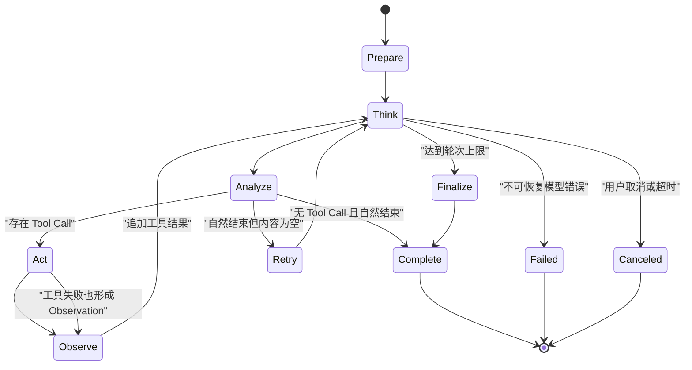

# 第 14 章　ReAct 循环的状态机

[返回全书目录](../README.md) · [上一篇：Function Calling 与 Tool Schema](01-function-calling-tool-schema.md)

## 本章要解决的问题

Function Calling 解决的是一次“模型提出工具调用—应用返回结果”。真正的 Agent 会重复这个过程：先搜索，再根据结果读取文档；发现数据不足后换关键词；拿到多份证据后综合回答。

这类动态链路无法完全预写成：

```java
search();
readDocument();
answer();
```

因为第二步调用哪个文档、是否需要第三个工具、何时已有足够信息，都取决于运行时 Observation。

ReAct 通常被解释为 Reason + Act：模型根据当前上下文推理，选择行动，观察结果，再决定下一步。工程上更准确的说法是：**应用托管一个有限状态循环，模型负责提出下一步，工具负责改变可观察信息，控制器负责安全、预算和终止。**

## 从一次 Chat 到一个受控循环

普通 Chat：

```text
用户消息 → 一次模型调用 → 最终文本
```

Agent：



每一轮都可能调用模型，因此 Agent 的成本、延迟和失败概率会随轮次累积。循环必须显式建模，不能用一个没有上限的 `while(true)` 包住模型调用。

### 把循环当作有预算的事务，而不是聊天魔法

假设一次用户请求的总预算是 30 秒、6 次模型/工具行动和 20,000 Token。第一轮搜索用了 4 秒，第二轮读取文档用了 8 秒，第三轮模型仍想继续访问网页。控制器不能只问“模型还想不想做”；还必须计算剩余时间、剩余轮数和剩余 Token 是否允许下一步。

```text
总截止时间 30s
  ├── 第 1 轮模型 + 搜索：4s
  ├── 第 2 轮模型 + 读取：8s
  ├── 第 3 轮模型：2s
  └── 剩余 16s：只允许在单步超时也能收尾的行动
```

若剩余预算不足，正确行为通常是停止新增副作用，基于已获得证据生成部分答案，并明确说明未完成内容；而不是为了“完成任务”无界地继续循环。第 17 章会把超时、重试和取消扩展为完整治理策略。

## ReAct 的四个工程阶段

WeKnora 在 [`engine.go`](../../internal/agent/engine.go) 中把一轮写成 `think → analyze → act → observe`。

### Think

应用把系统提示、用户问题、历史步骤、工具定义和已有 Observation 发给 Chat 模型。模型返回：

- 普通内容；
- 可选的 reasoning content；
- 零个或多个 Tool Call；
- finish reason；
- Token 使用量。

这里的“Thought”是系统记录的一轮模型内容，不应理解为应用能够验证模型内部真实思维过程。生产系统更应关注可观测行动、证据和结果，而不是要求模型展示隐含推理。

### Analyze

控制器检查模型响应：

- 没有 Tool Call，且是自然停止：把普通文本视为最终答案；
- 没有 Tool Call，但内容为空：有限重试；
- 内容被安全过滤：终止并返回安全结果；
- 存在 Tool Call：当前轮不是最终答案，进入 Act。

终止判断由应用代码完成，而不是模型说一句“我完成了”就无条件相信。

### Act

应用执行上一章所述的可信工具管线：解析、句柄解析、校验、授权、超时、执行、截断和观测。一轮可以有多个调用；配置允许时可并行。

### Observe

应用把这轮模型消息和工具结果按协议追加到消息历史：

```text
assistant:
  tool_calls: [{ id: call_1, name: knowledge_search, ... }]

tool:
  tool_call_id: call_1
  name: knowledge_search
  content: ...
```

下一轮模型看到这份 Observation，才能判断搜索是否足够、是否需要换工具，以及怎样回答。

## 状态不只是一个 messages 数组

WeKnora 在 [`internal/types/agent.go`](../../internal/types/agent.go) 中定义：

```text
AgentState
  CurrentRound
  RoundSteps[]
  IsComplete
  FinalAnswer
  KnowledgeRefs[]

AgentStep
  Iteration
  Thought
  ReasoningContent
  ToolCalls[]
  Timestamp
```

每个 `ToolCall` 还包含 ID、名称、参数、结果、耗时和供应商元数据。

状态至少有三种用途：

1. **模型上下文**：决定下一轮模型能看到什么；
2. **用户体验**：前端展示思考、工具进度、结果和最终答案；
3. **持久化与诊断**：刷新页面后恢复步骤，分析哪一轮失败。

这三种表示不一定完全相同。敏感参数可以进入执行上下文，却不应原样展示或写入外部 Trace；超长结果可以完整存储在文件中，但只把摘要交给模型。

## 消息协议必须保持 Tool Call 配对

一次工具调用不能只追加结果文本：

```text
user: 搜索结果是……
```

模型协议需要保留“assistant 请求了哪些工具”以及每个 `tool` 消息对应哪个 ID。丢失配对会造成：

- 模型不知道哪个结果属于哪个调用；
- 某些供应商直接拒绝请求；
- 并行调用结果串线；
- 多轮历史无法正确重放。

[`appendToolResults`](../../internal/agent/observe.go) 先追加带 `tool_calls` 的 assistant 消息，再逐个追加 `role=tool` 消息，并保留 `ToolCallID`、名称和供应商元数据。

因此做上下文压缩时，assistant tool-call 与 tool result 必须被视为不可拆散的事务单元。只删其中一半，消息数量少了，协议却坏了。

## 一条具体执行轨迹

用户问：“对比新版与旧版差旅住宿标准，并告诉我变化。”

可能形成：

```text
Round 1 / Think
  需要找到两个版本。

Round 1 / Act
  knowledge_search(query="差旅住宿标准 新版 旧版")

Round 1 / Observe
  返回新版文档 d1、旧版文档 d2 的相关片段。

Round 2 / Think
  片段缺少完整发布日期和适用范围。

Round 2 / Act
  get_document_info(knowledge_ids=["d1", "d2"])

Round 2 / Observe
  返回文档日期、版本和状态。

Round 3 / Think
  证据足够，生成对比答案。

Round 3 / Analyze
  无 Tool Call + 自然停止 → Complete
```

调用链由模型动态决定，但状态转移、可用工具、权限和终止条件始终由应用决定。

## 最终答案不是一个特殊工具

Agent 框架常见两种终止设计：

1. 模型调用 `final_answer` 工具；
2. 模型不再请求工具，以普通 assistant 文本自然结束。

WeKnora 当前采用第二种。[`analyzeResponse`](../../internal/agent/observe.go) 的核心规则是：

```text
自然 finish reason + 无 Tool Call = 最终答案
有 Tool Call = 非终态，执行后继续
```

这样与普通 Chat 协议一致，也减少一个虚拟工具。但控制器必须区分同一轮中的“我来搜索一下”这类前言和真正最终文本；只要该轮随后出现 Tool Call，这些文本就属于步骤说明，不应被持久化成最终答案。

## Finish Reason 不是唯一真相

供应商可能返回 `stop`、`end_turn`、`tool_calls`、`length`、`content_filter` 或兼容层自定义值。不同模型的流式行为也不完全一致。

终止判断应联合观察：

- 是否有 Tool Call；
- 是否有可用普通文本；
- finish reason 是否属于自然结束；
- 流是否返回错误；
- 请求上下文是否已取消；
- 是否达到系统预算。

例如，“没有 Tool Call + `stop` + 空内容”不能算一次成功回答。WeKnora 会追加“现在给出完整纯文本答案”的提示并有限重试，仍为空才使用兜底文本。

## 为什么需要多种终止条件

Agent 不一定主动走到正常终态。至少要覆盖：

### 自然完成

模型给出最终文本且不再请求工具。这是理想路径。

### 最大轮数

每轮都会花费模型和工具资源。WeKnora 的 `MaxIterations` 有配置默认与校验上限，最终循环只在 `CurrentRound < MaxIterations` 时继续；配置还不能超过服务定义的硬上限。

代码中存在多层默认设置：Custom Agent 当前会把未设置值补为 10，较底层校验对非正值补为 5，Agent 包也保留默认常量 20。它们服务不同构造路径。阅读这类配置时要沿真实入口确认最终生效值，不要只看到一个常量就认为线上一定使用它。

达到上限后，[`finalize.go`](../../internal/agent/finalize.go) 会基于已有工具结果再生成一次收尾答案，而不是直接丢弃过程。

### 请求取消或超时

用户点击停止、HTTP 上下文取消或上层超时后，循环必须停止。WeKnora 会保留已经形成的步骤；若已有工具结果，还会尝试据此合成答案，但不会把被取消的半截思考误当成最终回答。

### 卡死检测

某些异常 finish reason 可能导致模型连续返回相同文本却不进入正常终态。WeKnora 检测连续重复内容，达到阈值后强制停止。

### 内容安全终止

模型返回 `content_filter` 且没有工具调用时，系统结束循环，避免相同过滤结果不断累积。

### 不可恢复错误

模型接口、上下文协议或系统内部发生不可恢复错误时，应终止并发出明确 Error 事件，而不是用无限重试掩盖故障。

## 重试必须区分“同一轮”与“下一轮”

WeKnora 的循环结果有三个控制信号：

- `next`：完成本轮，轮次加一；
- `continue`：不增加轮次，重新尝试当前逻辑；
- `break`：退出循环。

空内容重试使用 `continue`，工具执行并追加 Observation 后使用 `next`，最终答案或卡死使用 `break`。

这个区分有助于准确记录轮次预算。更一般地，还应分别限制：

- 单次 LLM 调用重试数；
- 单个工具重试数；
- 相同参数的重复调用数；
- 总 Agent 轮数；
- 总执行时间；
- 总 Token 和费用。

只限制轮次仍可能在一轮并行调用大量工具；只限制时间又可能在超时前产生高额费用。生产系统通常需要组合预算。

## 工具失败为什么通常继续循环

假设 Web 搜索超时。立即终止可能错过知识库搜索这一替代路径。把结构化失败作为 Tool Result 返回后，模型可以：

- 调整参数重试；
- 换一个工具；
- 基于已有证据回答；
- 明确告诉用户信息不足。

这就是 Observe 的价值：成功和失败都转化为下一轮决策信息。

但不是所有错误都适合交给模型自行恢复。认证失效、明确拒绝、高风险审批未通过、整个请求取消等情况，应由控制器施加硬边界。模型不能通过“换一种说法”绕过安全决策。

## 并行行动会让状态机更复杂

一轮多个独立读工具并行可以降低延迟。WeKnora 在并行模式中：

- 用并发任务执行每个 Tool Call；
- 单个失败不取消兄弟调用；
- 把结果存回原始索引；
- 最后按模型提出调用的顺序追加 Observation。

保留顺序可以提高复现性，但并行还会带来：

- 总并发和供应商限流；
- 对同一资源的写冲突；
- 取消传播；
- 部分成功的补偿；
- 各结果对后续决策的依赖。

简单框架可以只允许并行只读工具。更成熟的框架会在工具元数据中声明副作用、幂等性、资源锁和依赖关系。

## 上下文会在每一轮增长

每轮新增：

- assistant 思考或说明；
- Tool Call 参数；
- 一个或多个 Tool Result；
- 供应商要求重放的 reasoning metadata。

如果每轮工具输出 16,000 字符，十轮后上下文很快失控。后果是成本持续上涨、延迟变长、模型忽略早期关键信息，甚至超出窗口。

WeKnora 在每轮开始估算 Token，优先利用上一轮 API Usage 加上新增消息估算增量，并在需要时压缩旧消息。引擎本身跨用户轮次无状态：历史从数据库重建后传入；当前 Agent 运行的多轮状态由内存中的 `AgentState` 和 messages 维护。

上下文治理的关键原则是：

- 保留当前目标和高优先级约束；
- 保留 Tool Call 与结果配对；
- 对旧工具结果总结或截断；
- 将大产物外置，只保留句柄；
- 不把过期知识结果无条件带入下一次用户对话；
- 记录压缩发生在哪一轮，便于诊断信息丢失。

第 17 章会进一步讨论 Token、超时和失败恢复。

## EventBus 把后台状态机变成用户体验

Agent 可能运行几十秒。若前端只看到一个转圈，用户不知道它是在思考、搜索、等待审批还是卡住。

WeKnora 通过 EventBus 发出：

- 思考内容；
- Tool Call 待执行与参数提示；
- Tool Result；
- 最终答案增量；
- 完成或错误；
- 审批与 OAuth 等待事件。

`executeLoop` 使用延迟执行保证各类退出路径只发出一次 Complete 事件，并在取消后的上下文上使用不继承取消的发送方式，确保完成状态仍能被持久化。

这是典型的状态机—视图分离：Agent 内核维护真实状态，事件是供 UI、持久化和观测消费的状态变化，不应反过来成为唯一事实来源。

## 每一轮都应该可追踪

Agent Trace 最适合用树展示：

```text
agent.execute
  agent.round.1
    chat
    agent.tool.knowledge_search
  agent.round.2
    chat
    agent.tool.get_document_info
  agent.round.3
    chat
```

WeKnora 正是按“整次 Agent → 每轮 → 模型与工具”创建 Langfuse Span，并记录：

- 最大轮数和工具集合；
- 每轮消息数、估算 Token、耗时和结果；
- 模型 finish reason、Tool Call 数和 Usage；
- 工具耗时、成功状态和脱敏参数；
- 最终轮数、总工具调用数和答案长度。

有了这棵树，才能回答“慢在模型还是工具”“为什么多跑了三轮”“哪次错误导致模型换了路线”。

## 与 Java 工作流引擎的对应

ReAct 可以先类比为一个工作流状态机：

| Agent 概念 | Java/工作流对应 |
|---|---|
| `AgentState` | Process Instance State |
| `AgentStep` | 一次状态迁移记录 |
| Tool Call | Command / Activity |
| Tool Result | Activity Result / Event |
| `CurrentRound` | 循环计数器 |
| `MaxIterations` | 工作流保护上限 |
| EventBus | 领域事件与进度通知 |
| Approval Gate | Human Task |
| Context Cancellation | 流程取消信号 |
| Finalize | 超限或异常后的补偿收尾 |

但 ReAct 与固定工作流有重要区别：下一条边由模型根据自然语言上下文概率选择，而不是预定义条件表达式。因此它更灵活，也更难穷举测试。

适合固定工作流的问题，不应为了“更 Agent”而全部交给 ReAct。付款、审批、合规发布等流程常适合由确定代码掌控主干，只在分类、抽取或解释节点调用模型。

## 什么任务适合 ReAct

适合：

- 需要根据中间结果动态选择信息源；
- 搜索、阅读、比较和归纳路径不可预先穷举；
- 工具以读操作为主，失败可恢复；
- 用户接受一定延迟和成本；
- 结果可由证据或人工验证。

不适合直接放任模型控制：

- 确定的 CRUD 表单提交；
- 强事务、多资源一致性流程；
- 无法撤销的高风险操作；
- 严格实时或极低延迟请求；
- 每一步必须形式化证明的合规流程。

实践中常采用混合架构：确定工作流定义边界和关键状态，Agent 只在某些开放决策节点内运行。

## 测试状态机而不只测试 Prompt

至少应覆盖这些轨迹：

1. 首轮直接回答，无工具；
2. 一次工具后正常回答；
3. 多轮不同工具后回答；
4. 一轮并行多个工具，结果顺序稳定；
5. 工具参数非法，下一轮纠正；
6. 工具失败，模型切换替代路径；
7. 自然停止但内容为空，有限重试；
8. 达到最大轮数，基于已有结果收尾；
9. 用户取消，不把半截思考当答案；
10. 内容过滤和重复响应能终止；
11. Tool Call 与 Tool Result 在压缩和历史重放后仍成对；
12. Complete 事件只发一次。

这些测试大多可以用可编程 Fake Chat Model 和 Fake Tool 完成，不需要每次调用真实大模型。模型质量评测与控制器状态机测试应该分开。

## 推荐源码阅读顺序

1. [`internal/types/agent.go`](../../internal/types/agent.go)：先看 `AgentState`、`AgentStep` 和 `ToolCall`。
2. [`engine.go`](../../internal/agent/engine.go)：阅读 `Execute`、`executeLoop` 和 `runReActIteration`。
3. [`think.go`](../../internal/agent/think.go)：看流式模型调用怎样累积内容、Reasoning、Tool Call 和 Usage。
4. [`observe.go`](../../internal/agent/observe.go)：看终止判断与 assistant/tool 消息配对。
5. [`act.go`](../../internal/agent/act.go)：看顺序和并行工具执行。
6. [`finalize.go`](../../internal/agent/finalize.go)：看最大轮数与已有工具结果怎样收尾。
7. [`session_agent_qa.go`](../../internal/application/service/session_agent_qa.go)：回到应用层，看配置、历史、附件、模型和 EventBus 怎样进入 Engine。

阅读时在纸上维护五列：轮次、发送给模型的消息、模型返回、执行的工具、`AgentState` 变化。跟完一次两轮工具调用后，代码会从“许多事件分支”变成一台明确的状态机。

## 常见误区

1. **ReAct 就是让模型自由思考。** 工程核心是受控状态循环、工具执行和终止条件。
2. **模型说完成就完成。** 控制器应根据 Tool Call、文本和 finish reason 判定。
3. **工具报错就必须终止。** 可恢复失败可以成为下一轮 Observation。
4. **有最大轮数就不会失控。** 还需时间、Token、费用、工具次数和并发预算。
5. **删除旧消息只影响记忆。** 拆散 Tool Call 与 Tool Result 可能直接破坏协议。
6. **所有工作流都适合 Agent。** 确定、高风险和强事务流程更适合代码掌控。
7. **并行调用一定更快。** 限流、依赖、写冲突和结果聚合可能抵消收益。
8. **前端事件就是 Agent 状态。** 事件是投影，`AgentState` 和持久化记录才是事实基础。

## 本章小结

- ReAct 把模型、工具和 Observation 组织成有限循环，模型提出下一步，应用掌握执行和终止。
- WeKnora 的单轮依次执行 Think、Analyze、Act、Observe。
- 自然停止且没有 Tool Call 才形成最终答案；存在 Tool Call 的轮次必须执行后继续。
- assistant Tool Call 与对应 tool result 是协议配对，历史重放和上下文压缩不能拆散。
- Agent 必须处理最大轮数、空响应、重复内容、内容过滤、取消、超时和不可恢复错误。
- 工具失败可以反馈给模型恢复，但审批拒绝和权限边界不能由模型绕过。
- 多轮会持续增长上下文、延迟和成本，需要复合预算与上下文压缩。
- EventBus 和分层 Trace 把后台状态机变成可理解、可持久化、可诊断的用户体验。
- 固定工作流与 ReAct 可以组合：确定代码控制高风险主干，模型处理开放决策。

### 可选实践

不用调用任何大模型，先用 Java 写一个最小状态机：Fake Model 第一次返回 `search` Tool Call，第二次返回最终答案；Fake Tool 返回固定结果。为直接完成、参数错误、工具失败、最大轮数和取消分别写测试。这个练习的目标不是做智能 Agent，而是证明你能完全控制它的状态与终止。

下一章：[MCP：把工具接入变成协议](03-mcp-protocol.md)
