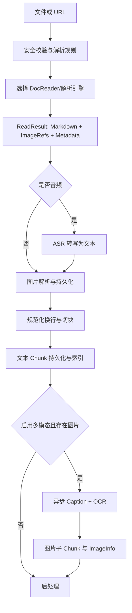

# 第 18 章　文档解析、OCR 与版面理解

[返回全书目录](../README.md) · [上一篇：Agent 的权限、超时与失败恢复](../03-agent/05-agent-governance.md)

## 本章要解决的问题

第 6 章已经从全局看过文档入库：读取、解析、切块、向量化和索引。本章向前再走一步，专门研究“解析”内部发生了什么。

用户上传的是 PDF、Word、Excel、网页、图片或音频，检索系统最终需要的是有顺序、可切分、可引用的知识内容。两者之间并不存在一个通用的 `file.getText()`：

- PDF 可能有原生文字层，也可能只是扫描图片；
- 双栏论文的存储顺序不一定等于阅读顺序；
- Word 中的标题、表格、脚注和浮动图片属于不同结构；
- 网页有导航、广告、脚本和远程图片；
- 表格转成纯文本后可能失去行列关系；
- 图片有文字，也可能是流程图、照片或统计图；
- 同一个文件甚至会混合文字层、扫描页和嵌入图片。

因此，文档解析不是入库前的格式转换小工具，而是 RAG 的“编译器前端”：它决定原始资料怎样变成后续系统能够理解的中间表示。

## 先区分解析、OCR、版面分析和视觉理解

这几个概念经常被混在一起。

### 文档解析（Document Parsing）

读取文件容器和内部结构，提取段落、标题、表格、图片、元数据等。例如从 DOCX XML 中得到标题层级，从带文字层的 PDF 中提取字形和坐标。

### OCR（Optical Character Recognition）

把像素中的文字识别为字符。OCR 解决“图里写了什么”，但单纯 OCR 不一定知道两段文字谁先读，也不知道一组数字属于哪一列表格。

### 版面分析（Layout Analysis）

识别页面区域和关系：标题、正文、双栏、表格、页眉、页脚、脚注、图片说明以及阅读顺序。它解决“内容在页面中怎样组织”。

### 视觉语义理解

使用 VLM 解释流程图、架构图、照片或图表表达的含义，常输出 Caption。它回答“这张图说明了什么”，并不等同于逐字 OCR。

```text
原生解析：利用文件已有的文字与结构
OCR：像素 → 字符
版面分析：区域 + 类型 + 阅读顺序 + 层级
VLM Caption：图片 → 语义描述
```

一个优秀解析管线常组合这些能力，而不是在四者中只选一个。

## 解析的真正输出不是一串文字

最简实现可能返回 `String content`。但生产系统至少需要同时保留：

- 规范化正文；
- 标题和层级；
- 图片及其原始引用；
- 页码、文件名和解析器元数据；
- 阅读顺序；
- 原文位置或可追溯标识；
- 表格、公式等特殊块的表达；
- 解析警告与质量信息。

否则，后续虽然能做 Embedding，却难以回答：这段证据来自第几页？图片和哪段正文相邻？OCR 文本是否可信？用户打开引用时应该定位到哪里？

## Markdown 是一种中间表示

WeKnora 把不同解析器收敛到统一接口：

```go
type DocReader interface {
    Read(ctx context.Context, req *ReadRequest) (*ReadResult, error)
}
```

[`ReadResult`](../../internal/types/docparser.go) 的核心字段是：

```text
MarkdownContent：统一正文
ImageRefs：图片文件、原始引用、MIME、存储键或内联字节
Metadata：页数等解析元数据
Error：解析器返回的业务错误
IsAudio / AudioData：等待 ASR 的音频载荷
```

这是一种 Adapter 设计：Go 原生解析、gRPC/HTTP DocReader、MinerU、PaddleOCR-VL 和云服务都返回同一种结果，后续存图、切块和索引不必了解供应商协议。

Markdown 在这里不是最终展示页面，而是 **Intermediate Representation，IR**：

- 标题符号保留层级；
- 段落边界可供切块使用；
- 表格可用 Markdown/HTML 表达；
- 图片以引用嵌在正文顺序中；
- 人可以直接检查和编辑；
- 下游模型也容易理解。

对 Java 开发者，它类似编译器的 AST 简化投影，或者 ETL 中的规范化事件模型。供应商输出先进入统一 IR，下游只依赖 IR 契约。

但 Markdown 不是无损格式。复杂合并单元格、精确坐标、浮动层、公式结构和每个文字块的置信度可能丢失。产品若要求精确页面还原，应在 Markdown 之外保留结构化 Block/Bounding Box 或原始解析 JSON，不能让一种 IR 承担所有任务。

## WeKnora 的解析主链

沿 [`knowledge_process.go`](../../internal/application/service/knowledge_process.go) 可以看到：



这条链里有三个容易忽略的边界：

1. **解析器只负责产生规范结果。** 存储、切块和索引由业务层编排。
2. **图片先成为可追溯资源，再异步理解。** Caption/OCR 不需要阻塞基础文本解析的所有步骤。
3. **音频也先进入统一结果，再由 ASR 替换占位文本。** 解析和模型能力通过 IR 解耦。

## 解析器选择是策略，不是 if-else 偶然分支

[`engine_registry.go`](../../internal/infrastructure/docparser/engine_registry.go) 注册了多类引擎，并描述支持格式与可用条件：

| 引擎 | 典型定位 | 依赖 |
|---|---|---|
| `simple` | md/txt/csv/json、图片、音频的 Go 原生包装 | 无外部解析服务 |
| `builtin` | 复杂文档的 DocReader 内置解析 | DocReader 连接 |
| `weknoracloud` | 租户凭证下的云端文档读取 | 云端凭证 |
| `mineru` / `mineru_cloud` | PDF、Office、图片等结构化解析 | 自建端点或 API Key |
| `paddleocr_vl` / cloud | PDF 与图片的 OCR/版面解析 | 自建端点或云 Token |

知识库配置可以按文件类型解析引擎规则。`resolveDocReader` 的默认策略是：简单格式优先走 Go 原生 Reader，复杂格式走 DocReader；显式指定 `builtin` 时不会偷偷降级成 simple。

这种“显式选择不隐式回退”很重要。解析质量是数据质量的一部分：用户选择高质量版面解析器却因服务故障静默回退为低质量纯文本，最终知识库看似成功，检索质量却不可解释。

合理的降级必须同时满足：

- 产品明确允许；
- 输出标记实际使用的引擎与质量等级；
- 不会破坏必须保留的结构；
- UI 能展示“降级完成”，而不是普通成功。

## 简单格式为什么值得原生处理

[`builtin_converter.go`](../../internal/infrastructure/docparser/builtin_converter.go) 直接处理 Markdown、文本、CSV、JSON、图片和音频。这样做不只是节省一次 RPC：

- 输入和输出更确定；
- 部署少一个强依赖；
- 延迟和失败面更小；
- CSV/JSON 到 Markdown 的转换易于单测；
- 图片和音频可以保留原始字节，交给后续专用模型。

原则是“按格式复杂度选择最小足够能力”，不是“所有文件都送给最强模型”。用 VLM 读取一个 UTF-8 文本文件既贵又不稳定。

## 扫描 PDF 不是一种文件扩展名

`.pdf` 只说明容器，不说明内容形态。常见情况包括：

1. 原生数字 PDF：有可靠文字层和坐标；
2. 扫描 PDF：每页是一张图片；
3. 混合 PDF：部分页有文字层，部分页是扫描；
4. 带错误隐藏文字层的扫描 PDF：能复制，但顺序或字符严重错误；
5. 图片为主的报告：正文很少，信息主要在图表。

因此不能用 `fileType == pdf` 决定是否 OCR。更合理的判定信号包括：

- 每页可提取字符数；
- 可打印字符比例；
- 文字块覆盖面积；
- 图片覆盖面积；
- 字符重复和乱码比例；
- 页面之间的差异；
- 解析器置信度。

WeKnora 在后续摘要阶段使用实际非图片文本量进行自适应：正文极少的图像主导文档会同时加入 Caption 与 OCR；文本充足的文档只使用 Caption，避免页眉、页脚、水印和插图 OCR 稀释主题。当前阈值是 200 个 Rune，这是一条工程启发式，不是扫描件识别的通用真理。

更进一步的系统应按页判定，而不是只给整份文档贴一个“扫描/非扫描”标签。

## 图片不是附件，而是正文中的一等对象

解析器返回的 `ImageRefs` 既可能携带内联字节，也可能指向解析产物目录或远程 URL。WeKnora 的 [`image_resolver.go`](../../internal/infrastructure/docparser/image_resolver.go) 会：

- 扫描 Markdown 中的图片引用；
- 将内联或解析器产生的图片写入文件服务；
- 更新 Markdown 引用到持久化地址；
- 下载并存储允许的远程 HTTP(S) 图片；
- 保留原始引用与存储后引用的对应关系。

这里需要保持两种关系：

```text
内容关系：图片在正文什么位置、属于哪个文本 Chunk
来源关系：图片从哪个文件/URL/解析产物而来、存到哪里
```

只保存图片 URL 会丢内容关系；只把 OCR 文本拼进正文会丢来源关系。RAG 的引用、重解析和审计都需要两者。

### 为什么独立上传的小图片不能随手过滤

解析文档时，人们常过滤图标、装饰线和极小图片，减少 VLM 成本。但如果用户上传的原始文件本身就是一张小截图，它不能被同一规则静默删除。

WeKnora 的 `ImageRef.IsOriginal` 专门标记“原始上传文件”，使其不被普通图标/尺寸过滤误伤。这是一个很好的领域建模例子：相同字节大小，在不同来源语义下有不同处理规则。

## Caption 与 OCR 应分别保存

一张架构图可能有两类互补信息：

- OCR：`API Gateway`、`Order Service`、`Kafka`；
- Caption：订单请求经过网关进入服务，再通过消息队列异步处理。

把二者直接合成一段不可区分的文本，会给检索和评测带来困难。WeKnora 为图片维护 `ImageInfo`，并在父文本 Chunk 下创建或更新两类子 Chunk：

- `image_caption`：视觉语义描述；
- `image_ocr`：图中文字。

[`UpdateImageInfo`](../../internal/application/service/knowledge_process.go) 会按原始图片 URL 匹配已有子 Chunk，更新变化内容，缺失时再创建。这种父子关系带来几项好处：

- OCR 与 Caption 可以独立向量化、召回和评估；
- 命中图片子 Chunk 时仍能回到正文上下文；
- 重跑某一种模型不必破坏原始文本 Chunk；
- UI 能分别展示图片、识别文字和语义说明。

下一章会继续讨论这些图片 Chunk 如何参与多模态检索。

## OCR 输出也要经过清洗

VLM/OCR 输出不是天然干净的数据。它可能返回：

- Markdown 代码围栏；
- “图片中没有文字”之类解释性句子；
- HTML 包装；
- 重复页眉页脚；
- 幻觉出的补全文字；
- 与页面语言不一致的翻译；
- 断行、连字符和空格噪声。

[`ocr_sanitizer.go`](../../internal/application/service/ocr_sanitizer.go) 会清理代码围栏和包装格式、规范 HTML 到 Markdown，并过滤无有效文字的回答。

清洗需要克制：

- 可确定识别的包装和协议噪声可以删除；
- 断行合并要避免把两个表格单元格拼在一起；
- 拼写纠正可能改变专有名词、编号和金额；
- LLM 后校正必须保存原始 OCR，标记模型与版本；
- 不确定内容应保留置信度或警告，而不是“修成”流畅句子。

OCR 的目标不是文章更好看，而是忠实恢复可检索证据。

## 版面理解决定阅读顺序

假设双栏论文被按横向坐标逐行提取：左栏第一行、右栏第一行、左栏第二行、右栏第二行……每个字符都识别正确，组合后的语义仍完全错误。

版面分析通常需要产生：

```text
Page
  Block(type, bbox, order, confidence)
    Line
      Span(text, style, bbox, confidence)
```

随后根据块类型和空间关系重建：

- 阅读顺序；
- 标题层级；
- 列与段落；
- 表格行列；
- 图片和说明文字；
- 脚注与正文引用；
- 页眉页脚重复区域。

WeKnora 当前跨引擎的稳定 IR 重点是 Markdown、图片和元数据。阅读源码时要区分：某个具体解析器可能内部拥有丰富版面结构，但统一结果不一定完整暴露它。若你的业务是合同条款定位、发票字段抽取或论文公式引用，可能需要扩展 IR，而不仅是更换 OCR 模型。

## 表格是解析质量的试金石

表格既有视觉布局，又有逻辑结构。常见失败包括：

- 行列顺序颠倒；
- 合并单元格展开错误；
- 多页表格丢表头；
- 数字与单位分离；
- 空单元格被删除后列错位；
- Markdown 管道符出现在内容中；
- 一张大表被切在任意 Token 位置。

WeKnora 的解析基础设施包含 HTML 表格规范化，Chunker 也会为表格切片处理表头上下文。这里体现了端到端原则：解析器保留表格结构只是第一步，切块和检索阶段也要理解结构，否则前面的解析质量仍会被后面破坏。

对高价值表格，可以同时保存：

- 原始 HTML/结构化单元格；
- 面向模型的 Markdown；
- 行级或区域级 Chunk；
- 页面截图与 Bounding Box；
- 表头上下文。

不同表示服务于展示、计算、检索和审计，不必强迫它们共享一串文本。

## 远程解析器是一条安全边界

文件解析器面对不可信二进制输入，本身就是高风险组件。压缩包、Office 宏、畸形 PDF、超大图片和解析库漏洞都可能消耗或突破系统资源。

至少要治理：

- 上传大小、页数、像素和解压后体积；
- 扩展名、MIME 与魔数的一致性；
- 压缩炸弹与递归嵌套；
- 解析进程的 CPU、内存、磁盘和超时；
- 临时文件隔离与清理；
- 外部 URL、重定向和 DNS 重绑定；
- 云解析器的数据驻留、保留和敏感信息合规；
- 解析产物中的主动内容和危险链接。

WeKnora 对导入 URL 和租户覆盖的解析端点执行 SSRF 校验。它还为 DocReader 调用创建子 Context：有效截止时间不会超过父请求，默认单次调用上限为 30 分钟；超时会被分类为独立错误，使 UI 能提示拆分大文件，而不是只显示模糊的“解析失败”。

对于解析服务，隔离通常比进程内调用更值得：即使多一次 RPC，也能把高风险解析库、巨量内存和崩溃影响隔离到独立 Worker。

## 异步多模态任务如何保持一致性

图片 Caption/OCR 可能比基础文本解析慢得多，还受到模型限流影响。同步等待所有图片处理完成会长期占用请求或 Worker，所以 WeKnora 将多模态处理排入异步任务。

异步化引入新的状态：

```text
文档已解析 ≠ 所有图片已理解 ≠ 全部索引已就绪
```

因此应分别记录解析、切块、多模态、向量化、摘要和后处理状态。重试时还要保证：

- 同一图片任务不会无限创建重复子 Chunk；
- 已成功的 Caption 不因 OCR 失败而丢失；
- 永久错误与限流等可重试错误分开；
- 所有任务结束后只触发一次后处理；
- UI 能解释“部分可用”而不是只有 `processing/finished` 两态。

WeKnora 更新图片信息时先匹配现有 Caption/OCR 子 Chunk，变化则更新、缺失才创建，这比“每次重试 append 一条”更接近幂等消费。

## 解析质量要用下游任务评估

OCR 的 Character Error Rate（CER）或 Word Error Rate（WER）有用，但不能单独代表 RAG 质量。一份字符准确率很高、阅读顺序错误的双栏文档，检索可能仍然很差。

建议建立分层指标：

| 层次 | 可评估内容 |
|---|---|
| 字符 | CER/WER、数字/日期/专名准确率 |
| 版面 | 区块分类、阅读顺序、标题层级、页眉页脚去除 |
| 表格 | 行列、合并单元格、表头继承、单元格准确率 |
| 图片 | OCR 覆盖、Caption 忠实性、图片与正文关联 |
| IR | Markdown 可解析性、图片引用有效率、来源完整率 |
| Chunk | 语义完整、表格不破坏、页码与偏移可追溯 |
| RAG | Recall@K、引用定位、问题回答正确性与忠实性 |
| 系统 | 延迟、成本、超时率、重试率、每页失败率 |

真正的黄金集不应只有干净电子 PDF，还要包含：

- 扫描倾斜、模糊、阴影和低对比度；
- 中文、英文和混排；
- 双栏、脚注、页眉页脚；
- 合并单元格和跨页表格；
- 公式、代码、印章和手写批注；
- 有错误隐藏文字层的 PDF；
- 只有图片的 DOCX 和网页远程图片。

最终要问的不只是“字识别对了吗”，而是“用户的问题能否召回正确区域并打开正确来源”。

## 如何诊断一份文档为什么搜不到

按数据血缘逐层检查，避免一开始就调 Embedding：

1. **原文件层**：文件能否正常打开，是否是扫描件或混合页？
2. **引擎层**：实际选择了哪个解析器，是否发生降级或超时？
3. **IR 层**：Markdown 是否有内容、标题、表格和正确图片引用？
4. **图片层**：图片是否成功持久化，OCR/Caption 是否完成？
5. **顺序层**：段落、双栏和跨页表格顺序是否合理？
6. **Chunk 层**：目标事实是否被切碎，表头是否保留？
7. **索引层**：正确 Chunk 是否向量化并启用？
8. **检索层**：关键词/向量是否召回，Rerank 是否误删？

如果 IR 中就没有目标文字，再调 Rerank 参数没有意义。解析质量是检索质量的上游上限。

## WeKnora 当前设计的取舍

值得学习的部分包括：

- 用统一 `DocReader` / `ReadResult` 隔离解析供应商；
- 选择 Markdown 作为人和模型都易检查的公共 IR；
- 简单格式原生处理，复杂格式再依赖外部服务；
- 解析引擎可按文件类型和租户配置选择；
- 图片原始引用、字节和持久化地址保持映射；
- Caption 与 OCR 形成独立图片子 Chunk；
- 图像主导文档与文本充足文档采用不同摘要增强策略；
- DocReader 独立超时和阶段状态提高可诊断性；
- URL 与解析端点在读取前接受 SSRF 防护。

也要理解其边界：统一 IR 以 Markdown 为中心，适合通用知识库，但对坐标级引用、复杂合同版面、计算型表格和公式结构可能不够。此时正确方向通常是扩展结构化结果和数据血缘，而不是不断给 Markdown 增加特殊字符串约定。

## 与 Java/Web 数据处理的对应

| 文档管线概念 | Java/Web 类比 | 关键差异 |
|---|---|---|
| `DocReader` | Strategy / SPI | 输出不仅是 DTO，还决定下游知识质量 |
| `ReadResult` | Canonical Data Model | 需要容纳文本、图片、元数据和模型待处理载荷 |
| Markdown IR | ETL 规范化模型 / 编译器 IR | 为模型、切块、展示和人工检查共同服务 |
| Image Resolver | 资源导入与 URL 重写 | 还要维护图片在语义正文中的位置 |
| OCR Worker | 异步媒体处理 Job | 输出会成为可检索证据，需忠实性评估 |
| Parser Engine Rule | 策略路由 | 质量、成本、隐私和格式能力共同决定 |
| 解析 Stage | 工作流步骤状态 | 文档可能部分可用，多子任务分别完成 |
| Bounding Box | DOM Range / 坐标定位 | PDF/图片没有稳定 DOM，需要版面模型重建 |

可以把整条管线理解为“非结构化数据 ETL + AI 增强”。解析器是 Source Adapter，Markdown/Block 是规范模型，Chunk 是服务检索的派生数据。

## 推荐源码阅读顺序

1. [`docparser.go`](../../internal/types/docparser.go)：先掌握统一请求、结果、图片和引擎信息。
2. [`document_parser.go`](../../internal/types/interfaces/document_parser.go)：理解本地 Reader 与远程生命周期接口的边界。
3. [`builtin_converter.go`](../../internal/infrastructure/docparser/builtin_converter.go)：从简单格式、原始图片和音频占位开始。
4. [`engine_registry.go`](../../internal/infrastructure/docparser/engine_registry.go)：看引擎能力、可用性和远程发现合并。
5. [`knowledge_process.go`](../../internal/application/service/knowledge_process.go)：跟踪 `convert → 存图 → 切块 → 多模态任务` 主链。
6. [`image_resolver.go`](../../internal/infrastructure/docparser/image_resolver.go)：看 Markdown 图片怎样解析、存储和重写引用。
7. [`ocr_sanitizer.go`](../../internal/application/service/ocr_sanitizer.go)：理解模型 OCR 输出为什么仍需确定性清洗。
8. 从 [`mineru_converter.go`](../../internal/infrastructure/docparser/mineru_converter.go) 或 [`paddleocr_vl_converter.go`](../../internal/infrastructure/docparser/paddleocr_vl_converter.go) 任选一个具体适配器，验证统一 IR 如何屏蔽供应商协议。

第一次不要同时阅读所有解析器。先用一份纯文本、一张截图和一份扫描 PDF，对比三者怎样进入同一个 `ReadResult`，再沿 `ImageRefs` 追到图片子 Chunk。

## 常见误区

1. **PDF 本身就是可搜索文本。** PDF 只是容器，可能没有文字层，也可能有错误文字层。
2. **OCR 准确就等于文档解析准确。** 阅读顺序、标题、表格和图片关系仍可能错误。
3. **所有文件都交给 VLM 最省事。** 简单格式会增加成本、延迟和不确定性。
4. **Markdown 是无损文档模型。** 它适合通用 IR，但会损失复杂布局、坐标和部分结构。
5. **把 OCR 文本拼回正文就完成了。** 还要保留图片来源、父子关系、处理版本与置信信息。
6. **Caption 可以替代 OCR。** 一个描述语义，一个恢复字符，检索价值不同。
7. **扫描件判定看文件扩展名。** 应观察页级文字、图片和质量信号。
8. **解析成功就代表知识可用。** 多模态、向量化和后处理可能仍在进行或部分失败。
9. **解析器失败时静默降级更友好。** 未标记的质量下降会让检索问题不可诊断。
10. **只看 CER 就能选解析器。** 最终还要评估版面、表格、Chunk、检索和引用定位。

## 本章小结

- 文档解析是 RAG 的编译器前端，决定原始资料如何进入知识系统。
- 原生解析、OCR、版面分析和 VLM Caption 解决不同问题，应组合而非混用。
- WeKnora 用 `DocReader` 和 `ReadResult` 把不同解析器收敛到 Markdown、图片与元数据的统一 IR。
- Markdown 适合人、模型与切块共同使用，但不是复杂版面的无损表示。
- 解析引擎应按格式、质量、成本、隐私和可用性显式选择，降级必须可见。
- 扫描 PDF 应按内容甚至按页识别，不能根据 `.pdf` 扩展名决定 OCR。
- 图片需要同时保留正文位置和来源关系，Caption 与 OCR 应分别建模和索引。
- OCR/VLM 输出需要确定性清洗，但不能为了流畅而改写证据。
- 表格、双栏和页眉页脚说明字符准确率之外还必须评估版面结构。
- 远程解析服务需要文件隔离、资源预算、超时、SSRF 与数据合规治理。
- 解析质量最终要通过 Chunk、检索、回答与引用定位的下游效果验证。

### 可选实践

准备三份内容相同的材料：原生 PDF、扫描 PDF 和手机拍照。为它们设计一张检查表，记录实际解析引擎、Markdown 文本量、图片数、OCR 文本、标题/表格/阅读顺序、处理耗时和可检索问题命中情况。先人工对比 IR 和 Chunk，再比较最终回答；不要一开始只比较模型名称。

下一章：[图片、VLM 与多模态检索](02-image-vlm-multimodal-retrieval.md)
