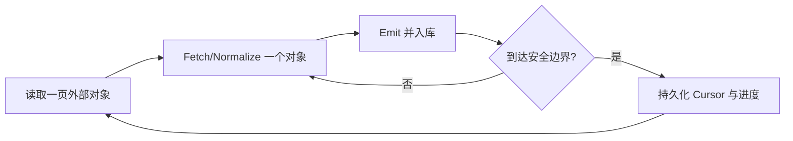
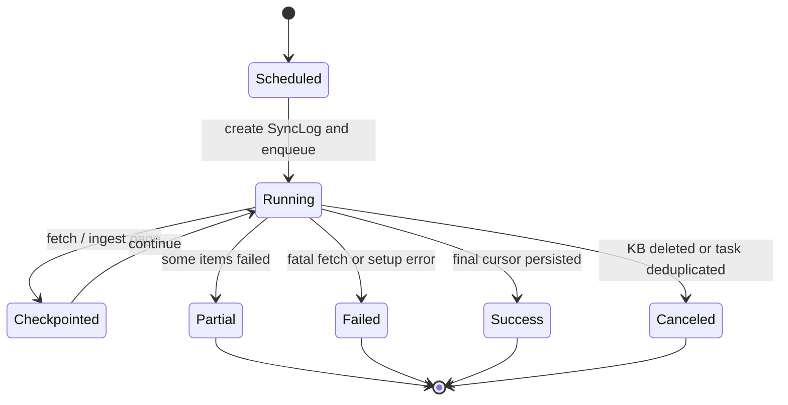

# 第 21 章　外部数据源与持续同步

[返回全书目录](../README.md) · [上一篇：知识图谱和 Wiki 生成](03-knowledge-graph-wiki-generation.md) · [下一篇：流式协议、会话和中断恢复](../05-engineering/01-stream-session-interruption-recovery.md)

## 本章要解决的问题

前面的入库章节大多从“用户上传一份文件”开始。但企业知识很少静止在上传页面里，它持续存在于飞书、Notion、语雀、GitLab、RSS 和其他业务系统中：

- 文档会新增、修改、移动、重命名和删除；
- API 会分页、限流、超时，也可能只返回一棵不完整的目录树；
- 同一次同步可能处理几万份对象，不能全部放进内存；
- 多个应用实例可能在同一分钟触发同一个定时任务；
- 同步中途崩溃后，既不能从头重复全部工作，也不能跳过尚未落库的数据；
- 用户修改同步范围或凭证后，旧数据是否应该被删除并没有天然答案。

因此，外部数据源并不是“再写几个调用第三方 API 的 Service”。它是一个小型的状态复制系统：不断比较外部世界与本地知识库，让两边在明确的安全策略下逐步收敛。

## 从一次导入到持续复制

一次性导入可以写成：

```text
下载 → 解析 → 入库
```

持续同步还要回答状态问题：

```text
上次已经成功处理到哪里？
这次哪些对象是新增、变化、未变或消失？
某个对象失败后，下次怎样只重试它？
这次看到的“缺失”是真删除，还是 API 只返回了部分结果？
```

可以把目标抽象成一个收敛函数：

```text
Local(t+1) = Reconcile(Local(t), ExternalSnapshot, Cursor, Policy)
```

这里的 `Policy` 很重要。外部删除是否传播、冲突时覆盖还是跳过、同步哪些目录，都不是第三方 API 能替你决定的。

### 同步不是数据库事务的远程版本

第三方系统与本地知识库通常不共享事务。你无法原子地完成“读飞书第 10 页、创建 20 条知识、推进游标”这三个动作。因此工程目标不是幻想 exactly-once，而是组合：

- 至少一次获取；
- 幂等写入；
- 保守推进游标；
- 可重复的删除判定；
- 可观测的部分成功；
- 最终收敛。

这与消息消费、CDC、Spring Batch 很相似，但外部 SaaS API 往往没有严格的变更日志，时间戳、分页令牌和目录快照都可能只是较弱的信号。

## 先建立四个核心对象

### Data Source：一份同步配置

Data Source 表示“从哪里、以什么凭证、选择什么范围、同步到哪个知识库”。它通常包含：

- 租户与目标知识库；
- Connector 类型；
- 加密凭证和非敏感设置；
- 选中的资源 ID；
- 全量/增量模式；
- Cron 调度；
- 删除与冲突策略；
- 上次成功时间、游标和结果摘要。

它不是一份文档，而是一条长期运行的复制关系。

### Resource：供用户选择的外部范围

Resource 是空间、文件夹、项目、页面等可同步范围。它需要稳定外部 ID，也可能具有 `ParentID` 与 `HasChildren`。资源选择器不应为了展示一棵大树而一次遍历整个外部系统，应支持按父节点懒加载。

当用户保存了一个深层页面，下次打开配置界面还需要直接展开到它。仅有 `ListResources(parentID)` 不够，还需要反向解析祖先路径，否则 UI 只能从根节点重新遍历。

### Fetched Item：Connector 与入库链之间的 IR

不同供应商的数据先投影成统一对象：

```text
FetchedItem
  external_id
  title
  content / url
  content_type / file_name
  updated_at
  source_resource_id
  metadata
  is_deleted
```

正文优先转为 Markdown，二进制文件也可以保留原 MIME 类型，再进入已有文档解析管线。这个中间表示隔离了“怎样从供应商取内容”和“怎样解析、切块、Embedding、索引”。

### Cursor：已经安全完成的进度证明

Cursor 不只是页码。它可能保存：

- 下一页令牌；
- 每个项目最后提交 SHA；
- 每个页面最后修改时间；
- 已扫描对象集合的摘要；
- 上次完整快照时间；
- Connector 自定义状态。

一个好定义是：

> Cursor 表示游标之前的外部变化已经产生了应用可以接受的持久效果；从这里恢复不会永久漏数据。

如果先推进 Cursor 再落库，崩溃会漏数据；如果永不推进，任务会反复重做。真正的难点是定义“持久效果”到底到哪一层完成。

## Connector 的职责边界

通用 Connector 通常需要五类能力：

```go
type Connector interface {
    Type() string
    Validate(ctx context.Context, config *DataSourceConfig) error
    ListResources(ctx context.Context, config *DataSourceConfig, parentID string) ([]Resource, error)
    ResolveResourceAncestors(ctx context.Context, config *DataSourceConfig, resourceIDs []string) ([]Resource, error)
    FetchAll(ctx context.Context, config *DataSourceConfig, resourceIDs []string) ([]FetchedItem, error)
    FetchIncremental(ctx context.Context, config *DataSourceConfig, cursor *SyncCursor) ([]FetchedItem, *SyncCursor, error)
}
```

它应该负责：

- 供应商认证、分页、限流与格式转换；
- 把外部身份映射为稳定 `external_id`；
- 判断供应商能够可靠表达的新增、修改、删除和重命名；
- 输出统一 `FetchedItem`；
- 构造下一次可恢复的 Cursor。

它不应复制知识库的解析、切块、Embedding 和索引逻辑。否则每增加一个数据源，就会产生一套质量行为不一致的入库系统。

## 稳定身份比标题和路径重要

假设页面从：

```text
/产品/旧方案.md
```

移动并重命名为：

```text
/架构/新方案.md
```

若以路径作为主键，同步器会看到“一次删除 + 一次新增”；若供应商提供稳定页面 ID，它只是同一对象的更新。稳定身份直接影响：

- 是否重复创建知识；
- 引用和标签是否保留；
- 更新能否替换旧版本；
- 删除是否找得到正确对象；
- 附件子项能否归属于同一父文档。

最佳选择通常是供应商不可变 ID。若只能自己计算指纹，应明确它在重命名、内容相同和路径移动时的语义，不能把内容 Hash、路径和对象身份混为一谈。

## 全量与增量不是互斥的两套系统

### 全量同步

全量同步重新扫描选定范围，适合：

- 首次导入；
- Cursor 损坏或 Schema 变化；
- 增量 API 丢失历史；
- 用户主动修复本地状态；
- 定期校准长期漂移。

“全量”不一定表示无脑重建全部知识。扫描可以是全量的，写入仍可用身份、时间戳或内容 Hash 跳过未变化对象。

### 增量同步

增量同步只获取上次 Cursor 之后的变化，成本低、延迟小，但依赖供应商信号：

- 更新时间可能精度不足；
- 比较提交可能遇到历史改写；
- Feed 只保留最近若干条目；
- 分页期间外部集合还在变化；
- 某些 API 没有删除事件。

成熟系统常采用“增量为主、周期性全量校准”的组合，而不是相信一个时间戳永远正确。

## 大规模同步为什么需要流式 Connector

批量接口先返回 `[]FetchedItem`，再开始入库。它很容易实现，却有两个问题：

1. 一万份文档的正文同时留在内存中；
2. 第 9999 份之后超时，下一次可能从头再来。

更稳妥的接口把获取、入库和检查点交错进行：

```go
type StreamingConnector interface {
    FetchStream(ctx context.Context, config *DataSourceConfig,
        cursor *SyncCursor, handler StreamHandler) (*SyncCursor, error)
}

type StreamHandler interface {
    Emit(ctx context.Context, item FetchedItem) error
    Checkpoint(ctx context.Context, cursor *SyncCursor) error
}
```



内存上限从“全部内容”降为“一个对象或一页”，超时重试也能从最近检查点继续。

### Checkpoint 必须对应完整快照

不要把正在原地修改的 Map 直接交给异步持久层。Checkpoint 应是不可变快照；分页边界、项目边界或固定对象数通常比“每读到一个字节”更合理。

还要分别考虑两类失败：

- **抓取失败**：外部内容尚未取得，不应把该对象标记为已同步；
- **入库失败**：内容已取得，但解析、存储或索引失败，Cursor 是否推进取决于你把哪一层定义为同步成功。

后者最容易被一句“失败不推进游标”掩盖。系统必须让 Connector 失败与下游入库失败拥有可区分的状态和修复路径。

## 删除是同步中最危险的判断

### 删除事件与“没有看见”不是一回事

可靠的删除来源包括：

- 供应商变更日志中的 tombstone；
- Git 比较结果中的 deleted/renamed old path；
- 一次完整、成功快照与上一完整快照的集合差。

一次分页失败、权限缩小、目录 API 部分返回或用户更改同步范围，都可能让对象暂时“没有看见”。如果直接把缺失解释成删除，就会放大第三方故障。

安全规则可以写成：

```text
只有当本轮枚举被证明完整时，absence 才可以参与删除判定。
```

### 重命名有两种语义

- 外部对象 ID 稳定：作为 update；
- 以路径为身份或 Git 文件：删除旧身份，再新增新身份。

两者都合理，关键是 Connector 的 `external_id` 约定必须与删除逻辑一致。

### 同步范围缩小不必自动删除

用户取消选中一个文件夹，可能表示“不再更新”，也可能表示“连本地副本一起清除”。产品应把这两个动作分开，尤其当知识已被人工编辑、引用或生成派生 Wiki 时。

## WeKnora 的具体选择

### 统一接口与实际注册范围

[`connector.go`](../../internal/datasource/connector.go) 定义 `Connector`、可选的 `StreamingConnector`、`StreamHandler` 和注册表。当前容器实际注册：

- 飞书 Wiki、Lark Wiki；
- 飞书云盘、Lark Drive；
- Notion、语雀、IMA、RSS、GitLab。

类型常量和前端元数据中还可以看到 Confluence、GitHub 等名字，但“出现在类型/能力清单”不等于“运行时已经注册”。判断可用能力应以 [`initConnectorRegistry`](../../internal/container/container.go) 的装配为准。

### DataSource、FetchedItem 与 Cursor

[`datasource.go`](../../internal/types/datasource.go) 保存数据源、同步日志和统一对象：

- `DataSource.Config` 中的字符串凭证可用 AES-256-GCM 加密；
- API Response 通过 DTO 排除凭证；
- `Resource` 支持层级与懒加载；
- `FetchedItem.ExternalID` 用于查找已有 Knowledge；
- `SyncCursor.ConnectorCursor` 允许每种 Connector 保存自定义状态；
- `SyncResult` 区分 created、updated、deleted、skipped、failed，并只保留有限错误样本。

同步时多模态开关来自目标知识库，只在本轮注入 Connector，不被重复持久化。这样内嵌图片是否提取由知识库能力决定。

### 更新目前采用“删除旧 Knowledge，再重新创建”

[`DataSourceService.ingestItem`](../../internal/application/service/datasource_service.go) 按 `external_id` 查找已有 Knowledge。存在时先删除，再通过文件或 URL 进入统一知识入库管线。

优点是复用成熟解析链，不必实现复杂的原地 Chunk Diff；代价是更新可能触发重新解析、重新 Embedding 和短暂可见性变化。若删除旧项成功而创建新项失败，还需要同步日志与修复操作帮助恢复。

### 流式同步与恢复点

实现 `StreamingConnector` 的数据源走 `processSyncStreaming`：

1. `Emit` 到达时立即调用统一入库逻辑；
2. `Checkpoint` 持久化 Cursor 和实时计数；
3. 首次强制全量会丢弃旧 Cursor；
4. 强制全量的 Asynq 重试仍从最新检查点恢复；
5. 最终写入成功、部分成功或失败的 Sync Log。

飞书 Wiki 与 Drive 共用 [`engine.go`](../../internal/datasource/connector/feishu/core/engine.go) 的泛型同步引擎。节点内容抓取失败时保留旧 edit time，使下次仍会重试；目录只部分枚举时会携带旧状态，也不会据此发出删除事件。

这里要精确区分：当前引擎对“外部抓取失败”不推进该节点状态；而 `Emit` 内发生的单项入库错误会被计数但不会向 Connector 返回错误。因此成功抓取但入库失败的对象，可能已经进入新 Cursor，后续需要强制全量或专门修复。阅读注释时应以实际错误传播路径为准。

### 两个具体 Connector 展示了不同变化模型

GitLab Connector 使用每项目提交 SHA：

- 首次遍历选定项目树；
- HEAD 变化时比较 commits；
- 删除文件发 tombstone；
- 重命名发“删除旧路径 + 新增新路径”；
- 比较超时或历史改写时回退到范围全量枚举；
- 每个项目完成后 Checkpoint。

RSS 没有可靠的远程删除语义：旧条目从 Feed 窗口消失不等于文章被删除。因此它用条目指纹判断变化，抓正文失败时退回 Feed 内容，并刻意不发删除事件。不同数据源不能被强行塞进同一个“更新时间 + 删除”假设。

### 删除策略是保守的

普通 `FetchedItem.IsDeleted` 目前在 `applyFetchedItem` 中只增加删除计数，并不实际删除知识。源码明确把知识移除留给用户，避免 Connector 误判或范围重配导致数据丢失。

另一方面，飞书文档内展开的附件/图片使用 `parent#kind#token` 身份和 `ReplacesSubtree/SubtreeKeep` 契约。父文档成功重建时，可以精确清扫这个父节点下已经消失的子项。这是一种范围更小、证据更强的删除收敛。

因此 UI 中的 `SyncDeletions` 与 `ItemsDeleted` 不能简单理解为“源端删除已经从知识库物理清除”。指标语义必须与实际副作用对齐。

### 多实例定时调度

[`scheduler.go`](../../internal/datasource/scheduler.go) 使用带秒的 Cron。多个实例会在同一墙上时间触发，因此有两层去重：

1. 数据库 `HasRunningSync` 阻止上一轮尚未结束时重叠执行；
2. 确定性 Asynq Task ID `dssync:<dataSourceID>:<minute>` 让 Redis 只接受一个入队任务。

同步任务最多重试 5 次，任务超时为 2 小时。第一层解决同一数据源的重叠，第二层解决多实例同时入队；两者解决的问题不同。

## 一次同步的状态机



“Partial”不是一个可有可无的 UI 标签。若一千份成功、十份失败，却只记录 Success，运营者会错误地相信本地已经收敛。

## 凭证、网络与租户边界

Connector 会让服务器代表用户访问外部网络，因此安全面比普通文件上传更大：

1. **凭证静态保护**：加密存储，API 不回显，日志不打印；
2. **验证与保存分离**：允许测试连通性，但不能在失败响应中泄露上游 body/token；
3. **租户绑定**：Data Source、Sync Log、目标 KB 和任务 Payload 都带租户；
4. **最小权限**：外部 Token 只授予选定资源所需的读取权限；
5. **SSRF 与重定向**：自定义 URL、Feed 和下载地址需要校验实际拨号目标；
6. **速率限制**：尊重 `Retry-After`，使用退避和抖动，避免所有实例同步放大流量；
7. **凭证轮换**：解密失败或过期应呈现为“需要重新配置”，不能把密文交给供应商。

## 如何观测持续同步

至少需要四组信号：

### 运行结果

- 总数、新增、更新、跳过、删除信号、失败数；
- full / incremental / scheduled / manual；
- 成功、部分成功、失败、取消；
- 错误样本与完整错误计数分离。

### 时效性

- 距离上次成功多久；
- 外部 `updated_at` 到本地可检索的延迟；
- 当前 Cursor 落后程度；
- 长时间 Running 和长期无进展。

### 性能

- List、Fetch、Parse、Ingest 各阶段耗时；
- 每页/每项目吞吐；
- 限流与重试次数；
- 峰值内存和对象大小。

### 收敛质量

- 同一 `external_id` 重复数；
- 本地孤儿子项；
- 多轮仍反复更新的对象；
- 强制全量后修复的漂移数量；
- 抓取成功但入库失败后未再重试的对象。

## 与 Java / Web 开发的对应关系

| AI 数据同步概念 | Java / Web 中熟悉的类比 | 关键差异 |
|---|---|---|
| Connector | Adapter / Anti-Corruption Layer | 还要表达变化、Cursor 和删除可信度 |
| Fetch → Ingest | Spring Batch Reader → Processor → Writer | Writer 后面还有解析、Embedding、索引 |
| Sync Cursor | Kafka offset / CDC LSN / 分页令牌 | SaaS Cursor 往往更弱、且为 Connector 私有 |
| FetchedItem | DTO / Canonical Event | 同时是外部内容进入 AI 入库链的 IR |
| Checkpoint | Batch restart point | 必须与外部快照和本地副作用共同定义 |
| Tombstone | 软删除事件 | “没看到”不能自动等于 tombstone |
| Full reconciliation | 定时校准任务 | 既校准增量遗漏，也可能消耗大量模型/Embedding 成本 |
| Sync Log | JobExecution / StepExecution | 必须呈现部分成功与 AI 加工后置状态 |

如果你熟悉 Spring Batch，可以把 Connector 看作带外部状态语义的 `ItemReader`，`DataSourceService` 是编排和 Writer，而知识入库管线是一个更长的异步 Processor 链。不要把整个同步事务想成一个带 `@Transactional` 的方法。

## 设计取舍与可演进方向

### 删除安全与自动收敛

当前普通删除只计数，最大化防误删，但会留下源端已经删除的知识。可演进为：

- 默认进入“待删除”隔离区；
- 展示删除证据与来源；
- 延迟若干天后自动清理；
- 人工修改过的知识永不自动删；
- 只有完整快照或强 tombstone 才允许自动传播。

### 删除重建与原地更新

删除再创建简单且行为统一，但成本高、失败窗口明显。原地更新可以保留 ID 与引用，却需要 Chunk Diff、索引版本和回滚策略。是否值得取决于文档规模、更新频率和引用稳定性需求。

### Cursor 与下游完成度

如果目标是“已创建 Knowledge 即算同步”，当前检查点粒度可以接受；若目标是“已经可检索”，还需等待解析和索引完成，或者增加第二套 ingest cursor / repair queue。一个 Cursor 很难同时表达抓取、持久化、解析、索引四层完成度。

### Pull 与 Push

Cron 拉取简单、统一，但有延迟和 API 成本。Webhook 可以更实时，却要处理签名、乱序、重复、丢事件与补偿全量。常见组合是 Webhook 提醒增量同步，Cron 负责兜底校准。

## 推荐的源码阅读顺序

1. [`internal/types/datasource.go`](../../internal/types/datasource.go)：先掌握 DataSource、Resource、FetchedItem、Cursor 与 SyncLog。
2. [`internal/datasource/connector.go`](../../internal/datasource/connector.go)：看批量/流式接口和注册表边界。
3. [`internal/container/container.go`](../../internal/container/container.go)：搜索 `initConnectorRegistry`，确认真正注册的 Connector。
4. [`internal/application/service/datasource_service.go`](../../internal/application/service/datasource_service.go)：跟踪 `ProcessSyncTask → processSyncStreaming → applyFetchedItem → ingestItem`。
5. [`internal/datasource/connector/feishu/core/engine.go`](../../internal/datasource/connector/feishu/core/engine.go)：看失败不推进抓取状态、部分枚举与删除判定。
6. [`internal/datasource/connector/gitlab/connector.go`](../../internal/datasource/connector/gitlab/connector.go)：看 commit cursor、rename/delete 与回退全量。
7. [`internal/datasource/connector/rss/connector.go`](../../internal/datasource/connector/rss/connector.go)：看没有可靠删除语义的数据源如何取舍。
8. [`internal/datasource/scheduler.go`](../../internal/datasource/scheduler.go)：最后看 Cron、运行中检查和多实例入队去重。

第一次阅读只选择飞书、GitLab、RSS 三种变化模型做对比，不要逐个阅读所有供应商客户端。

## 常见误区

1. **Connector 只是一个第三方 API Client。** Client 解决调用，Connector 还要定义身份、变化、游标和删除语义。
2. **增量同步就是按 `updated_at > last_sync_at` 查询。** 时间精度、时钟、分页并发和删除都会破坏这个假设。
3. **Fetch 成功就代表知识已可检索。** 后面还有持久化、解析、切块、Embedding 与索引。
4. **游标越早推进，性能越好。** 过早推进会把暂时失败变成永久遗漏。
5. **全量同步必须清空重建。** 全量扫描与全量重写是不同选择。
6. **本轮没看到就是删除。** 部分列表、权限变化和范围调整都可能造成假缺失。
7. **所有数据源都应该支持删除同步。** RSS 等来源没有足够可靠的删除证据。
8. **任务不重叠就不需要入队去重。** 多实例可能同时通过读检查，需要共享存储中的确定性 Task ID。
9. **把完整错误列表存进 Sync Log 最透明。** 数万失败会制造巨型 DB 行；准确计数与有界样本应分开。
10. **配置里出现某 Connector 名称就说明可用。** 还要检查运行时注册和凭证/依赖条件。

## 本章小结

- 外部数据源是持续状态复制，不是一次 HTTP 下载。
- Data Source、Resource、FetchedItem 与 Cursor 分别表示复制关系、范围、统一内容和恢复证明。
- 稳定 `external_id` 决定更新、重命名、删除和引用能否正确收敛。
- 全量用于首次构建和校准，增量用于低成本追踪变化，两者应共享同一身份与入库语义。
- Streaming Connector 交错 Fetch、Ingest 与 Checkpoint，使大同步内存有界并可恢复。
- 只有完整枚举或强 tombstone 才能可靠判定删除；范围缩小不天然等于删除本地知识。
- WeKnora 对飞书抓取失败保留旧节点状态，对部分枚举禁用删除判定，并用双层去重保护多实例调度。
- WeKnora 当前普通删除信号只计数，附件子树才执行精确清扫，这是保守安全与自动收敛之间的明确取舍。
- 抓取 Cursor、Knowledge 持久化、解析和索引是不同完成层，生产系统要分别观测。
- 连接器安全还包括凭证加密、租户绑定、SSRF、最小外部权限、限流和错误脱敏。

### 可选实践

选择一个你熟悉的业务系统，设计它的 `Resource`、`FetchedItem` 和 `SyncCursor`。至少模拟五个事件：新增、内容更新、重命名、删除、目录 API 部分失败。为每个事件写出外部身份、发出的 Item、Cursor 是否推进以及本地副作用。最后再模拟“抓取成功但 Embedding 失败”，判断你需要一个 Cursor、两个阶段状态，还是一条 repair queue。

