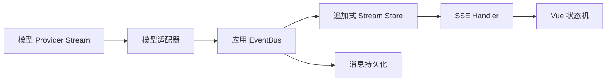
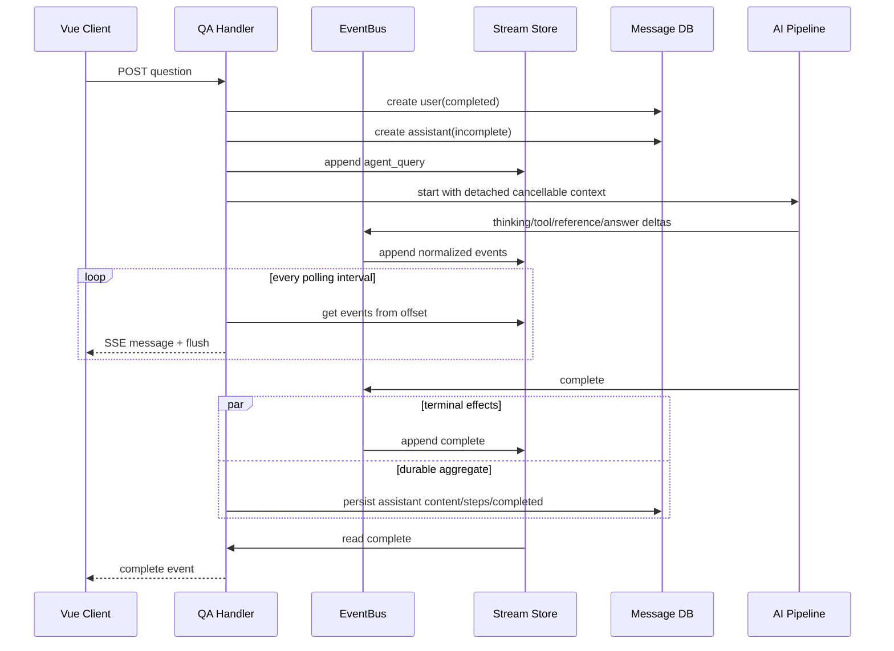
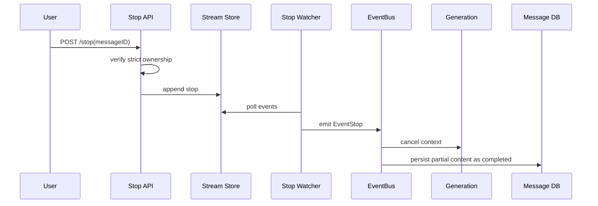

# 第 22 章　流式协议、会话和中断恢复

[返回全书目录](../README.md) · [上一篇：外部数据源与持续同步](../04-multimodal/04-external-data-source-sync.md)

## 本章要解决的问题

AI 聊天页面看起来只是“答案一个字一个字出现”，背后却同时存在计算、状态和连接问题：

- 模型的 token 增量怎样变成应用事件？
- 思考、工具调用、引用、答案和错误怎样共享一条流？
- 用户刷新页面后，已经产生的内容怎样重新显示？
- 浏览器断网是否应该停止模型和工具？
- 用户点击“停止”时，怎样真正取消后台任务，而不只是关掉页面动画？
- 多实例部署时，另一个实例怎样接着读同一条流？
- 进程崩溃后，事件回放与计算恢复有什么区别？
- 最终答案何时写数据库，重复完成事件怎样避免重复副作用？

这些问题不能只靠 `text/event-stream` 响应头解决。SSE 是传输方式，完整方案还需要事件协议、会话身份、追加式缓冲、取消信号、持久化边界与恢复策略。

## 先分清三种“流”

### 模型上游流

模型供应商返回 token、reasoning、tool call delta、usage 和 `[DONE]`。这是 Provider 协议，可能是 OpenAI 兼容 SSE，也可能是 SDK Channel 或本地模型回调。

### 应用内部事件流

应用把模型输出与检索、工具、审批、引用、标题等事件统一起来：

```text
thinking
tool_call
tool_result
references
answer
error
complete
```

这是业务协议。前端不应该直接理解每一家模型供应商的 chunk 格式。

### 浏览器下游 SSE

服务端把业务事件序列化为浏览器可消费的 SSE `message`。它负责连接、Flush、断线与重连，不负责定义工具调用或会话的业务语义。



把三层分开后，替换模型、增加工具事件或更换浏览器传输方式都不会同时改动整条链。

## 流式协议应该传事件，不只是字符串

只传 `{content: "字"}` 很快会遇到问题：前端不知道这段文本属于思考、最终答案还是工具结果，也不知道何时结束。

一个实用的事件信封至少包含：

```text
event_id       事件身份
response_type  业务类型
content        本次增量，不是累计全文
done           此子流是否结束
timestamp      产生时间
data           类型特有字段
```

其中 `data` 可以承载：

- `event_id` 与 duration；
- tool call ID、工具名、参数和结果；
- knowledge references；
- session ID 与 assistant message ID；
- artifacts；
- error stage；
- stop reason。

### `done` 与 `complete` 不同

一个答案事件可以由多个 delta 构成，最后用 `done=true` 关闭这个答案段；整个 Agent 还可能继续调用工具并产生新答案段。`complete` 才表示整个回合终止。

```text
answer(event=A, "我先查一下", done=false)
answer(event=A, "", done=true)
tool_call(...)
tool_result(...)
answer(event=B, "最终结论", done=false)
answer(event=B, "", done=true)
complete(...)
```

如果前端见到任何 `done=true` 就结束整轮，会提前关闭仍在运行的 Agent。

## 四类 ID 不要混用

### Session ID

会话容器，拥有多轮 user/assistant Message。它是授权、历史和沙箱生命周期的重要范围。

### Assistant Message ID

一次生成回合的稳定身份，也是流缓冲的分区键之一。刷新页面后，客户端通过它找到未完成消息并请求回放。

### Request ID

一次 HTTP/生成请求的追踪身份，用于日志、TTFB 和前端把早到事件绑定到占位消息。重试或续接可能使用新的 HTTP 请求，但仍指向同一个 Assistant Message。

### Event ID

某个思考段、答案段或工具事件的身份。多个 delta 可以共享同一个 Event ID，前端据此累计并去重。

把 Request ID 当消息主键，会让重连创建重复消息；把 Event ID 当 Session ID，则无法表达多轮历史。

## 一次流式回合的生命周期



关键顺序是先创建 `assistant(incomplete)`，再开始生成。这样即使连接中断，数据库中也有一个可定位的回合，而不是只剩一条无主的内存流。

普通 RAG 与 Agent 的终结 Handler 细节不同，`complete` 写入事件 Store 与最终 Message 更新也不应被假设为一个跨存储原子事务；恢复逻辑必须容忍其中一边先完成。

### 手工推演：断线后究竟恢复哪一段

设 `R1` 创建了 Assistant Message `M1`，并已依次写入 `E1=thinking`、`E2=reference`、`E3=answer("北京")`。浏览器在收到 `E2` 后断线；这不代表后端没有写入 `E3`。刷新页面产生的是新 HTTP Request `R2`，它应带着同一个 `M1` 和上次确认的 offset，从 Store 回放漏掉的 `E3`，再继续读取后续事件。

```text
R1: 创建 M1 ── 写 E1、E2、E3 ── 浏览器断线
R2: 读取 M1 从 offset=2 开始 ── 回放 E3、E4... ── 收到 complete
```

这里有两个不能混为一谈的“恢复”：**展示恢复**是新连接从已存事件继续渲染；**计算恢复**是模型、检索或工具在进程重启后继续执行。前者只需要事件仍在，后者需要可持久化的 Generation Job、检查点和可重入的工具调用。Store 中有旧事件，绝不证明上游模型此刻仍在运行；若生成进程已经死亡，系统应把 `M1` 标为可重试/失败，而不是让前端无限等待。

## 浏览器断线不等于用户取消

用户可能因为切换网络、刷新页面、合上笔记本或反向代理超时而断线。如果 HTTP Context 直接传进模型调用，任何断线都会取消已经执行了几十秒的检索和工具，用户重连只能从头再来。

另一种选择是让生成任务脱离连接生命周期：

```text
HTTP connection context ── controls only SSE writer
generation context      ── controls model/tools and explicit stop
```

这种设计允许断线续接，但也意味着：

- 后台工作仍会消耗 Token 与工具资源；
- 必须提供显式停止接口；
- 必须给孤儿任务设置最长生命周期；
- 任务完成后仍要持久化结果；
- 安全审计不能依赖浏览器连接是否存在。

两种策略都不是绝对正确。短小补全可以随连接取消；长 Agent 任务通常更适合连接独立，并由明确的任务状态控制。

## 回放缓冲：把生成者与连接解耦

生成者不应直接依赖当前 `http.ResponseWriter`。它先把事件追加到 Stream Store，SSE Handler 再按 offset 拉取：

```text
AppendEvent(sessionID, messageID, event)
GetEvents(sessionID, messageID, fromOffset)
    → events, nextOffset
```

这个模型带来三个好处：

1. 浏览器断线不会影响生产者；
2. 新连接可以回放已经产生的事件；
3. Redis 后端可让不同应用实例共享同一流。

### Offset 是消费位置，不是业务身份

Offset 表示“列表中读到第几个事件”，Event ID 表示“这是什么业务事件”。前者适合增量读取，后者适合前端累计和去重。若未来清理列表头部或切换到分区日志，还需要显式 Sequence / Resume Token，不能假设数组下标永久稳定。

## WeKnora 的流式分层

### 上游模型 SSE Reader

[`sse_reader.go`](../../internal/models/chat/sse_reader.go) 读取 OpenAI 兼容的 `data:` 行和 `data: [DONE]`，并把 Scanner 缓冲提高到 1 MiB，以容纳较长 reasoning 行。`event:`、`id:` 等上游字段会被跳过。

这只是 Provider 适配层。浏览器收到的并不是这个原始 JSON，而是后续统一的 `StreamResponse`。

### EventBus：请求内业务事件

[`event.go`](../../internal/event/event.go) 定义同步/异步 EventBus。每次 QA 请求创建独立 EventBus，因此 Handler 不必再用 Session ID 过滤其他请求事件。

Agent 与 RAG 流都可以发 `thought`、`references`、`final_answer`、`tool_call`、`tool_result`、`error` 和 `agent.complete`。`AgentStreamHandler` 把这些类型投影成前端协议。

EventBus 是进程内分发器，不是持久消息队列。真正用于断线回放的是 StreamManager。

### StreamManager：按会话与消息追加

[`stream_manager.go`](../../internal/types/interfaces/stream_manager.go) 只有 `AppendEvent` 与 `GetEvents` 两个方法，分区键是：

```text
sessionID + assistantMessageID
```

[`internal/stream`](../../internal/stream) 有两个实现：

- Memory：嵌套 Map + 事件 Slice，适合单实例；
- Redis：`RPUSH` 追加、`LRANGE offset -1` 回放，并刷新 TTL。

工厂默认使用 Memory；设置 `STREAM_MANAGER_TYPE=redis` 才启用 Redis。工厂当前传入 1 小时 TTL，因此回放窗口不是永久历史。

### AgentStreamHandler：统一事件协议

[`agent_stream_handler.go`](../../internal/handler/session/agent_stream_handler.go) 订阅请求 EventBus，并把每个增量追加到 StreamManager：

- thought → `thinking`；
- final answer → `answer`；
- tool call/result；
- references；
- approval/OAuth；
- title、error、complete。

答案按 Event ID 分段累计。某轮“先说一句再调用工具”的 preamble 可以标为 superseded，从最终持久答案中排除。若模型结束时有最终答案、却没正常发答案 delta，Handler 会补发 fallback answer 事件，避免数据库有内容而当前 UI 为空。

### 下游 SSE 是 Store 的轮询消费者

[`stream.go`](../../internal/handler/session/stream.go) 的主发送循环每 100 ms 从当前 offset 拉取事件，转成 `StreamResponse` 后 Flush。响应头包括：

```text
Content-Type: text/event-stream
Cache-Control: no-cache
Connection: keep-alive
X-Accel-Buffering: no
```

最后一个头防止 Nginx 把小块攒成大块，否则服务端在流式生成，用户却数秒后才看到一批内容。

前端 [`streame.ts`](../../frontend/src/api/chat/streame.ts) 使用 `fetchEventSource`，因为聊天创建需要 POST Body 和授权 Header，原生 `EventSource` 不适合这个请求形态。前端再由 [`useChatStreamHandler.ts`](../../frontend/src/composables/useChatStreamHandler.ts) 按事件类型维护 Vue 状态。

## ContinueStream 实际恢复了什么

重新进入会话时，前端发现最后一条 Assistant Message 的 `is_completed=false`，便调用：

```text
GET /sessions/continue-stream/{sessionID}?message_id={assistantMessageID}
```

服务端：

1. 验证 Session 可访问；
2. 通过 Message Service 验证消息属于该 Session/主体；
3. 从 offset 0 读取已有事件；
4. 若已经有 `complete`，回放后结束；
5. 否则继续每 100 ms 拉取新增事件。

它选择“从头回放”，而不是使用浏览器 `Last-Event-ID`。Agent 前端用 `event_id` 与事件 Map 累计相同段，历史未完成消息也会保留为响应式对象供回放补齐。

### 回放恢复不等于计算恢复

需要区分三层：

| 故障 | Memory Store | Redis Store | 还需要什么 |
|---|---|---|---|
| 浏览器断线/刷新 | 同实例可回放 | 任意实例可回放 | ContinueStream |
| 请求被负载均衡到另一实例 | 无法看到原流 | 可以看到共享事件 | Redis 与统一鉴权 |
| 生成实例进程崩溃 | 事件与计算都丢 | 已有事件仍在，计算已停 | 持久任务、Lease、Checkpoint |
| Redis TTL 到期 | 无回放 | 无回放 | 从 Message DB 读取最终历史 |
| 完成消息已经写 DB | 可从 DB 展示 | 可从 DB 展示 | Stream Store 不再是长期真相 |

Redis 解决“事件在哪里”，没有解决“谁继续执行模型和工具”。如果生产进程在写 `complete` 前崩溃，Redis 中可能保留半条流，但没有生产者继续追加。真正的计算恢复需要持久任务状态、Worker Lease、可重入步骤或至少一个超时终结器。

## 显式停止怎样穿过分布式边界

只在前端调用 `AbortController.abort()` 只会关闭客户端请求，并不必然停止后台生成。WeKnora 的 `/stop` 做了另一件事：

1. 校验 Message 属于 Session；
2. 使用严格 owner scope，租户管理员可读 API-Key 会话也不能随意中断外部调用；
3. 如果消息已完成，幂等返回成功；
4. 向共享 StreamManager 追加 `stop` 事件；
5. 独立 stop watcher 发现事件后向请求 EventBus 发 `EventStop`；
6. Stop Handler 调用 generation context 的 `cancel()`；
7. 使用 `context.WithoutCancel` 保存已经生成的部分内容，并把 Message 标为完成。



Stop watcher 与当前 SSE 连接独立，每 300 ms 检查事件，并在 complete、终态 error、stop 或 2 小时上限时退出。因此即使调用方先关闭 SSE，再发送 `/stop`，后台任务仍能收到取消。

### 取消是协作式的

Go `context.CancelFunc` 与 Java `Thread.interrupt()` 类似，只发出信号。模型 HTTP Client、工具、数据库循环和沙箱执行都要检查/传播 Context，取消才会及时生效。一个忽略 Context 的外部 SDK 仍可能运行到自己的超时。

## 消息持久化与完成边界

WeKnora 在开始生成前创建：

```text
user message       is_completed = true
assistant message  is_completed = false
```

生成期间答案和 Agent Step 在请求内累积，事件缓冲负责实时展示与回放；正常完成或停止时，再更新 Assistant Message 的 Content、References、AgentSteps、Artifacts 和 `is_completed=true`。

这形成两类存储：

- **Stream Store**：短期、追加式、面向实时与重连；
- **Message DB**：长期、聚合式、面向历史与后续上下文。

不要每个 token 都更新数据库：写放大、锁竞争和历史半状态会非常严重。但只在最后写也有崩溃丢失部分内容的窗口。长任务可以按时间或语义段定期保存草稿，而不是逐 token 落库。

### 完成必须是幂等边界

普通 RAG 完成 Handler 用 `completionHandled` 防止重复 `done` 触发重复完成；额外的 `sendCompletionEvent` 已经是 no-op，因为 `complete` 本身就是唯一的整轮终止信号。前端也会忽略已完成消息的空重复终止块。

真正需要幂等的不只是 UI 状态，还包括：

- Message 完成更新；
- 聊天历史索引；
- Follow-up Suggestions；
- Artifact 收集；
- Token/成本结算；
- 审计与通知。

只保护一个布尔变量不足以跨进程去重。重要副作用应使用 Message ID + operation type 作为幂等键。

## 顺序、重复与背压

### 顺序

当前 Memory Slice 与 Redis List 保留同一分区内的追加顺序。EventBus 默认同步执行 Handler，也降低了乱序概率。但工具可能并发执行，跨事件类型的业务顺序仍应靠 Event ID、Tool Call ID 和状态约束表达，不能只依赖到达时间。

### 重复

ContinueStream 从 offset 0 回放，因此客户端必须能重新构造状态或按 Event ID 去重。SSE 网络本身不提供业务 exactly-once。

### 背压

模型可能比浏览器渲染更快。WeKnora 的生成者只追加 Store，消费者每 100 ms 批量读取；前端也使用缓冲。这样解耦了瞬时速度，但当前接口没有显式流量窗口：

- Memory 事件列表没有 TTL 或数量上限；
- Redis 有 TTL，但一个巨大事件流仍可能占很多内存；
- `GetEvents(offset)` 会取回该 offset 之后的全部事件；
- 慢客户端写出大批事件时仍可能阻塞 Handler。

生产系统可以增加最大事件数/字节、批量上限、合并微小 token、心跳、客户端 lag 指标和过载降级。

## 错误也必须进入协议

HTTP 200 之后不能再可靠地改成 HTTP 500。SSE 建立后发生的模型、检索或工具错误必须成为 `error` 事件，并包含稳定 `stage/code`，原始敏感错误留在服务端日志。

至少区分：

- 连接建立前的鉴权/参数错误：普通 HTTP 4xx/5xx；
- 流内可恢复错误：事件提示并继续其他步骤；
- 流内终态错误：`error(done=true)`；
- 用户停止：`stop`，不是失败 toast；
- 浏览器断线：连接结束，但任务状态不自动变成 Failed。

WeKnora 在用户 stop 导致 Context cancellation 时不再额外发错误事件，避免前端同时显示“已停止”和“生成失败”。

## 安全边界

Continue 与 Stop 都是对象级操作，不能只验证调用者已经登录：

1. Session 必须属于当前可访问主体；
2. Message 必须属于该 Session；
3. Stream key 不能允许用户任意拼接读取其他租户事件；
4. Stop 使用的权限通常应比 Read 更严格；
5. 回放的工具参数、错误、引用 URL 和 Artifact 元数据必须脱敏；
6. Redis Prefix、TTL 与租户隔离不能替代 Service 层授权；
7. 公共/嵌入式聊天要有独立的 Visitor/Session 签名边界。

WeKnora 在发送事件时还会重写资源 URL；流尾可能暂存在 holdback buffer，遇到 complete、stop 或放弃 Store 时先 Flush，避免 Markdown 尾部引用被截断。

## 与 Java / Vue 开发的对应关系

| 流式 AI 概念 | Java / Web 类比 | 关键差异 |
|---|---|---|
| Provider token stream | WebClient `Flux<DataBuffer>` | 还要解析 reasoning、tool call 与供应商结束原因 |
| EventBus | Spring ApplicationEvent / Reactor Sink | 是请求内业务分发，不是耐久 Broker |
| StreamManager | Redis List / append-only log | 短期回放，不能自动恢复计算 |
| SSE Handler | WebFlux `Flux<ServerSentEvent<?>>` / `SseEmitter` | 传的是多类型 AI 事件协议 |
| generation context | CancellationToken / Reactor cancellation | 需要与 HTTP 连接生命周期刻意分离 |
| Assistant Message | Job/aggregate root | 同时承载历史、授权、流恢复与最终答案 |
| ContinueStream | 按 offset 重放消费 | 当前从 0 回放，不是原生 Last-Event-ID 续点 |
| Stop Event | 分布式 cancel command | 必须由正在执行的组件协作响应 |

在 Java 中实现相同设计时，可以用 WebFlux 承载下游 SSE，用独立 Executor/队列运行生成，用 Redis Stream/List 保存短期事件。不要让 Controller 返回的 Flux 成为生成任务唯一的所有者，否则客户端取消订阅会同时摧毁任务恢复能力。

## 一张恢复能力矩阵

设计前先明确产品承诺：

| 场景 | 期望状态 | 最小机制 |
|---|---|---|
| 短暂断网 | 回放后继续显示 | 追加式事件 Store + offset |
| 页面刷新 | 找到同一回合 | incomplete Message + message ID |
| 切换应用实例 | 继续显示 | 共享 Redis Store |
| 用户停止 | 保留部分答案并终止计算 | 分布式 stop + cooperative cancellation |
| 生成进程崩溃 | 明确失败或恢复执行 | Worker Lease + durable job/checkpoint |
| Store 过期 | 展示最终历史 | Message DB |
| 重复终止事件 | 不重复索引/结算 | 持久幂等键 |
| 永不终止的半条流 | 自动收口 | deadline / watchdog / terminal repair |

“支持断线续传”只覆盖前两三行，不能顺势宣称整个 Agent 可故障恢复。

## 可演进方向

### 使用 Sequence 与 Resume Token

为每个事件分配单调 Sequence，客户端提交最后已确认位置；服务端可从该位置继续，减少全量回放和前端去重压力。若底层会裁剪事件，还要让 Token 携带流版本与最小可读位置。

### 从轮询到阻塞读取/通知

100 ms 轮询简单可靠，但空闲连接持续访问 Store。Redis Streams `XREAD BLOCK`、Pub/Sub + 回放日志或进程内通知可以降低空轮询，同时仍需保留历史读取路径以防通知丢失。

### 持久 Generation Job

把运行状态从 Handler 内存提升为：

```text
queued → running(lease owner) → waiting_tool → cancel_requested
       → completed / failed / canceled
```

Worker 定期续租，失联后其他 Worker 可判定失败或从步骤 Checkpoint 恢复。对不可重放的写工具，仍需要幂等键和人工确认，不能简单重跑整个 Agent。

### 心跳与死信终结

SSE 心跳保持代理连接，也能帮助客户端判断静默。后台 watchdog 可以发现 Message 长期 incomplete 且没有活跃 Lease，把它标为 failed/canceled 并写终态事件，避免 ContinueStream 永久轮询。

### 分层持久化

短答案只在完成时落库；长答案每隔数秒或每个语义段保存 draft；工具步骤在执行前后分别记状态。持久化频率应由可接受的恢复损失决定，而不是越频繁越好。

## 推荐的源码阅读顺序

1. [`internal/types/interfaces/stream_manager.go`](../../internal/types/interfaces/stream_manager.go)：先看最小 append/get 接口与事件信封。
2. [`internal/stream/memory_manager.go`](../../internal/stream/memory_manager.go) 与 [`redis_manager.go`](../../internal/stream/redis_manager.go)：比较单实例和共享回放。
3. [`internal/handler/session/qa.go`](../../internal/handler/session/qa.go)：跟踪 incomplete Message、独立 generation context、异步 QA 与完成持久化。
4. [`internal/handler/session/agent_stream_handler.go`](../../internal/handler/session/agent_stream_handler.go)：看 EventBus 如何投影成前端协议。
5. [`internal/handler/session/stream.go`](../../internal/handler/session/stream.go)：看 SSE 消费、ContinueStream 和 StopSession。
6. [`internal/handler/session/helpers.go`](../../internal/handler/session/helpers.go)：看 SSE Headers、终止约定和独立 stop watcher。
7. [`frontend/src/api/chat/streame.ts`](../../frontend/src/api/chat/streame.ts)：看 fetchEventSource、AbortController 与请求追踪。
8. [`frontend/src/composables/useChatStreamHandler.ts`](../../frontend/src/composables/useChatStreamHandler.ts)：最后看多类型事件怎样归并成 Vue 消息状态。

第一次阅读只跟踪一个 `answer delta → append → poll → SSE → Vue → complete → DB` 回合，再分别注入“关闭浏览器连接”和“点击 Stop”。

## 常见误区

1. **SSE 就等于流式系统。** SSE 只是最后一段传输，前面还需要 Provider 适配、业务事件和回放状态。
2. **客户端 Abort 就会停止模型。** 若生成与 HTTP Context 解耦，Abort 只关闭连接。
3. **断线就应该取消任务。** 刷新和网络抖动不是用户明确的停止意图。
4. **Redis 中还有事件，所以任务可以恢复。** 事件回放与计算恢复是两套能力。
5. **看到 `done=true` 就结束整个 Agent。** 它可能只关闭一个思考/答案子段，整轮以 `complete` 为准。
6. **Request ID 可以充当 Message ID。** 重连是新请求，但应该继续同一消息。
7. **从 offset 0 重放不会重复。** 客户端必须重建状态或按 Event ID 去重。
8. **每个 token 都写数据库最安全。** 它会造成写放大，仍不能替代幂等终结与任务 Lease。
9. **Context cancel 能强制终止任何工具。** 取消是协作式的，底层调用必须响应 Context。
10. **HTTP 200 后还能返回 500。** 流建立后的失败必须进入事件协议。
11. **只要 Session 存在就能 Continue/Stop。** 还必须验证消息归属、租户和操作权限。
12. **完成事件重复只影响动画。** 它可能重复触发索引、结算、Artifact 和通知等副作用。

## 本章小结

- 模型上游流、应用业务事件流和浏览器 SSE 是三个不同层次。
- 流协议需要事件类型、Event ID、增量内容、子段 Done 与整轮 Complete。
- Session、Assistant Message、Request 和 Event 各有独立身份与生命周期。
- 先持久化 incomplete Assistant Message，才能在刷新后定位同一生成回合。
- StreamManager 用追加式事件把生成者与 SSE 连接解耦；Memory 适合单实例，Redis 支持跨实例短期回放。
- WeKnora 的生成 Context 脱离浏览器连接，断线不会自动停止后台任务。
- ContinueStream 从 offset 0 回放并继续轮询；它恢复展示，不自动恢复崩溃的计算。
- `/stop` 通过共享事件和独立 watcher 转成 Context cancellation，并持久化部分答案。
- Stream Store 是短期实时状态，Message DB 是长期聚合状态；两者不能互相替代。
- 终止、索引、结算和产物处理都需要幂等，慢消费者还需要背压与容量边界。
- 真正的进程故障恢复需要持久任务、Lease、Checkpoint、watchdog 和工具幂等。

### 可选实践

画一条包含 `thinking → tool_call → tool_result → answer → complete` 的事件序列，为每个事件填写 Session ID、Message ID、Request ID、Event ID、offset 和 done。然后分别在“第一个 answer 后断网”“tool_call 执行时点 Stop”“写 complete 前进程崩溃”三个位置切断流程，写出 Memory、Redis 和 Message DB 各自还保留什么，以及恢复展示和恢复计算分别缺少什么机制。

下一篇：[异步任务、队列与 Worker 池](02-async-task-queue-worker-pool.md)
