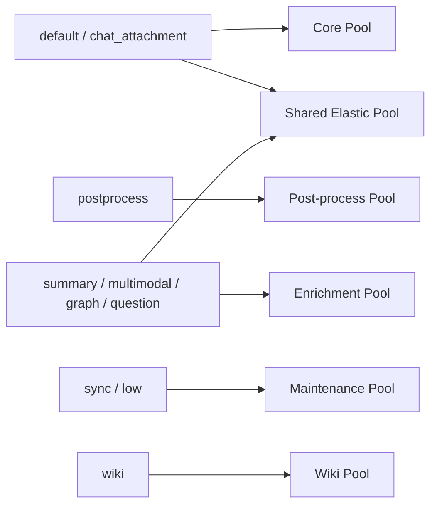
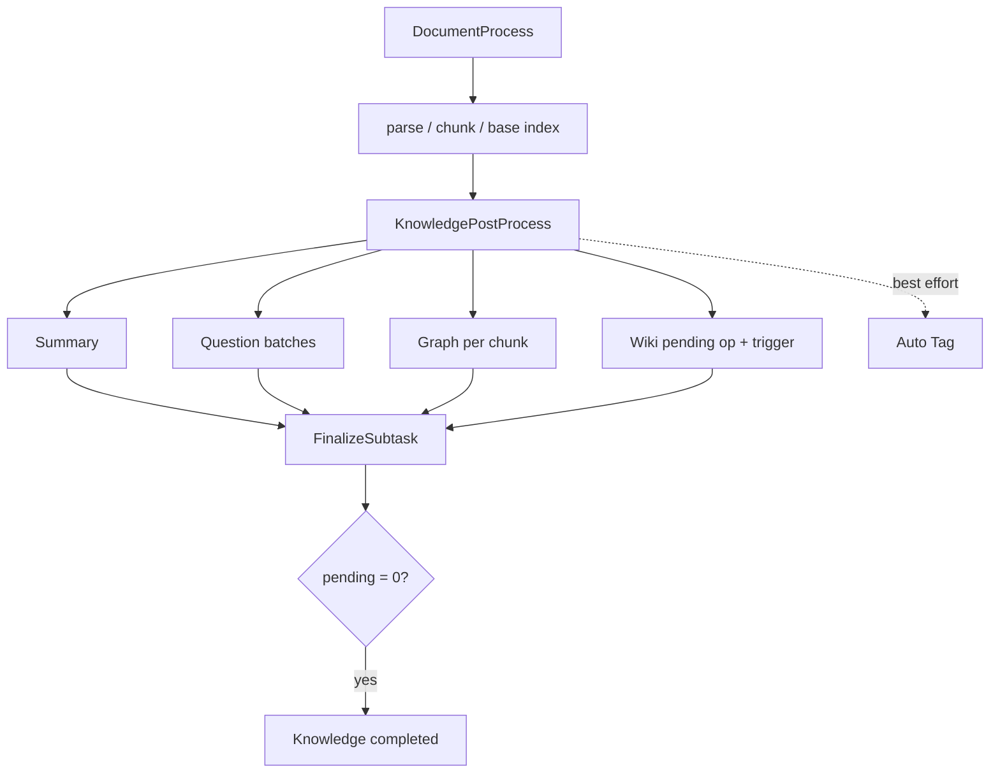

# 第 23 章　异步任务、队列与 Worker 池

[返回全书目录](../README.md) · [上一篇：流式协议、会话和中断恢复](01-stream-session-interruption-recovery.md) · [下一篇：多模型适配与依赖倒置](03-multi-model-adaptation-dependency-inversion.md)

## 本章要解决的问题

传统 Web 请求常希望在几百毫秒内完成一次数据库读写。但 AI 应用的后台工作可能持续数秒到数小时：

- 大文件要下载、解析、切块和建立索引；
- 一份文档会派生摘要、问题、图谱、图片 OCR/Caption 和 Wiki；
- 模型调用会限流、超时或暂时不可用；
- 批量删除和数据源同步不能长期占住 HTTP 连接；
- 服务重启后任务不能凭空消失；
- 用户取消或删除知识时，尚未执行的下游任务也应停止；
- 某类慢任务不能耗尽全部 Worker，让交互相关工作一直排队。

因此，生产级 AI 应用需要把“接受请求”和“执行重工作”分开，并明确任务身份、队列、并发、重试、取消、死信和业务状态之间的关系。

## 为什么 AI 管线天然适合异步化

同步 HTTP 调用适合：

- 参数校验；
- 权限检查；
- 创建业务记录；
- 返回任务或知识 ID；
- 小而可预测的计算。

异步任务适合：

- 耗时长且波动大；
- 可以稍后完成；
- 需要重试；
- 会 fan-out 成多个子任务；
- 依赖外部模型、对象存储或解析服务；
- 需要独立扩缩容和容量隔离。

典型请求边界是：

```text
HTTP Request
  → validate / authorize
  → create Knowledge(status=processing)
  → enqueue DocumentProcess
  → return Knowledge ID
```

用户看到“已接受”，不等于知识已经可检索。API、数据库状态和前端必须诚实表达 queued、processing、finalizing、completed、failed、cancelled 等阶段。

## 队列不是把函数放到另一个线程

一个可靠任务至少要回答：

```text
type        谁来处理
payload     处理哪个业务对象
queue       进入哪条调度车道
task id     怎样去重和追踪
timeout     单次最多运行多久
max retry   失败后最多再试几次
schedule    立即还是延迟执行
trace       怎样接回上游调用链
tenant      以哪个租户权限运行
attempt     属于业务对象的哪次处理尝试
```

队列保存“将来要做什么”，Handler 决定“怎样做”。如果 Payload 直接塞进整份 PDF、几千个 Chunk 或临时凭证，消息会巨大、陈旧且难以保护。更常见的做法是只携带稳定 ID 和必要快照，Worker 运行时重新读取当前业务数据。

## 三层容量控制不能混为一谈

### 队列权重

同一个 Worker Pool 订阅多条 Queue 时，权重决定更常从哪条队列取任务。它表达调度偏好，不是严格 SLA，也不限制外部资源并发。

### Worker 并发

Worker Pool 的 concurrency 决定一个实例同时执行多少个 Handler。它是应用侧 admission budget。

### 下游配额

模型、DocReader、向量库、对象存储、数据库连接池各有独立容量。32 个 Worker 不代表模型允许 32 个并发调用，也不代表 DocReader 有足够 CPU。

```text
Queue backlog
    ↓ scheduling weight
Worker admission
    ↓ pool concurrency
Provider / DB / DocReader admission
    ↓ quota, semaphore, connection pool
Actual execution
```

若模型并发限制为 4，把模型富化 Worker 从 12 增到 50，通常只会制造 46 个等待者和更多内存占用。

## Queue 与 Worker Pool 的区别

Queue 是 Redis 中的任务集合；Worker Pool 是一组只订阅特定 Queue、拥有独立并发预算的消费者。

只设置队列权重时，长任务仍可能占满同一个 Pool 的所有 Worker。要保证“文档解析至少始终有 8 个执行槽”，需要独立 Server/线程池，而不只是把 parse queue 权重调高。



Dedicated Pool 提供最低保障；Shared Pool 在 Core 或 Enrichment 有积压时借出弹性容量。

## WeKnora 的 Worker 拓扑

[`internal/types/task.go`](../../internal/types/task.go) 是队列拓扑的单一事实来源。当前每个服务实例默认：

| Worker Pool | 并发 | Queue | 主要任务 |
|---|---:|---|---|
| Core | 8 | `default`, `chat_attachment` | 文档解析、手动重解析、聊天临时附件 |
| Post-process | 2 | `postprocess` | 解析完成后的轻量 fan-out 编排 |
| Enrichment | 12 | `summary`, `multimodal`, `graph`, `question` | 模型密集型富化 |
| Maintenance | 4 | `sync`, `low` | 数据源同步、批量操作、删除清理 |
| Shared | 6 | Core 与 Enrichment 的部分 Queue | 两侧共享的弹性容量 |
| Wiki | 8 | `wiki` | 独立 Wiki 生成与 Finalize |

上游五个 Pool 总计 32 个 Worker，Wiki 另计 8 个。`chat_attachment` 在 Core 中权重高于普通 `default`，避免大批知识导入让交互上传一直等待。

Post-process 单独隔离，是因为它自身很轻，却负责派生所有后续工作。若它排在长时间 DocReader 任务后面，文档已经解析完仍会长时间停在“等待富化”。Maintenance 不进入 Shared Pool，避免两小时的数据源同步占住原本为用户管线准备的弹性槽位。

### 物理 Queue 名称也是兼容契约

Maintenance 常量在业务上叫 `QueueMaintenance`，实际 Redis 名仍是 `low`，以便滚动升级时新版本继续消费旧版本已入队任务。重命名代码常量容易，重命名队列中的在途数据则需要迁移策略。

## 一份文档怎样 fan-out 和 fan-in

WeKnora 的主链不是一个巨型 Task，而是阶段化任务图：



### 为什么拆任务

- 每类工作拥有独立并发与超时；
- 单个 Chunk 图抽取失败可独立重试；
- 用户取消时可以删除尚未运行的后续任务；
- Trace 可以显示每个阶段；
- 扩容 Enrichment 不必同步扩大文档解析；
- 某个可选富化失败不一定否定基础入库。

### Fan-out 不能无限细

一份 5000 Chunk 文档如果每个 Chunk 发一个问题生成任务，会制造数千条消息和数据库更新。WeKnora 将问题生成按 20 个文本 Chunk 分批：保留独立重试粒度，又把任务数量控制在约 250 个。Graph 仍按文本类 Chunk fan-out，因为抽取语义和失败隔离不同。

任务粒度要平衡：

```text
太粗：失败重做多、并发不足、取消迟钝
太细：调度开销大、消息爆炸、状态汇总复杂
```

## Fan-in：谁来宣布整份知识完成

子任务并发完成时，不能让任何一个 Worker 直接把 Knowledge 标为 completed。否则最先完成的摘要可能覆盖仍在运行的图谱状态。

WeKnora 的 [`KnowledgePostProcessService`](../../internal/application/service/knowledge_post_process.go) 先计算预期子任务数，再用条件更新把业务状态从 `processing` 转成 `finalizing`，并写入 `pending_subtasks_count`。每个拥有计数槽位的子任务在终态调用 `FinalizeSubtask`：

1. 原子地把计数减一，且不允许低于零；
2. 每个调用者都尝试执行带条件的 promote；
3. 只有满足 `status=finalizing AND pending=0` 的一个调用者能把状态改成 completed。

这里不能先 `SELECT count` 再决定是否更新。读副本延迟或并发快照可能让所有 Worker 都看到旧值，最终没有任何人完成 promote。正确性依赖主库上的条件写，而不是一次可能陈旧的读。

### 先计数再入队也有失败窗口

如果预先写入 10 个槽位，实际只成功入队 8 个，剩余两个永远无人释放。WeKnora 会比较 planned 与 actual enqueue 数量，主动释放 shortfall 槽位。Wiki 更进一步：进入 finalizing 与写入 durable pending op 在同一数据库事务完成，避免业务状态已经等待 Wiki、但 Wiki 操作根本没保存。

Auto Tag 被定义为 best effort，不拥有 finalizing 槽位；分类失败不应让基础文档永远无法完成。哪些子任务参与父状态，是产品语义，不是统一技术规则。

## Retry：重新执行，不是自动正确

重试适合：

- 网络瞬断；
- 供应商 429/5xx；
- 临时锁冲突；
- 短暂数据库连接失败；
- 可重复的读操作。

不适合直接重试：

- 参数永久错误；
- 模型不存在或无权限；
- Payload Schema 不兼容；
- 已执行但响应丢失的非幂等外部写；
- 内容过大且每次都会超限。

Asynq 默认使用退避。WeKnora 对 Wiki 并发锁冲突单独使用 15 秒固定延迟，因为锁 TTL 的恢复窗口已知，指数退避反而会让可恢复任务多等数分钟。

每种任务还应单独设置 `MaxRetry` 与 `Timeout`。例如文档处理默认重试 3 次，超时来自文档处理配置；Summary 与 Question 使用自己的 30 分钟上限；数据源同步可达到 2 小时。用一个全局 30 秒超时无法覆盖这些工作形态。

### Attempt 与 Retry 不同

- Retry：同一次业务处理尝试的第 N 次投递；
- Attempt：用户重新解析或重新发起后的一轮新业务版本。

Asynq Retry 应保留同一个 Attempt。旧 Attempt 的延迟任务到达时，要检查自己是否已经被新 Attempt 淘汰，不能覆盖新结果。这个规则类似乐观锁版本号。

## 幂等性必须在 Handler 内成立

队列系统通常提供至少一次执行：Worker 可能已经完成副作用，却在 ACK 前崩溃，于是任务再次投递。

常用幂等手段：

- Task ID 去重入队；
- 业务唯一键，如 `(knowledge_id, attempt, stage)`；
- UPSERT 而不是无条件 INSERT；
- 状态机条件更新；
- 外部写入使用 idempotency key；
- 子任务完成计数只能扣减一次；
- 删除操作设计成重复删除也成功；
- 运行前检查对象是否已取消、删除或被新版本淘汰。

确定性 Task ID 主要抑制重复入队，不能证明 Handler exactly-once。Task ID 过期、归档清理或 ACK 丢失后仍可能重复执行。

### 手工推演：Worker 在“已写入”与 ACK 之间崩溃

文档 `K9` 的第 3 次解析（`attempt=3`）拆出 Chunk `C1...C80`。Worker 已把 `C1...C50` 以 `(knowledge_id=K9, attempt=3, chunk_no)` 写入索引，却在向队列 ACK 前崩溃。队列不知道前半段已经成功，按至少一次语义把同一任务再投递一次。

正确的第二次执行不是“相信不会重复”，而是：先确认 `K9` 没有被删除且 `attempt=3` 仍是当前版本；每个 Chunk 按业务唯一键 UPSERT；完成计数只把首次从 pending 变为 done 的 Chunk 计入。这样重跑的可观察效果是 80 个有效 Chunk，而不是 130 个重复索引。若此时用户发起 `attempt=4`，旧任务应安静退出，绝不能把第 3 次的完成状态覆盖到新版上。

这也说明业务状态与队列状态不同：队列的 ACK 表示“这次投递已处理”，Knowledge 的状态表示“哪一个版本的文档已完成”。后者必须由 Handler 和数据库约束维护。

## 取消不是从 Queue 删除一条记录那么简单

业务对象删除时，相关任务可能处于：

- pending；
- scheduled；
- retry；
- active；
- 已经派生出新的下游任务；
- archived/completed。

WeKnora 的 [`task_inspector.go`](../../internal/router/task_inspector.go) 会：

1. 删除 pending、scheduled、retry 中匹配 Knowledge/KB 的任务；
2. 对 active Task 调用 `CancelProcessing`；
3. 等待 active 退出；
4. 删除因 `context.Canceled` 又转入 retry 的记录；
5. 再扫一次，捕获取消过程中刚产生的下游任务；
6. 保留 archived/completed 供运营审计。

Active Handler 仍必须传播 Context，长循环和外部调用才会及时终止。即使 Inspector 漏掉竞态任务，Handler 开始时也应检查 Knowledge 状态，形成“队列清理 + 业务状态防线”两层保护。

某些 KB 删除/索引清理任务携带删除所需快照，即使 KB 已软删除也必须继续执行；取消匹配逻辑会刻意保留它们。不能看到 `knowledge_base_id` 就一律删任务。

## Dead Letter：重试预算耗尽以后

任务最终失败若只写日志，会产生两个问题：

- 用户界面一直显示 processing；
- 运营者无法按租户、对象或任务类型查询失败。

[`TaskDeadLetter`](../../internal/types/task_dead_letter.go) 保存：

- tenant、task type；
- logical scope 与 scope ID；
- related object；
- 原始 Payload；
- 最后错误与尝试次数；
- 失败时间。

Asynq 中间件统一捕获耗尽 Retry 的任务。对于会决定基础解析结果的 DocumentProcess、KnowledgePostProcess、ManualProcess，回调还会把 Knowledge 标成 failed，并关闭相应 Trace；单张图片或可选问题生成的死信则不应一概破坏已完成的基础知识。

Dead Letter 不是垃圾桶。它需要：

- 检索与聚合；
- 重新运行或放弃操作；
- 错误分类；
- Payload 脱敏；
- 保留/清理策略；
- 修复后如何恢复业务状态。

WeKnora 的数据库 Dead Letter 当前无 TTL，直到人工清理；这保留审计证据，也意味着运营流程必须控制增长与敏感数据。

## Durable Pending Op：业务操作与触发消息分离

数据库提交和 Redis Enqueue 不能天然原子：

```text
DB commit 成功 → 进程崩溃 → Redis trigger 未发送
```

WeKnora 的 Wiki 使用 [`task_pending_ops`](../../internal/types/task_pending_op.go) 保存长期业务操作。按 `(task_type, scope, scope_id)` 形成逻辑队列，以 `dedup_key` 串行同一文档的 ingest/retract。Repository 的 `ClaimBatch` 用事务、claim timestamp，并在 PostgreSQL 上通过 `FOR UPDATE SKIP LOCKED` 让并发消费者获得不同 key 集合；过期 Claim 可以被重新接管。

Redis Task 在这里更像“请来检查数据库 pending ops”的触发器。即使触发丢失，业务操作仍在数据库中，可由重试或补偿任务再次唤醒。这接近 Transactional Outbox 思路，但具体触发与补偿仍需实现。

## 标准模式与 Lite 模式

### 标准模式

- Redis + Asynq；
- 多 Queue、独立 Worker Pool；
- 任务跨进程持久化；
- 多实例原子消费；
- Inspector、运行时统计、取消与归档；
- Redis 分布式模型并发治理。

### Lite 模式

[`SyncTaskExecutor`](../../internal/router/sync_task.go) 不把任务写 Redis，而是启动 Go goroutine：

- 支持延迟和 `MaxRetry` 的基本兼容；
- 重试采用线性增加、最高 30 秒的 backoff；
- 使用本地模型并发限制；
- 服务重启会丢失尚未完成的 goroutine；
- 没有真正的 Queue/Pool 隔离；
- Task Inspector 是 no-op，不能像 Asynq 一样撤销已启动 goroutine；
- 不适合把“可靠任务恢复”作为产品承诺。

Lite 的价值是降低单机体验和开发部署门槛，不是用进程内 goroutine 模拟完整消息系统。架构应让同一 Handler 能被两种 TaskEnqueuer 调用，同时明确能力等级不同。

## Worker 容量怎样估算

可用 Little's Law 的工程近似：

```text
required workers = ceil(peak arrival rate × mean runtime / target utilization)
```

若峰值每秒进入 2 个 Summary Task，平均运行 3 秒，希望利用率不超过 70%：

```text
ceil(2 × 3 / 0.70) = 9
```

但 arrival rate 要按 fan-out 之后计算。一份文档可能产生 1 个摘要、多个问题批次、每 Chunk 1 个 Graph Task、每图片 1 个多模态任务。只看“每秒上传多少文件”会严重低估 Enrichment 压力。

调整 Worker 前先看瓶颈：

```text
Queue oldest age 增长 + Worker 利用率高 + 下游有余量
    → 可以增加该 Pool

Model limiter waiting 增长 + Provider 已满
    → 不应继续增加 Worker

DocReader CPU/内存已满
    → 降低 Core admission 或扩 DocReader
```

## 可观测性

至少需要：

### Queue

- pending、active、scheduled、retry、archived；
- oldest pending age，而不只是数量；
- 今日 processed/failed；
- Redis memory；
- paused 状态。

### Worker

- 每实例配置 concurrency；
- 活跃 Server 心跳与实例数；
- 集群总 capacity、active 和 utilization；
- Pool/Queue 权重映射。

### Task

- type、ID、tenant、scope；
- enqueue/start/finish 时间；
- attempt、retry count、timeout；
- Trace/Span；
- 最后错误与 Dead Letter。

### 业务

- processing/finalizing 停留时间；
- pending_subtasks 是否长期不归零；
- 取消后仍产生的模型调用；
- 基础入库成功但可选富化失败比例；
- 每份文档实际 fan-out 数量。

队列长度为 100 不能单独说明故障：100 个 50 ms 任务和 100 个 30 分钟任务完全不同，oldest age 与任务运行时间更有意义。

## 与 Java / Spring 的对应关系

| WeKnora / 异步概念 | Java 生态类比 | 注意点 |
|---|---|---|
| Asynq Task | Spring Batch Job/Step、消息事件 | Task 是至少一次投递，不是普通方法调用 |
| Queue | RabbitMQ/Kafka/Redis 队列 | Queue 权重不等于消费者线程隔离 |
| Worker Pool | 独立 Listener Container / Executor | 并发应按工作类型与下游资源拆分 |
| ServeMux Handler | `@RabbitListener` / Job Step | Handler 必须幂等并恢复租户上下文 |
| Payload | Event DTO | 优先传 ID、版本和必要快照，不传大对象 |
| Retry | Spring Retry / Broker redelivery | 必须分类永久错误与瞬时错误 |
| Dead Letter | DLQ / failed JobExecution | 还要回写用户可见业务状态 |
| pending counter | `CountDownLatch` 的持久化版本 | 需要原子 decrement 与条件 promote |
| TaskPendingOp | Transactional Outbox / work table | Redis trigger 与 durable intent 分离 |
| Lite executor | `@Async` / local Executor | 不具备跨重启可靠性和分布式取消 |

如果你熟悉 Spring，最容易犯的错是把 `@Async` 当作消息队列。它只改变线程，不自动提供持久化、重投、跨实例消费、死信、Inspector 和业务恢复。

## 可演进方向

### 统一错误分类

让 Handler 返回 `retryable / permanent / canceled / superseded` 等稳定类别，而不是靠字符串判断。Retry Delay、告警、Dead Letter 与 UI 可以共享分类。

### Outbox 化关键入队

对“数据库状态已变，但任务绝不能丢”的路径，在同一事务写 Outbox，再由独立 Relay 投递 Redis，并记录 delivery ID。TaskPendingOp 已展示了这一方向。

### Fairness 与租户配额

全局 Queue 可能被一个大租户占满。可以加入每租户并发、加权公平排队、单任务 fan-out 上限和每日模型预算，避免 noisy neighbor。

### 自动容量控制

根据 oldest age、active utilization 和下游 headroom 调整实例数，而不是只按 CPU。Worker concurrency 仍需要上限，避免扩实例后把供应商配额瞬间打满。

### 工作流引擎

当任务图出现长期等待、人工审批、补偿事务和跨天恢复时，单纯 Queue + 状态字段会越来越复杂。可评估 Temporal、Cadence 或明确的 Saga/Workflow Engine；但简单的文档入库不必为了“看起来先进”立即引入。

## 推荐的源码阅读顺序

1. [`internal/types/task.go`](../../internal/types/task.go)：先看 Task Type、QueueDefinition、Pool 与默认并发。
2. [`internal/router/task.go`](../../internal/router/task.go)：看六个 Asynq Server、Middleware、Handler 注册和共同 ServeMux。
3. [`internal/application/service/knowledge_task_options.go`](../../internal/application/service/knowledge_task_options.go)：看文档与后处理任务的 Queue、Timeout、MaxRetry。
4. [`internal/application/service/knowledge_post_process.go`](../../internal/application/service/knowledge_post_process.go)：跟踪 fan-out、预期槽位、入队 shortfall 与 Wiki durable op。
5. [`internal/application/repository/knowledge.go`](../../internal/application/repository/knowledge.go)：搜索 `SetFinalizing` 与 `FinalizeSubtask`，理解原子 fan-in。
6. [`internal/router/task_inspector.go`](../../internal/router/task_inspector.go)：看跨状态取消、active settle 和运行时统计。
7. [`internal/types/task_dead_letter.go`](../../internal/types/task_dead_letter.go) 与 [`internal/middleware/asynqdl/asynqdl.go`](../../internal/middleware/asynqdl/asynqdl.go)：看 Retry 耗尽后的收口。
8. [`internal/router/sync_task.go`](../../internal/router/sync_task.go)：最后对比 Lite 模式缺少哪些可靠性能力。

第一次阅读只追一个 PDF：创建 Knowledge → `document:process` → `knowledge:post_process` → summary/question/graph → `FinalizeSubtask`。然后分别在“后处理只成功入队一半”和“一个子任务耗尽重试”处推演状态。

## 常见误区

1. **异步就是开一个 goroutine。** goroutine 不提供跨重启持久化、分布式消费和死信。
2. **Queue 权重能保证资源隔离。** 同一 Pool 的长任务仍能占满所有 Worker。
3. **增加 Worker 一定提高吞吐。** 下游模型或 DocReader 已满时只会增加等待。
4. **Retry 越多越可靠。** 永久错误会浪费资源并延迟进入 Dead Letter。
5. **Broker 保证 exactly-once，所以 Handler 不必幂等。** ACK 丢失和 Worker 崩溃仍会重复执行。
6. **Task ID 去重等于业务幂等。** 它只覆盖特定入队窗口和队列记录生命周期。
7. **一个大 Task 比 fan-out 简单。** 它会失去独立并发、局部重试、取消和观测。
8. **Fan-out 越细越好。** 数千微任务会把调度和状态成本放大。
9. **子任务完成后直接把父对象标 completed。** 并发子任务需要持久 fan-in 协议。
10. **取消 Active Task 后记录会自动消失。** canceled Handler 可能进入 retry，需要 settle 和再次清理。
11. **Dead Letter 只供开发查日志。** 它必须驱动用户可见状态和运营修复。
12. **Lite 与 Redis 模式只是性能不同。** 它们的持久化、取消、隔离与恢复承诺也不同。

## 本章小结

- AI 入库和知识加工耗时长、波动大、会 fan-out，适合从 HTTP 请求中异步化。
- Task 要显式携带类型、对象身份、租户、Attempt、Trace，并配置 Queue、Timeout 与 Retry。
- Queue 权重、Worker concurrency 和下游配额是三层不同容量控制。
- WeKnora 用独立 Core、Post-process、Enrichment、Maintenance、Shared、Wiki Pool 提供硬隔离与弹性借用。
- 文档后处理先持久化 finalizing 计数，再 fan-out；子任务原子 decrement，最后一个条件 promote。
- 入队 shortfall 必须释放无主槽位，关键业务 intent 可通过数据库 pending op 与触发消息分离。
- Retry 只适合瞬时失败，Handler 仍需幂等、版本检查与状态机保护。
- 取消需要清理 queued 状态、协作取消 active Handler，并阻止竞态产生的下游工作。
- Dead Letter 要同时保存运营证据并收口用户可见业务状态。
- Lite goroutine executor 降低部署门槛，但不具备 Redis/Asynq 的完整可靠性承诺。
- 扩容应同时观察 backlog age、Worker 利用率、模型 limiter 和下游资源余量。

### 可选实践

为“一份包含 100 个文本 Chunk、20 张图片的文档”设计任务图。假设 Question 每 20 个 Chunk 一批、Graph 每 Chunk 一个任务，计算总 fan-out 数和 `pending_subtasks_count`。再模拟 Summary 入队失败、3 个 Graph Task 重试一次、用户在一半任务完成时删除文档，逐步写出 Queue 状态、计数释放、取消动作、最终 Knowledge 状态和需要留下的 Dead Letter。
