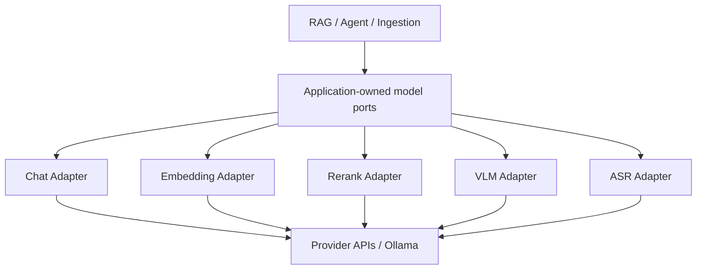

# 第 24 章　多模型适配与依赖倒置

[返回全书目录](../README.md) · [上一篇：异步任务、队列与 Worker 池](02-async-task-queue-worker-pool.md)

## 本章要解决的问题

一个 AI 应用很快会同时接入：

- Chat/Reasoning 模型；
- Embedding 模型；
- Rerank 模型；
- VLM；
- ASR；
- 本地 Ollama 与多个远程 Provider；
- OpenAI-compatible、自定义签名和完全不同的原生协议。

如果业务代码到处写：

```go
if provider == "openai" { ... }
else if provider == "aliyun" { ... }
else if provider == "anthropic" { ... }
```

那么每增加一个供应商，RAG、Agent、入库、评测和管理接口都会一起变化。更麻烦的是，“兼容 OpenAI”并不表示所有字段、鉴权、流事件和工具元数据都相同。

本章讨论怎样把模型当成可替换基础设施，同时保留每种能力真正不同的契约。

## 先按能力拆接口，而不是定义一个万能 Model

Chat、Embedding、Rerank、VLM、ASR 的输入输出完全不同：

```text
Chat       messages + options + tools → answer / stream / tool calls
Embedding text[]                    → vectors[]
Rerank    query + documents         → ranked indexes + scores
VLM       images[] + prompt         → text
ASR       audio + filename          → transcript + segments
```

若定义：

```go
type Model interface {
    Predict(input any) (any, error)
}
```

编译器无法检查能力，业务层充满类型断言，模型配置也会变成一个塞满所有供应商字段的 Map。

接口隔离原则更适合这里：调用者只依赖自己需要的能力。

```go
type Chat interface {
    Chat(ctx, messages, opts) (*ChatResponse, error)
    ChatStream(ctx, messages, opts) (<-chan StreamResponse, error)
}

type Embedder interface {
    Embed(ctx, text) ([]float32, error)
    BatchEmbed(ctx, texts) ([][]float32, error)
    GetDimensions() int
}

type Reranker interface {
    Rerank(ctx, query, documents) ([]RankResult, error)
}
```

VLM 和 ASR 再分别定义 `Predict`、`Transcribe`。这些接口是应用的 Port，OpenAI、Ollama、Jina、Anthropic 等实现是 Adapter。

## 依赖倒置究竟倒置了什么

没有依赖倒置时：

```text
RAG Service → OpenAI SDK
Agent       → Anthropic SDK
Image Job   → 某云 VLM SDK
```

业务规则依赖具体基础设施。依赖倒置后：



“倒置”不是运行时调用方向变了，仍然是业务调用 Provider；变化的是源码依赖方向：业务依赖自己定义的抽象，基础设施实现这个抽象。

## 五层模型架构

成熟适配通常至少包含五层。

### 1. Model Entity：用户配置了什么

保存：

- ID、Tenant、Name、DisplayName；
- ModelType；
- local / remote Source；
- Provider；
- BaseURL、API Key、ExtraConfig；
- Embedding Dimension；
- 是否支持 Vision；
- 后台最大并发；
- 状态与内置模型归属。

它是配置实体，不负责执行推理。

### 2. Provider Metadata：配置界面应该展示什么

Provider Registry 描述：

- 展示名称和说明；
- 支持哪些 ModelType；
- 每类模型默认 URL；
- 是否需要认证；
- 额外配置字段；
- 基础配置校验。

这一层服务 UI 和管理 API，并不等于已经实现所有执行协议。

### 3. Capability Config：从实体投影到运行时配置

`ModelParameters` 会分别转为 `ChatConfig`、`embedding.Config`、`RerankerConfig`、`vlm.Config`、`asr.Config`。集中使用 `ConfigFromModel` 可以避免生产调用和“测试连接”走两套字段映射。

### 4. Factory：选择具体协议实现

Factory 根据 Source、Provider、InterfaceType 和 ModelName 选择：

- 本地 Ollama；
- 通用 OpenAI-compatible；
- Anthropic 原生 Messages；
- 特定 Embedding/Rerank 协议；
- WeKnoraCloud 签名接口；
- VLM/ASR 特定实现。

### 5. Decorator：统一横切治理

具体 Adapter 外层再包：

- Debug 日志；
- Langfuse Trace；
- 每模型并发限制；
- 超时；
- 安全 Transport；
- Usage 归一化。

让 Factory 统一装饰，比每个业务调用点手工埋点更不容易遗漏。

## WeKnora 的能力接口

### Chat

[`chat.Chat`](../../internal/models/chat/chat.go) 提供非流式 `Chat` 与流式 `ChatStream`，统一 `Message`、`Tool`、`ToolCall` 和 `ChatOptions`。业务层不处理供应商原始 SSE。

统一 Message 还包含：

- 文本与多模态 Content Part；
- tool role 与 `tool_call_id`；
- Assistant ToolCalls；
- reasoning content；
- Provider-specific ToolCall Metadata。

最后一个字段很重要：统一协议不能通过“只保留公共最小字段”破坏供应商多轮工具调用需要的签名信息。

### Embedding

[`embedding.Embedder`](../../internal/models/embedding/embedder.go) 暴露单条、批量、模型名、模型 ID 和向量维度。`EmbedderPooler` 将批处理/并发策略与具体 Provider 分开。

Embedding 的 Dimension 是数据契约，不只是显示属性。知识库已经用 1024 维建立向量索引后，不能无迁移地换成 1536 维模型。模型可替换性受到既有数据 Schema 约束。

### Rerank

[`rerank.Reranker`](../../internal/models/rerank/reranker.go) 输入 Query 与 Document List，返回原始 Index 和统一 RelevanceScore。不同 Provider 可能返回：

- `relevance_score` 或 `score`；
- document string 或 `{text: ...}`；
- 不同 endpoint 与认证。

Adapter 负责归一化，RAG Pipeline 只消费排序结果。

### VLM

[`vlm.VLM`](../../internal/models/vlm/vlm.go) 接收多张图片字节与 Prompt，返回文字结果。本地 Source/`ollama` 走 Ollama，远程通常走统一 Remote API，WeKnoraCloud 走专用实现。

VLM 与“Chat 支持图片”可以共享底层模型，却是不同应用能力：文档 OCR/Caption 需要简单 `Predict(images,prompt)`，聊天需要角色历史、流式输出和工具协议。

### ASR

[`asr.ASR`](../../internal/models/asr/asr.go) 返回全文与带时间戳 Segment。当前 Adapter 使用 OpenAI-compatible `/audio/transcriptions` 形态。ASR 不应被塞进 Chat Message 接口，只因为最终也输出文字。

## Model、Provider 和 Adapter 不是同一个概念

假设用户配置：

```text
Model ID: summary-prod
Type: KnowledgeQA
Source: remote
Provider: aliyun
Name: qwen-plus
BaseURL: .../compatible-mode/v1
```

- Model 是租户的一条可引用配置；
- Provider 是供应商类别和默认配置知识；
- Chat Adapter 是真正构造请求、认证、读取流并归一化响应的代码；
- `qwen-plus` 是供应商端模型名称；
- `summary-prod` 是 WeKnora 中稳定绑定 ID。

一个 Provider 可以支持多种 ModelType，每种能力又可能使用不同协议。Jina 的 Embedding 与 Rerank 不是同一个接口；阿里云文本 Embedding 可以走兼容接口，多模态 Embedding 则需要专用 endpoint。

## OpenAI-compatible 到底兼容多少

OpenAI-compatible 通常能复用：

- `/chat/completions` 主体结构；
- role/content；
- 基本流式 delta；
- 常见 Tool Call；
- Bearer Auth。

但以下差异仍很常见：

- endpoint 路径；
- `Authorization`、`api-key` 或请求签名；
- thinking 参数形态；
- 是否支持非流式 thinking；
- `max_tokens` 与 `max_completion_tokens`；
- 是否支持 temperature、top_p、tool_choice；
- Tool Call 中必须跨轮回传的签名元数据；
- Usage/cache token 字段；
- `[DONE]`、reasoning delta 和 error body；
- 图片 Content Part 格式。

因此“兼容”更像共享一个基础方言，而不是行为完全相同。

## WeKnora 的 Chat Provider Adapter

[`internal/models/chat/provider.go`](../../internal/models/chat/provider.go) 在 OpenAI-compatible Chat 内部定义更细的 `providerAdapter`：

```text
Matches(model)
Thinking strategy
ShapeRequest
TransformMessages
Endpoint
Auth
ForceRawHTTP
Extract / Inject ToolCallMetadata
```

`baseProvider` 给出 Bearer Auth、标准 endpoint、不启用 thinking 等默认行为，新 Provider 只覆盖差异：

- Azure 使用 `api-key`；
- OpenAI reasoning/GPT-5 去掉不支持的采样参数，并迁移 Max Tokens 字段；
- DeepSeek 去掉 `tool_choice`，并用 Raw HTTP 保留 cache usage；
- Gemini 保存和回填工具 thought signature；
- Qwen、LKEAP、Volcengine、Generic/NVIDIA 使用不同 thinking 字段；
- Moonshot 某些模型固定 temperature；
- WeKnoraCloud 使用专用 endpoint、请求签名与消息降级。

更具体的 Adapter 必须排在同 Provider 的通用 Adapter 前面，否则 catch-all 会提前匹配。这是责任链/策略注册表常见的顺序风险。

Anthropic 因 Messages 协议差异更大，不强行塞进 OpenAI Raw Request，而由独立 `AnthropicChat` 实现同一个 `Chat` Port。

## Provider 选择：显式优先于猜测

各 Factory 通常采用：

```text
explicit Parameters.Provider
  → 若为空，根据 BaseURL DetectProvider
  → 无法识别，回退 Generic/OpenAI-compatible
```

URL 检测适合迁移旧配置和改善体验，不应成为长期唯一真相：

- 企业网关域名看不出背后 Provider；
- 同一 Provider 可能有多个区域域名；
- 代理 URL 可能同时服务多个模型；
- 错误检测会选择错误鉴权或参数策略。

保存新配置时应写入明确 Provider；Detect 作为兼容回退。

## ModelService：把配置解析与业务使用连接起来

[`model.go`](../../internal/application/service/model.go) 的 `ModelService`：

1. 按当前 Tenant 读取 Model Entity；
2. 检查模型存在和状态；
3. 解析 WeKnoraCloud 等凭证来源；
4. 调用相应 `ConfigFromModel`；
5. 通过 Factory 返回能力接口。

RAG 和 Agent 依赖 `interfaces.ModelService` 以及 `chat.Chat`、`embedding.Embedder` 等 Port，不读取 API Key，也不判断 Provider。

当前 Model Client 不做实例缓存，每次 `GetChatModel/GetEmbeddingModel` 都从最新 Parameters 重建，因此更新凭证后下一次调用自然生效，不需要显式 cache invalidation。代价是重复构建轻量 Client/Decorator；底层 HTTP Transport 则尽量共享连接池。

### 跨租户 Embedding 是显式能力

共享知识库的向量必须使用源租户绑定的 Embedding 模型，才能与已有索引兼容。WeKnora 提供 `GetEmbeddingModelForTenant(modelID, tenantID)`，而不是临时切换当前 Context 猜测租户。这说明模型身份还包含授权与数据兼容边界。

## Model Entity 的生命周期与安全

[`internal/types/model.go`](../../internal/types/model.go) 将 API Key、App Secret、BaseURL、Provider 和能力参数保存在 `ModelParameters`：

- API Key/App Secret 使用 AES-256-GCM 静态加密；
- 解密失败时清空为未配置，使列表仍可展示并允许重新录入；
- API Response 使用 DTO 排除敏感字段；
- 内置模型可由 YAML 管理，普通租户不能修改；
- 人工修改内置模型会解除 YAML 生命周期所有权，避免启动时覆盖；
- 被 Knowledge Base 或 Agent 引用的模型不能直接删除；
- local 模型先记录 downloading，再后台拉取 Ollama 模型。

最后一项当前使用进程内 goroutine，服务重启会中断下载状态推进。它与上一章的 Lite Task 类似：适合简单流程，但若模型下载成为关键生产能力，应进入可恢复任务系统。

## 横切能力为什么放在 Adapter 外层

### Trace 与 Debug

Chat、Embedding、Rerank、VLM、ASR 都有 Langfuse Wrapper；部分还有 LLM Debug Wrapper。业务代码无需知道当前供应商，也能得到统一 Trace。

管理端 [`DebugModel`](../../internal/handler/model.go) 使用与生产相同的 ModelService/Factory：

- Chat 真实消费 Stream；
- Embedding 返回实际维度；
- Rerank 展示统一结果；
- VLM/ASR 接收受限文件；
- 请求预览不包含凭证。

测试连接若另写一套 HTTP 请求，很容易出现“测试成功、生产失败”，因为两边 Provider 规则不同。

### 每模型并发治理

后台文档富化会同时使用同一个模型。WeKnora 在 Chat、Embedding、VLM Adapter 上使用按 Model ID 的并发 Gate：

- 标准模式 Redis ZSET 实现跨实例 Lease Semaphore；
- Lite 模式使用进程内 Channel Semaphore；
- 只限制标记为 Background Task 的调用，交互 Chat 不进入等待；
- Model 可覆盖全局默认 MaxConcurrency；
- Lease 用心跳续期，进程崩溃后自动过期；
- Redis/limiter 故障时 fail open，避免治理组件让全部模型调用停摆。

Rerank 与 ASR 当前不受这个 per-model Gate 保护。配置注释也明确治理范围主要是 Chat/VLM/Embedding。不要看到统一 ModelParameters 就假设所有能力的治理完全一致。

### 安全 HTTP Transport

用户可配置 BaseURL 和 CustomHeaders，模型适配层必须防止：

- SSRF 与 DNS rebinding；
- 重定向到内网；
- 自定义 Header 覆盖 `Authorization`、`api-key`、`Content-Type`；
- 无限流请求；
- 连接池泄漏；
- 日志打印凭证或完整敏感 Prompt。

WeKnora 的 Chat、Embedding、Rerank、VLM、ASR Transport 都使用 SSRF 校验/安全 Dial 或 Redirect 检查，并让 timeout 通过 Context 控制长流。

## 配置能力与运行能力可能漂移

Provider Registry 的 `ProviderInfo.ModelTypes` 决定 UI 展示哪些选项；真正的执行能力由各 Capability Factory 和 Adapter 决定。这两层分开是合理的，但也产生漂移风险：

```text
UI 显示支持 Rerank
  但 NewReranker 没有对应实现

Factory 已支持某 Provider
  但 ProviderInfo 没列该 ModelType
```

应增加契约测试：遍历 Registry 的每个 `(Provider, ModelType)`，确认对应 Factory 至少能构造或明确返回“需要凭证/连接”的预期错误，而不是 unsupported branch。

同样，`SupportsVision`、Embedding Dimension Override、Thinking 和 Tool Calling 是不同能力，不应浓缩成一个 `supports_all=true`。模型名称也不是可靠能力检测 API。

## 怎样新增一个 Provider

不要从复制整个 OpenAI Client 开始。先回答：

1. 支持哪些能力：Chat、Embedding、Rerank、VLM、ASR？
2. 是否真的 OpenAI-compatible？哪些字段不同？
3. 鉴权是 Bearer、API Key Header 还是签名？
4. Stream、Reasoning、Tool Call、Usage 有哪些差异？
5. BaseURL 和 Redirect 是否安全？
6. 错误码怎样归一化为 retryable/permanent？
7. 是否支持 Batch、Dimension Override、Vision？
8. Timeout、并发、RPM/TPM 如何治理？

然后按最小变化实现：

```text
Provider metadata + validation
  → capability factory route
  → reuse base protocol
  → override only quirks
  → contract tests
  → debug endpoint live test
  → docs and UI fields
```

只有协议主体完全不同，例如 Anthropic Messages，才建立独立实现。

## 契约测试应该验证什么

### Chat

- System/User/Assistant/Tool Message；
- 流式 delta 顺序与终止；
- Tool Call 参数累计；
- reasoning 与 final answer 分离；
- Usage、FinishReason；
- 多轮工具元数据回传；
- Context timeout/cancel。

### Embedding

- 单条与 Batch 结果数量相等；
- 每个向量维度稳定；
- 空文本与超长文本策略；
- Dimension Override；
- 批次拆分后顺序不变。

### Rerank

- Index 对应原输入；
- Score 字段归一化；
- 返回缺项/乱序/重复 Index 的处理；
- Top-N 与空文档。

### VLM / ASR

- 文件类型和大小；
- 多图片顺序；
- Segment 时间戳；
- Provider Error 脱敏；
- SSRF、Redirect 与 Timeout。

Mock 测试用于验证请求形状，少量真实 Provider 冒烟测试用于发现兼容接口的行为差异。不要把昂贵 Live Test 放进每次单元测试。

## 与 Java / Spring 的对应关系

| WeKnora 概念 | Java / 架构类比 | 说明 |
|---|---|---|
| `chat.Chat` / `Embedder` | Port / Java Interface | 由应用定义需要的能力 |
| OpenAI/Ollama 实现 | Adapter | 把外部协议转换成应用契约 |
| ModelService | Application Service + Abstract Factory | 从租户配置构造能力实例 |
| `ConfigFromModel` | Mapper / Configuration Projection | 避免管理与生产路径字段漂移 |
| Provider Registry | Metadata Registry / Strategy Catalog | 主要服务发现、UI 与校验 |
| providerAdapter | Strategy / Template Method | 覆盖兼容协议中的局部差异 |
| Debug/Langfuse/Concurrency | Decorator / AOP | 给所有实现增加横切能力 |
| `ModelParameters` | JPA Entity 中的配置 Value Object | 不是运行时 Client 本身 |
| Ollama/Remote Factory | Spring Bean Factory | 选择实现并统一装饰 |

在 Spring 中，可以让业务 Service 注入 `ChatPort`、`EmbeddingPort`，用 Factory 根据租户 Model ID 构造 Adapter。若使用 Spring AI 等统一框架，仍要保留自己的 Port：第三方框架的抽象边界不一定与产品的 Tool Metadata、Trace、租户和安全需求一致。

## 设计取舍与可演进方向

### Switch Factory 与注册式 Factory

当前每种能力用 switch/分支选择 Provider，直观且编译期可见，但新增 Provider 要修改核心 Factory。可演进为按 `(ModelType, Provider)` 注册构造器，同时用启动期校验防止重复或缺失注册。

注册式设计并不自动更好：隐式 `init()`、顺序和全局状态会降低可读性。Provider 数量有限时，显式 switch 可能更适合。

### Capability Descriptor

把 Vision、Tool Calling、Thinking、JSON Mode、Batch、Dimension Override、Max Context 等建成结构化能力，并区分：

- Provider 声明；
- Model 配置；
- 连接测试实测；
- 运行期降级。

调用前做 capability negotiation，比等 Provider 返回 400 更友好。

### Client 缓存

每次重建 Client 让配置热更新简单。若构造成本变高，可按 `(tenant, modelID, configVersion)` 缓存，并在模型更新时失效。不要只按 modelID 缓存，否则凭证轮换、BaseURL 修改或跨租户同 ID 会串用旧实例。

### 统一错误与降级

Adapter 应把 Provider Error 映射为认证失败、限流、超时、上下文超限、能力不支持、内容策略拒绝等稳定类别。业务层才能决定重试、换模型、关闭 Thinking 或提示用户，而不解析供应商字符串。

### RPM/TPM 与成本治理

并发 Semaphore 只控制同时在途数量，不控制每分钟请求、Token 或费用。生产环境还需要 Provider/Quota Group 级 RPM、TPM、预算、优先级与 interactive/background 公平性。

## 推荐的源码阅读顺序

1. [`internal/types/model.go`](../../internal/types/model.go)：先看 ModelType、Source、Parameters、凭证与生命周期。
2. [`internal/models/chat/chat.go`](../../internal/models/chat/chat.go)：掌握 Chat Port、统一消息和 Factory。
3. [`internal/models/embedding/embedder.go`](../../internal/models/embedding/embedder.go)、[`rerank/reranker.go`](../../internal/models/rerank/reranker.go)、[`vlm/vlm.go`](../../internal/models/vlm/vlm.go)：比较能力接口为何不能合并。
4. [`internal/models/provider/provider.go`](../../internal/models/provider/provider.go)：看 Provider Metadata Registry、显式配置与 URL 检测。
5. [`internal/models/chat/provider.go`](../../internal/models/chat/provider.go)：看兼容协议中的 Thinking、Auth、Request Shaping 和 Tool Metadata。
6. [`internal/application/service/model.go`](../../internal/application/service/model.go)：跟踪 Model ID 如何变成运行时能力实例。
7. [`internal/models/limiter`](../../internal/models/limiter)：理解背景模型调用的本地/分布式并发 Decorator。
8. [`internal/handler/model.go`](../../internal/handler/model.go)：最后看 DebugModel 如何复用生产构造链验证五种能力。

第一次阅读选择一个 OpenAI-compatible Chat 和一个非 Chat 能力，例如 Jina Rerank。比较它们哪些层能复用，哪些必须独立。

## 常见误区

1. **所有 AI 模型都可以抽象成 `Predict(any)`。** 这会丢失类型、流、工具和维度契约。
2. **OpenAI-compatible 就能零适配接入。** Thinking、Auth、Tool Metadata 和参数支持仍可能不同。
3. **Provider Registry 中列出来就代表执行实现完整。** Metadata 与 Capability Factory 需要契约校验。
4. **根据 BaseURL 猜 Provider 足够可靠。** 企业网关和代理会让 URL 失去供应商信息。
5. **模型可替换意味着随时换 Embedding。** 维度和已有向量索引构成数据兼容约束。
6. **VLM 就是支持图片的 Chat。** 文档加工与多轮聊天需要不同 Port。
7. **统一接口应该丢掉所有供应商字段。** 某些 Tool Metadata 必须跨轮保留，否则协议会失败。
8. **测试连接单独发一次 HTTP 就够了。** 它必须复用生产 Factory、Adapter 和 Decorator。
9. **一个全局并发数能治理所有模型。** 模型、Provider、能力、前后台流量需要分层配额。
10. **并发限制等于 RPM/TPM/成本限制。** Semaphore 只约束同时在途请求。
11. **自定义 BaseURL 只是灵活配置。** 它同时扩大 SSRF、重定向和 Header 注入攻击面。
12. **依赖倒置就是多写几个 interface。** 业务若仍读取 Provider 和 API Key，依赖并没有真正倒置。

## 本章小结

- 多模型架构应先按 Chat、Embedding、Rerank、VLM、ASR 能力拆 Port，而不是定义万能 Model。
- 依赖倒置让业务依赖应用拥有的能力契约，具体 Provider 作为 Adapter 实现。
- Model Entity、Provider Metadata、Capability Config、Factory 和 Decorator 是不同层。
- OpenAI-compatible 复用主体协议，但鉴权、Thinking、采样参数、流和 Tool Metadata 仍需适配。
- WeKnora 的 Provider Adapter 通过局部策略覆盖差异，Anthropic 等大差异协议则独立实现 Chat Port。
- `ConfigFromModel` 让生产与 Debug 路径使用同一配置投影，ModelService 负责租户与凭证解析。
- Embedding Dimension、跨租户源模型和既有索引限制了“随意换模型”。
- Trace、Debug、Concurrency 和安全 Transport 应由 Factory/Decorator 统一施加。
- Provider Metadata 与真实 Factory 可能漂移，需要按 `(Provider, ModelType)` 建立契约测试。
- 当前后台并发 Gate 主要覆盖 Chat、Embedding、VLM；它不等于 RPM、TPM 和成本治理。
- 新 Provider 应优先复用基础协议、只覆盖差异，并测试流式、工具、错误和安全边界。

### 可选实践

选择一个你熟悉的模型供应商，为它填写五列能力矩阵：Chat、Embedding、Rerank、VLM、ASR。对每个支持项写出 endpoint、鉴权、输入、输出、流式、特殊参数和错误格式。然后以 WeKnora 的 Port 为目标，判断哪些能复用 OpenAI-compatible Adapter、哪些只需 Provider Strategy、哪些必须新建独立实现。最后设计三组契约测试：正常调用、能力不支持、限流/超时。

下一篇：[可观测性：Trace、Token、延迟与成本](04-observability-trace-token-latency-cost.md)
